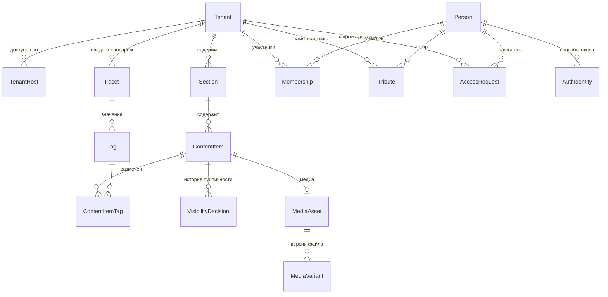

# Доменная модель: платформа «Очаг»

**Версия:** 0.1 (черновик)
**Дата:** 2026-07-30
**Основано на:** scope v0.4, ADR-0001 (мультитенантность), ADR-0002 (резолвинг по хосту), ADR-0003 (фасетная разметка)

Модель концептуальная: сущности, атрибуты и связи предметной области. Типы полей, индексы и внешние ключи определяются позже, при проектировании схемы БД.

---

## 1. Обзор

---

## 2. Тенант и адресация

### Tenant

Один мемориал. Корневая сущность изоляции: почти всё остальное принадлежит тенанту.

| Атрибут | Описание |
|---|---|
| `id` | Идентификатор |
| `slug` | Короткое имя, используется в поддомене (`vostok` → `vostok.ochag.family`) |
| `title` | Отображаемое название мемориала |
| `subjectName` | Имя человека, которому посвящён мемориал |
| `subjectBornOn`, `subjectDiedOn` | Даты жизни (могут быть неполными) |
| `status` | Активен / приостановлен |
| `createdAt` | |

### TenantHost

Хост, по которому мемориал доступен. Один тенант — несколько хостов (поддомен платформы плюс кастомные домены). Основа резолвинга из ADR-0002.

| Атрибут | Описание |
|---|---|
| `host` | Нормализованное имя хоста, уникально по всей платформе |
| `tenantId` | |
| `isPrimary` | Используется для генерации абсолютных ссылок |
| `verifiedAt` | Момент подтверждения владения доменом |

---

## 3. Люди и доступ

### Person

Человек, авторизовавшийся на платформе. **Единственная сущность вне тенанта.**

Обоснование исключения из ADR-0001: один и тот же человек может быть родственником в нескольких мемориалах, и заводить ему отдельную учётную запись под каждый — значит требовать повторной авторизации на каждом мемориале. Изоляция при этом не страдает, поскольку любой доступ к данным тенанта идёт через `Membership`, который тенант-скоупный: сама по себе `Person` не даёт прав нигде.

| Атрибут | Описание |
|---|---|
| `id` | |
| `displayName` | Имя из профиля провайдера |
| `avatarUrl` | |
| `createdAt` | |

### AuthIdentity

Способ входа. Реализует абстракцию `AuthProvider` из scope: VK и Telegram — две записи одного вида.

| Атрибут | Описание |
|---|---|
| `personId` | |
| `provider` | `VK` / `TELEGRAM` |
| `externalId` | Идентификатор в системе провайдера |
| `linkedAt` | |

Уникальность по паре (`provider`, `externalId`). Один человек может привязать несколько способов входа к одной учётной записи.

### Membership

Роль человека в конкретном мемориале. Тенант-скоупная сущность.

| Атрибут | Описание |
|---|---|
| `tenantId` | |
| `personId` | |
| `role` | `OWNER` / `RELATIVE` |
| `grantedByPersonId` | Кто выдал |
| `grantedAt` | |

Роль `GUEST` в модели отсутствует: гость — это отсутствие членства, а не запись о нём.

### AccessRequest

Запрос на получение роли родственника.

| Атрибут | Описание |
|---|---|
| `tenantId`, `personId` | |
| `message` | Кем приходится, от заявителя |
| `status` | `PENDING` / `APPROVED` / `REJECTED` |
| `decidedByPersonId`, `decidedAt` | |

---

## 4. Контент

### Section

Раздел мемориала. Сущность, а не константа в коде — у разных мемориалов разный состав разделов, и добавление нового типа контента не должно требовать миграции.

| Атрибут | Описание |
|---|---|
| `tenantId` | |
| `slug` | Часть URL раздела |
| `title` | «Стихи», «Фотографии», «О нём» |
| `contentType` | `POEM` / `PHOTO` / `BLOG_ENTRY` / `AUDIO` / `VIDEO` |
| `visibility` | Видимость раздела целиком |
| `position` | Порядок отображения |

Четыре раздела первого мемориала — четыре записи, две из которых имеют `contentType = PHOTO` (снимки автора и снимки с ним). Различие между ними — принадлежность к разным разделам, а не отдельный тип сущности.

### ContentItem

Единица контента. Общий тип для всех разделов — обеспечивает требование расширяемости из scope: разметка, видимость, история решений и API работают с `ContentItem`, а не с четырьмя параллельными сущностями.

**Общие атрибуты:**

| Атрибут | Описание |
|---|---|
| `tenantId`, `sectionId` | |
| `type` | Дискриминатор: `POEM` / `PHOTO` / `BLOG_ENTRY` / `AUDIO` / `VIDEO` |
| `title` | Может отсутствовать (безымянное стихотворение, фото) |
| `description` | Комментарий владельца |
| `visibility` | `PUBLIC` / `FAMILY` / `DRAFT`, по умолчанию `DRAFT` |
| `occurredOn` | Датировка (см. раздел 5) |
| `position` | Ручная сортировка внутри раздела |
| `createdAt`, `updatedAt` | |

**Специфичные атрибуты по типам:**

| Тип | Атрибуты |
|---|---|
| `POEM` | `body` (текст), `firstLine` (для списков, если нет названия) |
| `BLOG_ENTRY` | `body`, `sourceUrl` (откуда перенесено), `publishedAt` (исходная дата публикации) |
| `PHOTO` | `mediaAssetId`, `capturedAt`, `place` |
| `AUDIO` | `mediaAssetId`, `recordedAt`, `place`, `transcript` |
| `VIDEO` | `mediaAssetId`, `recordedAt`, `place`, `transcript` |

### MediaAsset и MediaVariant

Файл и его версии. Разделены, поскольку у одного оригинала несколько производных.

**MediaAsset:**

| Атрибут | Описание |
|---|---|
| `tenantId` | |
| `mediaType` | `IMAGE` / `AUDIO` / `VIDEO` |
| `originalFilename` | |
| `contentHash` | Хеш содержимого — основа идемпотентности при повторном добавлении |
| `recordedAt` | Дата из технических метаданных, если есть |
| `durationSeconds` | Только для аудио и видео |
| `technicalMetadataJson` | Исходные метаданные целиком, как есть: EXIF для изображений, контейнер и кодеки для аудио и видео |

**MediaVariant:**

| Атрибут | Описание |
|---|---|
| `mediaAssetId` | |
| `kind` | `ORIGINAL` / `WEB` / `THUMBNAIL` / `POSTER` |
| `storageKey` | Ключ объекта в хранилище |
| `width`, `height`, `sizeBytes`, `mimeType` | Размеры — только для визуальных вариантов |
| `bitrate`, `codec` | Только для аудио и видео |

Назначение вариантов по типам:

| Тип | `ORIGINAL` | `WEB` | `THUMBNAIL` | `POSTER` |
|---|---|---|---|---|
| `IMAGE` | исходный файл | версия для страницы | миниатюра для списка | — |
| `AUDIO` | исходная запись | воспроизводимая версия | — | обложка, если есть |
| `VIDEO` | исходная запись | воспроизводимая версия | миниатюра для списка | кадр-заставка |

Оригинал никогда не удаляется (NFR по сохранности). Производные версии могут быть пересозданы.

---

### 4.1 Особенности аудио и видео

Аудио и видео вписываются в модель без структурных изменений — `Section`, `ContentItem`, разметка и видимость работают с ними так же, как с фотографиями. Но за пределами модели данных они тянут за собой следствия, которых нет у изображений:

**Конвертация обязательна, в отличие от фотографий.** Записи с камер и диктофонов приходят в контейнерах и кодеках, которые браузеры воспроизводят выборочно или не воспроизводят вовсе. Изображение без обработки хотя бы откроется; видео — нет. Это возвращает в проект задачу подготовки производных версий, которую для фотографий удалось вынести из приложения из-за малого объёма.

**Объём на порядки больше.** Тысяча фотографий — единицы или десятки гигабайт. Несколько десятков видеозаписей по десять минут — сопоставимо или больше. Требование NFR о стоимости простаивающего мемориала остаётся выполнимым, но расчёт объёма меняется качественно.

**Срок жизни временных ссылок.** Непубличные медиа отдаются по временным ссылкам после проверки роли. Для изображения это безразлично: файл загружается за секунды. Часовая запись, которую смотрят дольше срока действия ссылки, прервётся на середине. Требуется либо срок с запасом, либо обновление ссылки в процессе воспроизведения.

**Расшифровка речи.** Для записей, где звучит голос человека, текстовая расшифровка — это и содержание само по себе, и единственный способ сделать запись находимой поиском в v1.1: без неё аудио и видео остаются для поиска непрозрачными. Поле `transcript` предусмотрено в модели; способ его получения — отдельный вопрос.

---

## 5. Датировка

Отдельный вопрос модели: даты в архиве часто неточны. «Около 1975», «конец 70-х», «лето, год неизвестен» — обычное состояние семейного архива.

Хранение единственного поля `date` вынуждает либо выдумывать точность, которой нет, либо оставлять поле пустым, теряя известное приближение. Оба варианта необратимо портят архив.

Предлагаемая структура датировки (составное значение при `occurredOn`):

| Атрибут | Описание |
|---|---|
| `dateFrom`, `dateTo` | Границы интервала. Для точной даты совпадают |
| `precision` | `DAY` / `MONTH` / `YEAR` / `DECADE` / `UNKNOWN` |
| `displayText` | Как показывать: «1975», «конец 1970-х», «около 1980» |

Фильтрация по фасету «период» работает по пересечению интервала с границами периода, что корректно обрабатывает неточные датировки.

---

## 6. Разметка

Реализует ADR-0003.

### Facet

Измерение разметки. Словарь принадлежит тенанту.

| Атрибут | Описание |
|---|---|
| `tenantId` | |
| `code`, `title` | |
| `isSingleValue` | Допустимо ли одно значение на единицу контента |
| `applicableTypes` | Типы контента, к которым применим |
| `position` | Порядок в интерфейсе фильтров |

### Tag

Значение внутри фасета.

| Атрибут | Описание |
|---|---|
| `tenantId`, `facetId` | |
| `title` | Отображаемое имя |
| `normalizedTitle` | Для контроля дубликатов, уникально в пределах фасета |
| `position` | |

### ContentItemTag

Связь контента с тегом. Ограничение единственности из `Facet.isSingleValue` проверяется на этом уровне.

---

## 7. Видимость и её история

### VisibilityDecision

Реализует требование из scope 6.3: решение о публичности фиксируется как событие, а не как перезапись поля.

| Атрибут | Описание |
|---|---|
| `tenantId`, `contentItemId` | |
| `fromVisibility`, `toVisibility` | |
| `decidedByPersonId`, `decidedAt` | |
| `note` | Пояснение, если нужно |

Текущее значение `ContentItem.visibility` остаётся денормализованным для скорости выборок; `VisibilityDecision` даёт историю. Механизм согласования между родственниками надстраивается поверх этой истории без изменения структуры.

---

## 8. Памятная книга

### Tribute

Воспоминание, оставленное родственником. Не является `ContentItem`: автор — не владелец мемориала, набор атрибутов и правила публикации другие.

| Атрибут | Описание |
|---|---|
| `tenantId` | |
| `authorPersonId` | |
| `body` | Текст воспоминания |
| `status` | `PUBLISHED` / `HIDDEN` |
| `createdAt`, `updatedAt` | |

Скрытие выполняет владелец. Удаление не предусмотрено: `HIDDEN` сохраняет запись.

---

## 9. Открытые вопросы модели

| # | Вопрос | Почему важно решить до реализации |
|---|---|---|
| 1 | **Происхождение метаданных** (открытый вопрос 3 в scope). Если добавлять — это поле у датировки, места и разметки: откуда взято значение и подтверждено ли человеком | Задним числом неотличимо, что подтверждено, а что проставлено автоматически |
| 2 | Стратегия наследования `ContentItem` в БД: одна таблица с дискриминатором либо таблица общих полей плюс таблицы специфичных. Первое проще, второе чище при росте числа типов | Влияет на первую миграцию |
| 3 | Может ли `Tribute` относиться к конкретной единице контента, а не только к мемориалу в целом | В scope комментарии к записям вынесены за границы v1; если это когда-то понадобится, ссылка добавляется без переработки |
| 4 | Нужна ли связь между единицами контента (стихотворение и фотография одного события) | «Переходы между связанным контентом» отнесены к Could have; отдельная сущность связи добавляется позже без ломки модели |
| 5 | Хранение `subjectBornOn` / `subjectDiedOn` в `Tenant` или в отдельной сущности «человек, которому посвящён мемориал» | Второе понадобится, если мемориал будет посвящён нескольким людям (семейный архив) |
| 6 | **Входят ли аудио и видео в первый релиз.** В scope v0.4 они значатся вне границ v1; модель их поддерживает, но подготовка воспроизводимых версий — работа, которой в плане на сентябрь нет | Влияет на дату релиза, не на модель |
| 7 | Где готовятся воспроизводимые версии аудио и видео: вне приложения при наполнении либо фоновой обработкой на сервере | Второе возвращает в архитектуру очередь и воркеры, исключённые из v1 |
| 8 | Источник расшифровок: вручную, автоматически, не делать | Определяет, находимы ли записи поиском в v1.1 |

---

## 10. Соответствие принятым решениям

| Решение | Как отражено |
|---|---|
| ADR-0001: `tenant_id` везде | Все сущности тенант-скоупные, кроме `Person` и `AuthIdentity` — исключение обосновано в разделе 3 |
| ADR-0002: резолвинг по хосту | `TenantHost` с уникальным `host` по всей платформе |
| ADR-0003: фасетный словарь | `Facet` / `Tag` / `ContentItemTag`, словарь принадлежит тенанту |
| Scope 6.2: дефолт `DRAFT` | Значение по умолчанию у `ContentItem.visibility` |
| Scope 6.3: история решений | `VisibilityDecision` как отдельная сущность |
| NFR: оригиналы не удаляются | `MediaVariant.kind = ORIGINAL` не подлежит удалению; производные пересоздаваемы |
| Расширяемость типов контента | `Section.contentType` + дискриминатор в `ContentItem`; новый тип не требует новых связей для разметки и видимости |