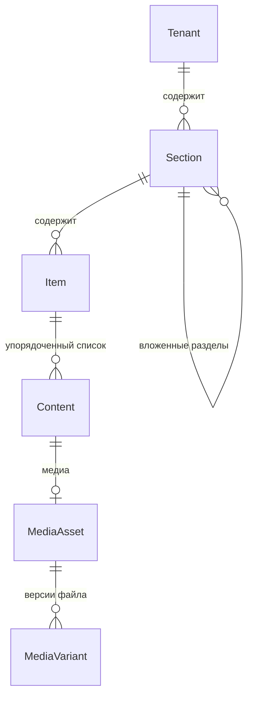

# Доменная модель: контент платформы «Очаг»

**Версия:** 0.1 (черновик)
**Дата:** 2026-10-17
**Выделено из:** доменная модель v0.1
**Основано на:** scope v0.4, ADR-0001 (мультитенантность)

Здесь описана часть модели, связанная с контентом: тенант, разделы, единицы контента, медиа и датировка. Хосты, `Subject`, люди и доступ (`Person`, `Membership`, `AccessRequest`) и памятная книга остаются в основном документе.

Модель концептуальная: сущности, атрибуты и связи предметной области. Типы полей, индексы и внешние ключи определяются позже, при проектировании схемы БД.

---

## 1. Обзор

### Служебные поля

Есть у каждой сущности этого документа. В таблицах ниже они сведены в одну строку.

| Атрибут | Описание |
|---|---|
| `version` | Номер версии записи, растёт при каждом изменении. Историю прежних значений не хранит |
| `createdAt`, `updatedAt` | Когда запись создана и когда изменена в последний раз |
| `createdByPersonId`, `updatedByPersonId` | Кто создал и кто изменил в последний раз. Ссылаются на `Person` из основного документа; пусто, если действие выполнила система |
| `deletedAt` | Момент мягкого удаления, пусто, пока запись не удалена. Запись скрывается, но физически не стирается; оригиналы медиа не удаляются в любом случае (NFR по сохранности) |

---

## 2. Тенант

### Tenant

Один мемориал. Корневая сущность изоляции: почти всё остальное принадлежит тенанту.

| Атрибут | Описание |
|---|---|
| `id` | Идентификатор |
| `slug` | Короткое имя, используется в поддомене (`vostok` → `vostok.ochag.family`) |
| `title` | Отображаемое название мемориала |
| `status` | Активен / приостановлен |
| `version`, `createdAt`, `updatedAt`, `createdByPersonId`, `updatedByPersonId`, `deletedAt` | Служебные поля, см. раздел 1 |

---

## 3. Контент

### Section

Раздел мемориала. Сущность, а не константа в коде — у разных мемориалов разный состав разделов, и добавление нового типа контента не должно требовать миграции.

| Атрибут | Описание |
|---|---|
| `tenantId` | |
| `parentSectionId` | Родительский раздел. Пусто у раздела верхнего уровня |
| `slug` | Часть URL раздела, уникален в пределах родителя |
| `title` | «Стихи», «Фотографии», «О нём» |
| `visibility` | Видимость раздела целиком |
| `position` | Порядок отображения среди разделов одного родителя |
| `version`, `createdAt`, `updatedAt`, `createdByPersonId`, `updatedByPersonId`, `deletedAt` | Служебные поля, см. раздел 1 |

Раздел не ограничивает тип контента: в одном разделе могут лежать элементы разных типов (фото, стихи, аудио). Четыре раздела первого мемориала — четыре записи; два раздела с фотографиями (снимки автора и снимки с ним) различаются принадлежностью к разным разделам, а не отдельным типом сущности.

Разделы образуют дерево: раздел с `parentSectionId` — вложенная страница со своим адресом (например, «О путешествиях» внутри «О нём»).

### Item

Контейнер для списка единиц контента разных видов: запись, аудио, видео, фото, текст идут подряд, порядок задаёт `Content.position`. Лежит в разделе.

| Атрибут | Описание |
|---|---|
| `tenantId`, `sectionId` | |
| `slug` | Часть URL, уникален в пределах раздела |
| `title` | Заголовок |
| `position` | Порядок отображения среди элементов одного раздела |
| `version`, `createdAt`, `updatedAt`, `createdByPersonId`, `updatedByPersonId`, `deletedAt` | Служебные поля, см. раздел 1 |

### Content

Единица контента внутри `Item`. Общий тип для всех видов контента — обеспечивает требование расширяемости из scope: видимость и API работают с `Content`, а не с четырьмя параллельными сущностями.

**Общие атрибуты:**

| Атрибут | Описание |
|---|---|
| `itemId` | `Item`, в список которого входит единица контента |
| `type` | Дискриминатор: `POEM` / `PHOTO` / `BLOG_ENTRY` / `AUDIO` / `VIDEO` |
| `title` | Может отсутствовать (безымянное стихотворение, фото) |
| `description` | Комментарий владельца |
| `visibility` | `PUBLIC` / `FAMILY` / `DRAFT`, по умолчанию `DRAFT` |
| `occurredOn` | Датировка (см. раздел 4) |
| `position` | Порядковый номер внутри `Item` |
| `version`, `createdAt`, `updatedAt`, `createdByPersonId`, `updatedByPersonId`, `deletedAt` | Служебные поля, см. раздел 1 |

**Специфичные атрибуты по типам** (в БД — отдельные таблицы, связанные с таблицей общих полей: наследование joined):

| Тип | Атрибуты |
|---|---|
| `POEM` | `body` (текст), `firstLine` (для списков, если нет названия) |
| `BLOG_ENTRY` | `body`, `sourceUrl` (откуда перенесено), `publishedAt` (исходная дата публикации) |
| `PHOTO` | `mediaAssetId`, `capturedAt`, `place` |
| `AUDIO` | `mediaAssetId`, `recordedAt`, `place` |
| `VIDEO` | `mediaAssetId`, `recordedAt`, `place` |

### MediaAsset и MediaVariant

Файл и его версии. Разделены, поскольку у одного оригинала несколько производных.

**MediaAsset:**

| Атрибут | Описание |
|---|---|
| `tenantId` | |
| `mediaType` | `IMAGE` / `AUDIO` / `VIDEO` |
| `originalFilename` | |
| `contentHash` | Хеш содержимого — основа идемпотентности при повторном добавлении |
| `recordedAt` | Дата из технических метаданных, если есть |
| `durationSeconds` | Только для аудио и видео |
| `technicalMetadataJson` | Исходные метаданные целиком, как есть: EXIF для изображений, контейнер и кодеки для аудио и видео |
| `version`, `createdAt`, `updatedAt`, `createdByPersonId`, `updatedByPersonId`, `deletedAt` | Служебные поля, см. раздел 1 |

**MediaVariant:**

| Атрибут | Описание |
|---|---|
| `mediaAssetId` | |
| `kind` | `ORIGINAL` / `WEB` / `THUMBNAIL` / `POSTER` |
| `storageKey` | Ключ объекта в хранилище |
| `width`, `height`, `sizeBytes`, `mimeType` | Размеры — только для визуальных вариантов |
| `bitrate`, `codec` | Только для аудио и видео |
| `version`, `createdAt`, `updatedAt`, `createdByPersonId`, `updatedByPersonId`, `deletedAt` | Служебные поля, см. раздел 1 |

Назначение вариантов по типам:

| Тип | `ORIGINAL` | `WEB` | `THUMBNAIL` | `POSTER` |
|---|---|---|---|---|
| `IMAGE` | исходный файл | версия для страницы | миниатюра для списка | — |
| `AUDIO` | исходная запись | воспроизводимая версия | — | обложка, если есть |
| `VIDEO` | исходная запись | воспроизводимая версия | миниатюра для списка | кадр-заставка |

Оригинал никогда не удаляется (NFR по сохранности). Производные версии могут быть пересозданы.

---

### 3.1 Особенности аудио и видео

**Аудио входит в первый релиз, видео — нет.** Модель поддерживает оба типа; различие в сроках, не в структуре. Оба вписываются без структурных изменений — `Section`, `Content` и видимость работают с ними так же, как с фотографиями.

**Подготовка воспроизводимых версий — вне системы.** Приложение принимает файлы, готовые к воспроизведению, и не обрабатывает медиа. Фоновая обработка, очереди и воркеры в архитектуре не появляются.

**Поиск по записям — по названию и описанию.** Расшифровка звучащего в записи не ведётся. Поля `title` и `description` в общих атрибутах `Content` уже покрывают эту потребность, отдельных полей не требуется. Следствие: качество описания напрямую определяет находимость записи, поскольку иного текста у неё нет.

**Срок жизни временных ссылок.** Непубличные медиа отдаются по временным ссылкам после проверки роли. Для изображения это безразлично: файл загружается за секунды. Длинная запись, воспроизводимая дольше срока действия ссылки, прервётся на середине. Требуется срок с запасом либо обновление ссылки в процессе воспроизведения.

---

## 4. Датировка

Отдельный вопрос модели: даты в архиве часто неточны. «Около 1975», «конец 70-х», «лето, год неизвестен» — обычное состояние семейного архива.

Хранение единственного поля `date` вынуждает либо выдумывать точность, которой нет, либо оставлять поле пустым, теряя известное приближение. Оба варианта необратимо портят архив.

Предлагаемая структура датировки (составное значение при `occurredOn`):

| Атрибут | Описание |
|---|---|
| `dateFrom`, `dateTo` | Границы интервала. Для точной даты совпадают |
| `precision` | `DAY` / `MONTH` / `YEAR` / `DECADE` / `UNKNOWN` |
| `displayText` | Как показывать: «1975», «конец 1970-х», «около 1980» |

---

## 5. Принятые решения по модели

| Вопрос | Решение |
|---|---|
| Наследование `Content` в БД | Joined: таблица общих полей плюс таблицы специфичных |
| Вложенность разделов | Разделы образуют дерево: `Section.parentSectionId` |
| Тип контента в разделе | Раздел не ограничивает типы: в одном разделе допустимы элементы разных типов |
| Контейнер контента | `Item` — упорядоченный список единиц `Content` разных видов; порядок задаёт `Content.position` |
| Аудио и видео в v1 | Аудио входит, видео — нет |
| Подготовка воспроизводимых версий | Вне системы, приложение медиа не обрабатывает |
| Связь между единицами контента | Не нужна |
| Расшифровка аудиозаписей | Не ведётся. Поиск по `title` и `description` |
| Служебные поля | У всех сущностей: версия, создание, изменение, мягкое удаление (раздел 1) |

---

## 6. Соответствие принятым решениям

| Решение | Как отражено |
|---|---|
| ADR-0001: `tenant_id` везде | Все сущности этого документа тенант-скоупные; `Content` принадлежит тенанту через `Item` и собственного `tenantId` не хранит |
| Scope 6.2: дефолт `DRAFT` | Значение по умолчанию у `Content.visibility` |
| NFR: оригиналы не удаляются | `MediaVariant.kind = ORIGINAL` не подлежит удалению; производные пересоздаваемы |
| Расширяемость типов контента | Дискриминатор `Content.type`; новый тип не требует новых связей для видимости |
| Вложенные разделы | `Section.parentSectionId` |

---

## 7. Открытые вопросы

| # | Вопрос | Блокирует |
|---|---|---|
| 1 | Настройки представления раздела: `layout` (`LIST` / `GRID` / `CONTINUOUS`), `defaultOrdering` (`MANUAL` / `DATE_ASC` / `DATE_DESC` / `TITLE`). Предложены, не утверждены | Модель `Section` |