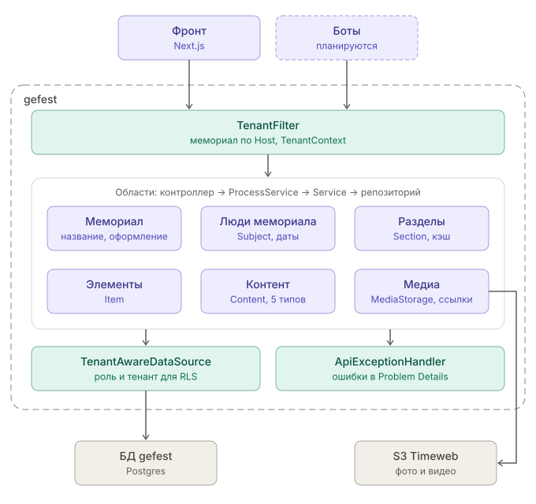

# Компоненты gefest (C4, уровень 3)

Что внутри одного контейнера — gefest. Компоненты сервиса авторизации и ботов появятся, когда их спроектируем. Правила кода — `memory/CLAUDE.md`.

## Путь запроса

1. **`TenantFilter`** определяет мемориал по `Host` (за прокси — по `X-Forwarded-Host`) и кладёт его в `TenantContext`.
2. **Область** обрабатывает запрос по слоям: контроллер (реализует интерфейс из контракта API, только делегирует) → `XxxProcessService` (DTO, маппинг, транзакции) → `XxxService` (сущности, блокировки, кэш) → репозиторий (Spring Data JDBC).
3. **`TenantAwareDataSource`** на каждом соединении выставляет роль с ограничениями RLS и `app.tenant_id` — Postgres сам отдаёт только строки текущего мемориала.
4. **`ApiExceptionHandler`** превращает исключения (`NotFoundException`, `ValidationException`, `ConflictException`, `StaleVersionException`) в ответы Problem Details.

## Области

| Область | Сущности | Заметки |
|---|---|---|
| Мемориал | `Tenant`, `TenantAppearance` | Блокировка мемориала — для корневых разделов и людей |
| Люди мемориала | `Subject`, `DateStatement` | Даты (`DateStatement`) общие: ими пользуются люди, элементы и контент |
| Разделы | `Section` | Кэш активных разделов мемориала (Caffeine) |
| Элементы | `Item` | |
| Контент | `Content` и пять типов: блог, стихи, фото, аудио, видео | `ContentProcessService` выбирает сервис типа |
| Медиа | `MediaAsset`, `MediaVariant` | `MediaStorage` — файлы в S3 и временные ссылки (кэш на половину срока) |

Очистка HTML (`SafeHtmlComponent`, jsoup) — общий компонент, ею пользуются разделы, люди, записи блога и стихи.
