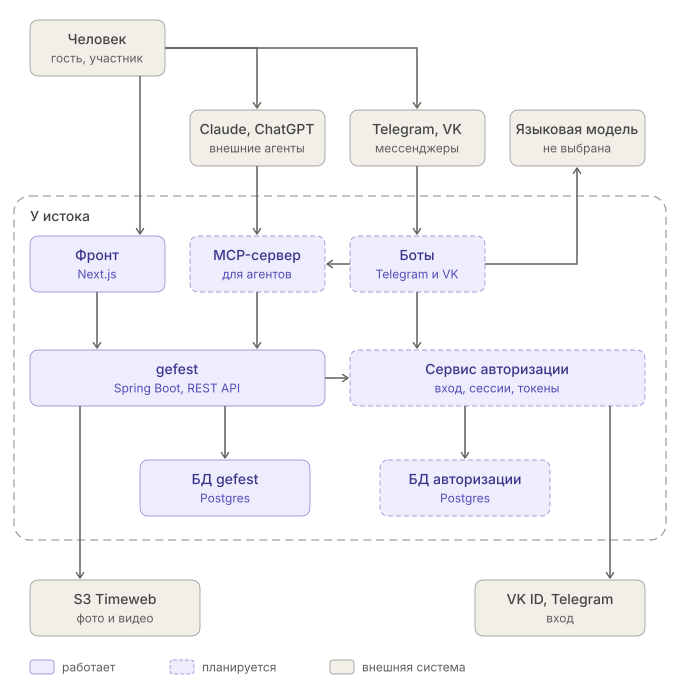

# Контейнеры платформы (C4, уровень 2)

Схема C4 уровня контейнеров: из каких отдельно запускаемых программ и хранилищ состоит платформа и кто к кому обращается. «Контейнер» здесь — программа или хранилище, не Docker. Пунктир — запланировано.

## Наши контейнеры

| Контейнер | Что делает | Состояние |
|---|---|---|
| Фронт (Next.js) | Сайты мемориалов | работает |
| gefest (Spring Boot, REST API) | Мемориалы, разделы, контент, медиа; дальше — участие и права: `Membership`, `Audience`, `AccessGrant`, `Invitation`, `AccessRequest` | работает |
| БД gefest (Postgres) | Данные gefest, изоляция мемориалов через RLS | работает |
| Сервис аутентификации (`auth.у-истока.рф`) | «Кто ты»: `Person`, `AuthIdentity`, сессии, `ApiToken`; вход через VK ID и Telegram, выдаёт токены | планируется |
| БД авторизации (Postgres) | Данные сервиса аутентификации | планируется |
| Боты Telegram и VK | Приём сообщений + языковая модель + свой список действий модели; действия выполняют запросами к REST API gefest с токеном человека, как фронт | планируется |

## Внешние системы

| Система | Зачем |
|---|---|
| Telegram, VK | Мессенджеры: передают сообщения ботам и принимают ответы |
| Языковая модель | Для ботов, не выбрана: Claude и ChatGPT по API из России недоступны |
| S3 Timeweb | Фото и видео |
| VK ID, Telegram | Вход |

Claude, ChatGPT и другие внешние агенты к платформе не подключаются: чат с платформой — только через наших ботов. Поэтому нет и MCP-сервера; если внешние агенты понадобятся, список действий бота можно выделить в MCP-сервер.

## Связи, не нарисованные на схеме

- **Вход на сайт.** Фронт отправляет браузер в сервис аутентификации, тот возвращает его на мемориал с одноразовым кодом (`../domain_model/vk-login-pkce.md`).
- **Файлы.** Фото и видео браузер берёт прямо из S3 по временным ссылкам, которые выдаёт gefest.
- **Проверка токенов.** gefest проверяет токены ключами сервиса аутентификации. Стрелка gefest → сервис аутентификации — получение этих ключей.

## Не решено

- База сервиса аутентификации: отдельный Postgres или отдельная схема в том же.

Решения по авторизации и ботам — `../domain_model/Access-questions.md` и `../domain_model/Access-decisions.md`.
