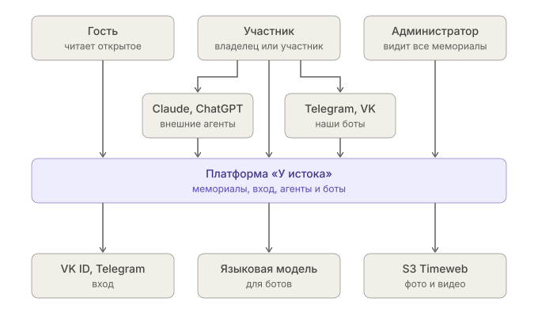

# Контекст платформы (C4, уровень 1)

Платформа целиком — один блок: кто ею пользуется и какими внешними системами она пользуется сама. Из чего она состоит — `containers.md`.

## Люди

| Кто | Что делает |
|---|---|
| Гость | Читает то, что открыто всем; входить не нужно |
| Участник | Владелец (`OWNER`) или участник (`MEMBER`) мемориала: смотрит, добавляет, ведёт мемориал — по роли и аудиториям. Работает на сайте, через внешних агентов и через наших ботов |
| Администратор | Администратор платформы: видит все мемориалы. Права пересмотрим позже |

## Внешние системы

| Система | Зачем |
|---|---|
| Claude, ChatGPT | Внешние агенты: участник подключает их к платформе сам |
| Telegram, VK | Мессенджеры, в которых работают наши боты |
| VK ID, Telegram | Вход |
| Языковая модель | Для наших ботов, не выбрана |
| S3 Timeweb | Фото и видео |
