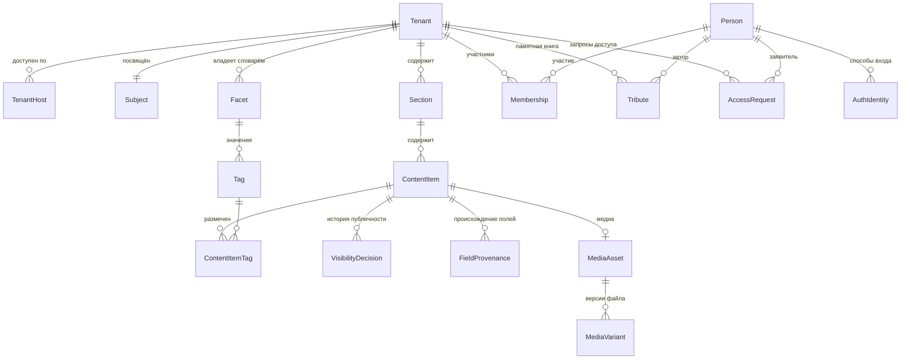

# Доменная модель: платформа «Очаг»

**Версия:** 0.1 (черновик)
**Дата:** 2026-07-30
**Основано на:** scope v0.4, ADR-0001 (мультитенантность), ADR-0002 (резолвинг по хосту), ADR-0003 (фасетная разметка)

Модель концептуальная: сущности, атрибуты и связи предметной области. Типы полей, индексы и внешние ключи определяются позже, при проектировании схемы БД.

---

## 1. Обзор

---

## 2. Тенант и адресация

### Tenant

Один мемориал. Корневая сущность изоляции: почти всё остальное принадлежит тенанту.

| Атрибут | Описание |
|---|---|
| `id` | Идентификатор |
| `slug` | Короткое имя, используется в поддомене (`vostok` → `vostok.ochag.family`) |
| `title` | Отображаемое название мемориала |
| `status` | Активен / приостановлен |
| `createdAt` | |

### Subject

Человек, которому посвящён мемориал. **Один мемориал — один человек**, связь один к одному (уникальность `tenantId`).

Вынесен из `Tenant` отдельной сущностью, хотя связь и однозначная: сведения о человеке — данные предметной области, а не настройки тенанта, и смешивать их в одной таблице значило бы складывать вместе две разные ответственности. Побочная выгода: если однажды понадобится мемориал на несколько человек, это снятие ограничения уникальности, а не перенос полей между таблицами.

| Атрибут | Описание |
|---|---|
| `tenantId` | Уникален |
| `fullName` | |
| `bornOn`, `diedOn` | Даты жизни. Могут быть неполными — используется структура датировки из раздела 5 |
| `shortBio` | Краткая справка |
| `portraitMediaAssetId` | Портрет для шапки мемориала |

### TenantHost

Хост, по которому мемориал доступен. Один тенант — несколько хостов (поддомен платформы плюс кастомные домены). Основа резолвинга из ADR-0002.

| Атрибут | Описание |
|---|---|
| `host` | Нормализованное имя хоста, уникально по всей платформе |
| `tenantId` | |
| `isPrimary` | Используется для генерации абсолютных ссылок |
| `verifiedAt` | Момент подтверждения владения доменом |

---

## 3. Люди и доступ

### Person

Человек, авторизовавшийся на платформе. **Единственная сущность вне тенанта.**

Обоснование исключения из ADR-0001: один и тот же человек может быть родственником в нескольких мемориалах, и заводить ему отдельную учётную запись под каждый — значит требовать повторной авторизации на каждом мемориале. Изоляция при этом не страдает, поскольку любой доступ к данным тенанта идёт через `Membership`, который тенант-скоупный: сама по себе `Person` не даёт прав нигде.

| Атрибут | Описание |
|---|---|
| `id` | |
| `displayName` | Имя из профиля провайдера |
| `avatarUrl` | |
| `createdAt` | |

### AuthIdentity

Способ входа. Реализует абстракцию `AuthProvider` из scope: VK и Telegram — две записи одного вида.

| Атрибут | Описание |
|---|---|
| `personId` | |
| `provider` | `VK` / `TELEGRAM` |
| `externalId` | Идентификатор в системе провайдера |
| `linkedAt` | |

Уникальность по паре (`provider`, `externalId`). Один человек может привязать несколько способов входа к одной учётной записи.

### Membership

Роль человека в конкретном мемориале. Тенант-скоупная сущность.

| Атрибут | Описание |
|---|---|
| `tenantId` | |
| `personId` | |
| `role` | `OWNER` / `RELATIVE` |
| `grantedByPersonId` | Кто выдал |
| `grantedAt` | |

Роль `GUEST` в модели отсутствует: гость — это отсутствие членства, а не запись о нём.

### AccessRequest

Запрос на получение роли родственника.

| Атрибут | Описание |
|---|---|
| `tenantId`, `personId` | |
| `message` | Кем приходится, от заявителя |
| `status` | `PENDING` / `APPROVED` / `REJECTED` |
| `decidedByPersonId`, `decidedAt` | |

---

## 4. Контент

### Section

Раздел мемориала. Сущность, а не константа в коде — у разных мемориалов разный состав разделов, и добавление нового типа контента не должно требовать миграции.

| Атрибут | Описание |
|---|---|
| `tenantId` | |
| `slug` | Часть URL раздела |
| `title` | «Стихи», «Фотографии», «О нём» |
| `contentType` | `POEM` / `PHOTO` / `BLOG_ENTRY` / `AUDIO` / `VIDEO` |
| `visibility` | Видимость раздела целиком |
| `position` | Порядок отображения |

Четыре раздела первого мемориала — четыре записи, две из которых имеют `contentType = PHOTO` (снимки автора и снимки с ним). Различие между ними — принадлежность к разным разделам, а не отдельный тип сущности.

### ContentItem

Единица контента. Общий тип для всех разделов — обеспечивает требование расширяемости из scope: разметка, видимость, история решений и API работают с `ContentItem`, а не с четырьмя параллельными сущностями.

**Общие атрибуты:**

| Атрибут | Описание |
|---|---|
| `tenantId`, `sectionId` | |
| `type` | Дискриминатор: `POEM` / `PHOTO` / `BLOG_ENTRY` / `AUDIO` / `VIDEO` |
| `title` | Может отсутствовать (безымянное стихотворение, фото) |
| `description` | Комментарий владельца |
| `visibility` | `PUBLIC` / `FAMILY` / `DRAFT`, по умолчанию `DRAFT` |
| `occurredOn` | Датировка (см. раздел 5) |
| `position` | Ручная сортировка внутри раздела |
| `createdAt`, `updatedAt` | |

**Специфичные атрибуты по типам** (в БД — отдельные таблицы, связанные с таблицей общих полей: наследование joined):

| Тип | Атрибуты |
|---|---|
| `POEM` | `body` (текст), `firstLine` (для списков, если нет названия) |
| `BLOG_ENTRY` | `body`, `sourceUrl` (откуда перенесено), `publishedAt` (исходная дата публикации) |
| `PHOTO` | `mediaAssetId`, `capturedAt`, `place` |
| `AUDIO` | `mediaAssetId`, `recordedAt`, `place` |
| `VIDEO` | `mediaAssetId`, `recordedAt`, `place` |

### MediaAsset и MediaVariant

Файл и его версии. Разделены, поскольку у одного оригинала несколько производных.

**MediaAsset:**

| Атрибут | Описание |
|---|---|
| `tenantId` | |
| `mediaType` | `IMAGE` / `AUDIO` / `VIDEO` |
| `originalFilename` | |
| `contentHash` | Хеш содержимого — основа идемпотентности при повторном добавлении |
| `recordedAt` | Дата из технических метаданных, если есть |
| `durationSeconds` | Только для аудио и видео |
| `technicalMetadataJson` | Исходные метаданные целиком, как есть: EXIF для изображений, контейнер и кодеки для аудио и видео |

**MediaVariant:**

| Атрибут | Описание |
|---|---|
| `mediaAssetId` | |
| `kind` | `ORIGINAL` / `WEB` / `THUMBNAIL` / `POSTER` |
| `storageKey` | Ключ объекта в хранилище |
| `width`, `height`, `sizeBytes`, `mimeType` | Размеры — только для визуальных вариантов |
| `bitrate`, `codec` | Только для аудио и видео |

Назначение вариантов по типам:

| Тип | `ORIGINAL` | `WEB` | `THUMBNAIL` | `POSTER` |
|---|---|---|---|---|
| `IMAGE` | исходный файл | версия для страницы | миниатюра для списка | — |
| `AUDIO` | исходная запись | воспроизводимая версия | — | обложка, если есть |
| `VIDEO` | исходная запись | воспроизводимая версия | миниатюра для списка | кадр-заставка |

Оригинал никогда не удаляется (NFR по сохранности). Производные версии могут быть пересозданы.

---

### 4.1 Особенности аудио и видео

**Аудио входит в первый релиз, видео — нет.** Модель поддерживает оба типа; различие в сроках, не в структуре. Оба вписываются без структурных изменений — `Section`, `ContentItem`, разметка и видимость работают с ними так же, как с фотографиями.

**Подготовка воспроизводимых версий — вне системы.** Приложение принимает файлы, готовые к воспроизведению, и не обрабатывает медиа. Фоновая обработка, очереди и воркеры в архитектуре не появляются.

**Поиск по записям — по названию и описанию.** Расшифровка звучащего в записи не ведётся. Поля `title` и `description` в общих атрибутах `ContentItem` уже покрывают эту потребность, отдельных полей не требуется. Следствие: качество описания напрямую определяет находимость записи, поскольку иного текста у неё нет.

**Срок жизни временных ссылок.** Непубличные медиа отдаются по временным ссылкам после проверки роли. Для изображения это безразлично: файл загружается за секунды. Длинная запись, воспроизводимая дольше срока действия ссылки, прервётся на середине. Требуется срок с запасом либо обновление ссылки в процессе воспроизведения.

---

## 5. Датировка

Отдельный вопрос модели: даты в архиве часто неточны. «Около 1975», «конец 70-х», «лето, год неизвестен» — обычное состояние семейного архива.

Хранение единственного поля `date` вынуждает либо выдумывать точность, которой нет, либо оставлять поле пустым, теряя известное приближение. Оба варианта необратимо портят архив.

Предлагаемая структура датировки (составное значение при `occurredOn`):

| Атрибут | Описание |
|---|---|
| `dateFrom`, `dateTo` | Границы интервала. Для точной даты совпадают |
| `precision` | `DAY` / `MONTH` / `YEAR` / `DECADE` / `UNKNOWN` |
| `displayText` | Как показывать: «1975», «конец 1970-х», «около 1980» |

Фильтрация по фасету «период» работает по пересечению интервала с границами периода, что корректно обрабатывает неточные датировки.

---

## 6. Происхождение метаданных

У каждого значимого метаданного фиксируется, откуда взято значение и подтверждено ли оно человеком.

Причина: в семейном архиве проверить значение спустя годы будет не у кого. Достоверно известная дата и обоснованное предположение выглядят в базе одинаково, и через двадцать лет предположение станет фактом просто потому, что записано.

### 6.1 Две независимые оси

**Источник** — откуда значение взялось:

| Значение | Смысл |
|---|---|
| `TECHNICAL` | Извлечено из технических метаданных файла (EXIF, свойства контейнера) |
| `KNOWN` | Известно достоверно: память, подпись на обороте, документ, слова родственника |
| `INFERRED` | Предположение по косвенным признакам: соседние файлы, возраст людей на снимке, стилистика |
| `IMPORTED` | Перенесено из исходного источника как есть, не проверялось |
| `GENERATED` | Проставлено автоматически, без участия человека |

**Подтверждение** — просмотрел ли значение человек и согласился ли с ним. Не выводится из источника: `GENERATED`-значение может быть подтверждено и стать достоверным, `KNOWN` — остаться неподтверждённым, если внесено при массовом наполнении и не пересматривалось.

Отдельно от обоих — `precision` в датировке (раздел 5): она отвечает на вопрос «насколько точно», а не «кто это утверждает». Значение может быть точным до дня и при этом предположением.

### 6.2 FieldProvenance

Происхождение скалярных полей `ContentItem`.

| Атрибут | Описание |
|---|---|
| `tenantId`, `contentItemId` | |
| `fieldName` | Какое поле описывается: `occurredOn`, `place`, `title`, `transcript` и т.д. |
| `source` | Значение из перечисления выше |
| `confirmedByPersonId`, `confirmedAt` | Пусто, если не подтверждено |
| `evidence` | Основание: «подпись на обороте: Алтай, лето», «по дате соседних кадров» |

Отсутствие записи означает, что происхождение неизвестно — это допустимое состояние, а не ошибка.

**Отслеживаемые поля** (не весь набор атрибутов, а те, где ошибка необратима): `occurredOn`, `place`, `capturedAt` / `recordedAt`, `title` при реконструкции.

Содержимое — текст стихотворения, файл, тело записи — не отслеживается: оно не выводится и не предполагается.

### 6.3 Происхождение разметки

Для тегов происхождение хранится не в `FieldProvenance`, а прямо в `ContentItemTag`: разметка — это уже отдельная запись, и выносить её описание в другую таблицу означало бы связывать строку со строкой без выигрыша.

`ContentItemTag` дополняется полями `source`, `confirmedByPersonId`, `confirmedAt`.

Компромисс осознанный: два механизма вместо одного универсального. Альтернатива — единая таблица с полиморфной ссылкой на цель — даёт единообразие ценой ссылочной целостности, которую в SQL при полиморфизме приходится проверять вручную.

### 6.4 Следствия

- На `ContentItem` полезен производный признак наличия неподтверждённых метаданных — для очереди на пересмотр без соединения таблиц при каждой выборке
- Значения с источником `INFERRED` и `GENERATED` без подтверждения разумно показывать иначе: «около 1975» вместо «1975»
- Разметка становится трудоёмче: помимо значения указывается его происхождение. Это сознательная плата
- Механизм применим и к будущим типам контента без изменений: `fieldName` — строка, новые поля не требуют миграции

---

## 7. Разметка

Реализует ADR-0003.

### Facet

Измерение разметки. Словарь принадлежит тенанту.

| Атрибут | Описание |
|---|---|
| `tenantId` | |
| `code`, `title` | |
| `isSingleValue` | Допустимо ли одно значение на единицу контента |
| `applicableTypes` | Типы контента, к которым применим |
| `position` | Порядок в интерфейсе фильтров |

### Tag

Значение внутри фасета.

| Атрибут | Описание |
|---|---|
| `tenantId`, `facetId` | |
| `title` | Отображаемое имя |
| `normalizedTitle` | Для контроля дубликатов, уникально в пределах фасета |
| `position` | |

### ContentItemTag

Связь контента с тегом. Ограничение единственности из `Facet.isSingleValue` проверяется на этом уровне.

---

## 8. Видимость и её история

### VisibilityDecision

Реализует требование из scope 6.3: решение о публичности фиксируется как событие, а не как перезапись поля.

| Атрибут | Описание |
|---|---|
| `tenantId`, `contentItemId` | |
| `fromVisibility`, `toVisibility` | |
| `decidedByPersonId`, `decidedAt` | |
| `note` | Пояснение, если нужно |

Текущее значение `ContentItem.visibility` остаётся денормализованным для скорости выборок; `VisibilityDecision` даёт историю. Механизм согласования между родственниками надстраивается поверх этой истории без изменения структуры.

---

## 9. Памятная книга

### Tribute

Воспоминание, оставленное родственником. Не является `ContentItem`: автор — не владелец мемориала, набор атрибутов и правила публикации другие.

| Атрибут | Описание |
|---|---|
| `tenantId` | |
| `authorPersonId` | |
| `body` | Текст воспоминания |
| `status` | `PUBLISHED` / `HIDDEN` |
| `createdAt`, `updatedAt` | |

Скрытие выполняет владелец. Удаление не предусмотрено: `HIDDEN` сохраняет запись.

---

## 10. Принятые решения по модели

Открытых вопросов по модели не осталось. Принятые решения:

| Вопрос | Решение |
|---|---|
| Наследование `ContentItem` в БД | Joined: таблица общих полей плюс таблицы специфичных |
| Привязка `Tribute` к единице контента | Возможна, вынесена в поздние релизы |
| Даты жизни | Отдельная сущность `Subject`, связь с мемориалом один к одному |
| Аудио и видео в v1 | Аудио входит, видео — нет |
| Подготовка воспроизводимых версий | Вне системы, приложение медиа не обрабатывает |
| Связь между единицами контента | Не нужна |
| Расшифровка аудиозаписей | Не ведётся. Поиск по `title` и `description` |
| Происхождение метаданных | Фиксируется источник и факт подтверждения человеком (раздел 6) |

---

## 11. Соответствие принятым решениям

| Решение | Как отражено |
|---|---|
| ADR-0001: `tenant_id` везде | Все сущности тенант-скоупные, кроме `Person` и `AuthIdentity` — исключение обосновано в разделе 3 |
| ADR-0002: резолвинг по хосту | `TenantHost` с уникальным `host` по всей платформе |
| ADR-0003: фасетный словарь | `Facet` / `Tag` / `ContentItemTag`, словарь принадлежит тенанту |
| Scope 6.2: дефолт `DRAFT` | Значение по умолчанию у `ContentItem.visibility` |
| Scope 6.3: история решений | `VisibilityDecision` как отдельная сущность |
| NFR: оригиналы не удаляются | `MediaVariant.kind = ORIGINAL` не подлежит удалению; производные пересоздаваемы |
| Расширяемость типов контента | `Section.contentType` + дискриминатор в `ContentItem`; новый тип не требует новых связей для разметки и видимости |
| Происхождение метаданных | `FieldProvenance` для полей, поля источника и подтверждения в `ContentItemTag` |
