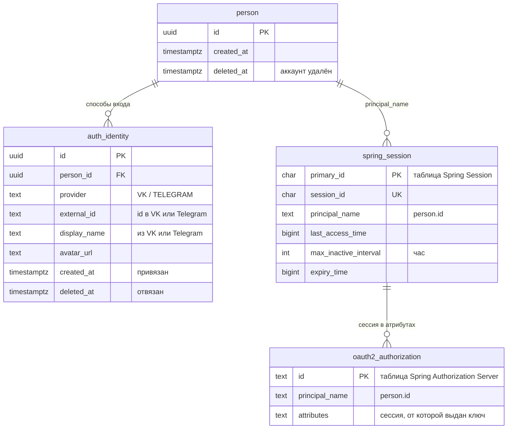
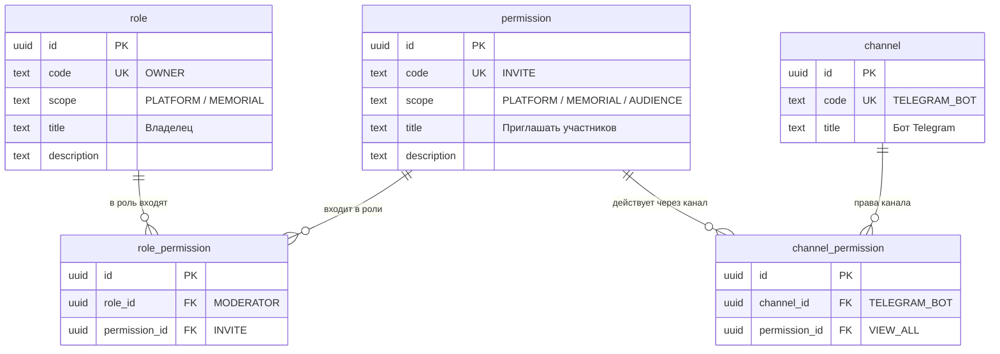
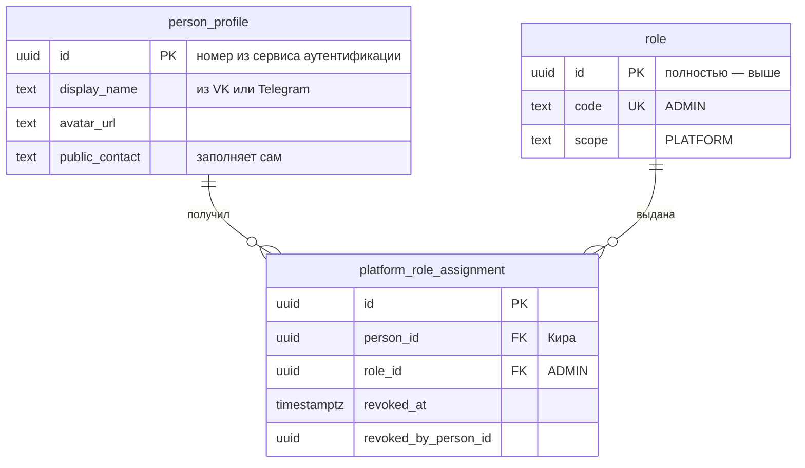
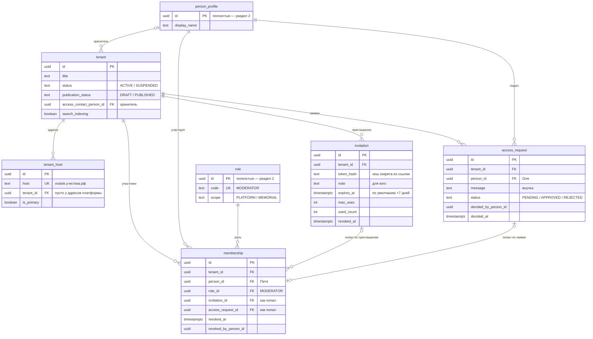
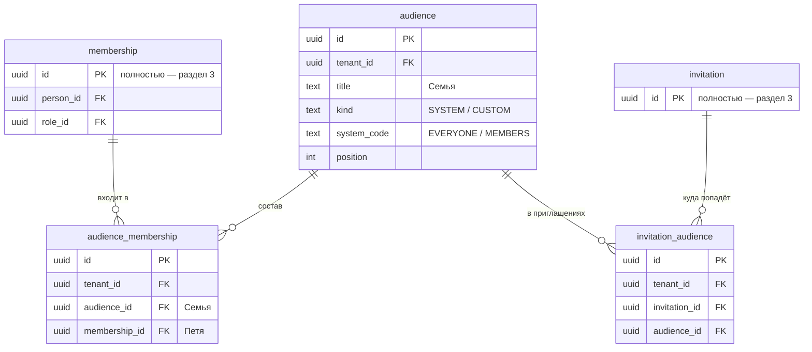
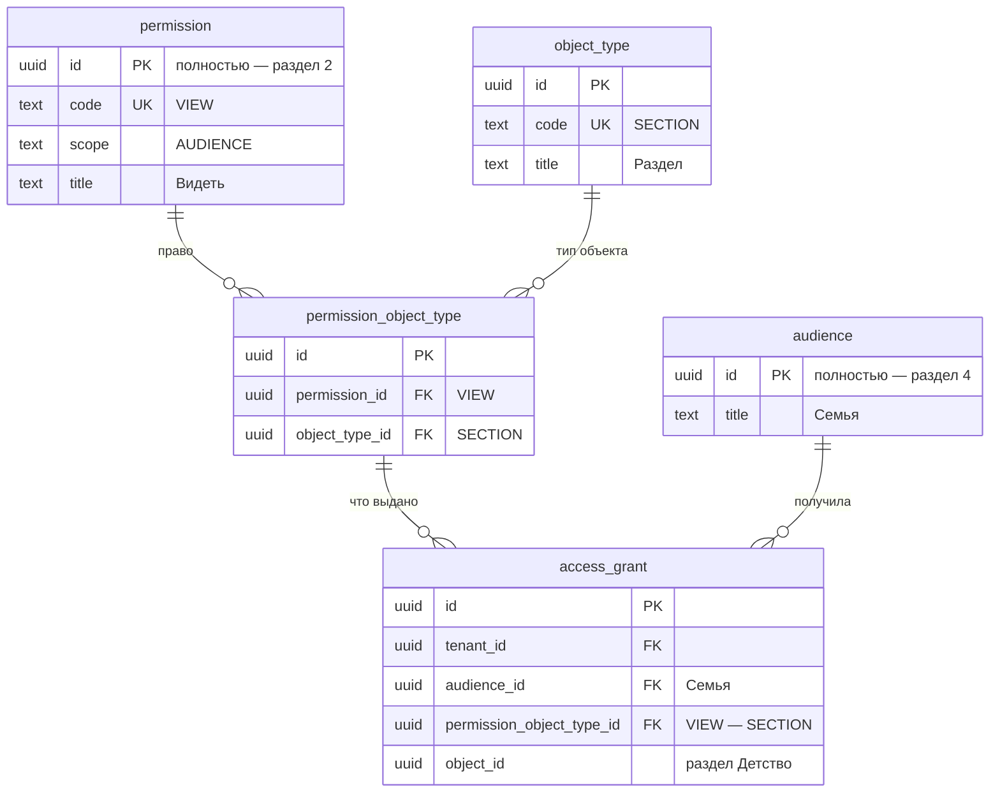

# Таблицы: вход, роли, права, аудитории

Проект таблиц по решениям из `Access-decisions.md`. Черновик: при переносе в модель и в миграции уточняется.

Где что живёт:
- **сервис аутентификации** — своя база: как человек входит;
- **бэк-сервис** (gefest) — всё остальное: профиль, роли и права, мемориалы.

Соглашения — как в существующих миграциях бэк-сервиса (`0001-content-schema.sql`):
- У каждой таблицы `id` — `uuid`, по умолчанию `uuidv7()`. Все ссылки между таблицами — по `id`.
- Исключение из правила `uuid` — таблицы, которые создают фреймворки (`spring_session`, `oauth2_authorization`): их устройство задаёт фреймворк.
- У ролей и прав, кроме `id`, есть постоянный уникальный `code` (`OWNER`, `INVITE`): по нему роль или право ищет программа (решение 36).
- Служебные поля у каждой таблицы бэк-сервиса, на схемах не показаны: `version`, `created_at`, `updated_at`, `created_by_person_id`, `updated_by_person_id` (→ `person_profile.id`), `created_via_channel_id`, `updated_via_channel_id` (→ `channel.id`) — канал: сайт, бот Telegram, бот VK (решения 12а, 51), `deleted_at`.
- Таблицы мемориала содержат `tenant_id`, база прячет их строки от других мемориалов (RLS, ADR 0009). Поверх мемориалов читают только «мои мемориалы» и «создать мемориал» — через политику «свои участия человека» на `membership` — и администрирование под своей ролью базы (решения 52, 68). Ссылки внутри мемориала — составные (`tenant_id`, `x_id`): на запись чужого мемориала сослаться нельзя.
- Логика — в коде, не в базе: без триггеров, хранимых функций и каскадных удалений. База держит ключи, ссылки, уникальность и изоляцию мемориалов. Исключение — только отдельным решением (решение 68).
- Как читать схему: `||--o{` — «один ко многим», `|o--o{` — «необязательно, один ко многим»; `PK` — ключ строки, `FK` — ссылка, `UK` — уникальное значение. Таблица из другого раздела показана коротко — только нужные столбцы, полностью — в своём разделе.

---

## 1. Сервис аутентификации

Свои таблицы — `person` и `auth_identity`. Сессии и выданные ключи хранят стандартные таблицы Spring.

| Таблица | Что хранит | Правила |
|---|---|---|
| `person` | Номер человека. Этот же номер — `id` профиля в бэк-сервисе | |
| `auth_identity` | Способ входа: VK или Telegram | Один и тот же VK — только у одного человека среди действующих: уникально (`provider`, `external_id`) где `deleted_at is null` (решения 5, 27). Последний способ входа отвязать нельзя. Новый привязывается только из своей открытой сессии входом через него — ещё одна строка с тем же `person_id` (решение 46). Имя и аватар из VK или Telegram хранятся здесь и отдаются бэк-сервису по пропуску (решение 66) |
| `spring_session` | Главный вход — сессия браузера на `auth.у-истока.рф`. Таблицу (и `spring_session_attributes`) создаёт Spring Session | `principal_name` — `person.id` (текст, не внешний ключ). Час без активности — вход закрыт (решения 4, 31). Продление пропуска в любом мемориале обновляет `last_access_time` этой сессии |
| `oauth2_authorization` | Пропуск (JWT, 5 минут) и ключ продления (час, новый при каждом продлении), выданные бэк-сервису для сайта мемориала; пропуска бота. Стандартная таблица Spring Authorization Server | `principal_name` — `person.id`. От какой главной сессии выдан ключ — в стандартных атрибутах авторизации, своих столбцов в таблице нет (решение 55). Продление проверяет, что главная сессия жива, и продлевает её; «Выйти» закрывает главную сессию — следующее продление не проходит (решения 4, 31) |

Не нужны: `oauth2_registered_client` — клиентов два (бэк-сервис и бот), они в настройках; `oauth2_authorization_consent` — экрана согласия нет.

---

## 2. Бэк-сервис: профиль, роли и права

Таблицы платформы — без `tenant_id`, не принадлежат ни одному мемориалу.

**Роли, права и каналы**

**Профиль и роли платформы**

| Таблица | Что хранит | Правила |
|---|---|---|
| `person_profile` | Профиль: имя, аватар, публичный контакт (решение 34). `id` — номер человека из сервиса аутентификации | Создаётся, когда бэк-сервис впервые видит пропуск человека — из любого канала (решение 53); имя и аватар — у сервиса аутентификации, бэк-сервис получает их по пропуску и обновляет при каждом входе (решение 66). Удаление аккаунта — имя «Удалённый пользователь», `deleted_at` |
| `role` | Справочник ролей: `ADMIN` (платформа); `OWNER`, `MODERATOR`, `MEMBER` (мемориал) | `code` постоянный и уникальный, название можно менять. Роли, о которых знает программа, создаёт миграция — с постоянным `id`, одинаковым во всех базах (решение 36) |
| `permission` | Справочник прав: платформы (`VIEW_ALL_MEMORIALS`, `SUSPEND_MEMORIAL`, `HIDE_POST`, `RAISE_MEMORIAL_LIMIT`, `MANAGE_PLATFORM_ROLES`), ролей мемориала (`VIEW_ALL`, `INVITE`, `MANAGE_AUDIENCES`, `MODERATE_POSTS`, `MANAGE_POSTS`, `MANAGE_STRUCTURE`, `MANAGE_MODERATORS`, `DOWNLOAD_ALL_ORIGINALS`, `APPROVE_REQUESTS`, `REMOVE_MEMBERS`, `MANAGE_SETTINGS`, `MODERATE_TRIBUTES`, `OPEN_TO_EVERYONE`), аудиторий (`VIEW`, `CONTRIBUTE`, `WRITE_TRIBUTE`, `DOWNLOAD_ORIGINALS`). Право на каждое правило — решение 49; что даёт каждое и у кого — [«Все права» в `Access.md`](Access.md#все-права) | Так же, как у ролей |
| `role_permission` | Какие права входят в роль: `MODERATOR` → `INVITE`; полностью — [«Все права» в `Access.md`](Access.md#все-права) | Уникально (`role_id`, `permission_id`). Пометки роли и права совпадают: в роль мемориала — только права мемориала, права аудиторий — ни в одну роль. Проверяет код при записи |
| `platform_role_assignment` | Кому выдана роль платформы: Кира → `ADMIN` | Только роли с пометкой `PLATFORM` — проверяет код при записи. Одна действующая выдача роли человеку: уникально (`person_id`, `role_id`) где `revoked_at is null`. Назначает и снимает тот, у кого `MANAGE_PLATFORM_ROLES` (решение 65) |
| `channel` | Справочник каналов, через которые человек действует: `SITE` — сайт, `TELEGRAM_BOT`, `VK_BOT` — наши боты (решение 51). Канал записывает в пропуск сервис аутентификации (решение 32) | `code` постоянный и уникальный; строки создаёт миграция с постоянным `id`. Новый мессенджер — новая строка |
| `channel_permission` | Какие права действуют через канал: бот Telegram → `VIEW_ALL`; полностью — [«Все права» в `Access.md`](Access.md#все-права) | Уникально (`channel_id`, `permission_id`). Сайту — все права; ботам — только права ролей мемориала из решения 51. Новое право сайту добавляет та же миграция, что его создаёт; ботам — только отдельным решением |

---

## 3. Бэк-сервис: мемориал и участники

| Таблица | Что хранит | Правила |
|---|---|---|
| `tenant` (есть) | Мемориал | Новые поля: `access_contact_person_id` — хранитель (раздел 8.3 `Access.md`), `search_indexing`. `status = SUSPENDED` — приостановлен администратором (решение 21); снять приостановку может только администратор (решение 42); что видят люди — решение 62. `publication_status` — черновик или опубликован (решение 58) |
| `tenant_host` (есть) | Адрес мемориала — пока только поддомен платформы: `vostok.у-истока.рф`. Собственные домены отложены (решение 45) | Сейчас ключ — `host`; добавляем `id`, `host` остаётся уникальным. Без изоляции по мемориалу: по этой таблице мемориал и определяется. Здесь же адреса самой платформы — `у-истока.рф` и `admin.у-истока.рф`: у них `tenant_id` пусто (решение 56). После входа сервис аутентификации возвращает только на адреса из этой таблицы (решения 3, 45, 56) |
| `membership` | Участник и его роль в мемориале: Петя → `MODERATOR` | Только роли с пометкой `MEMORIAL` — проверяет код при записи. Один действующий участник на человека: уникально (`tenant_id`, `person_id`) где `revoked_at is null`. Владелец один: уникально (`tenant_id`) где `role_id` — `id` роли `OWNER` (постоянный, его задаёт миграция) и `revoked_at is null` (решения 13, 36). Отозвать участие владельца нельзя — проверяет код (решение 61). Окончание — только `revoked_at` (решение 26). У создателя `invitation_id` и `access_request_id` пусты |
| `invitation` | Ссылка-приглашение | Принявший получает роль `MEMBER`. Срок по умолчанию 7 дней (решение 30) |
| `access_request` | Заявка на доступ | Одна нерассмотренная заявка на человека: уникально (`tenant_id`, `person_id`) где `status = 'PENDING'` (решение 30) |

Кроме того, у `item` (есть) новые поля скрытия администрацией платформы (решение 42): `platform_hidden_at`, `platform_hidden_by_person_id` (→ `person_profile.id`), `platform_hidden_reason`. Скрытый так пост не видит никто, кроме администратора; владелец и модераторы видят пометку «Скрыто администрацией платформы» и снять её не могут.

Статус публикации (решение 58): у `tenant`, `section` и `item` (есть) — новое поле `publication_status`: `DRAFT` — черновик, `PUBLISHED` — опубликован; у `item` ещё `HIDDEN` — скрыт модерацией, с полями `moderation_hidden_at` и `moderation_hidden_by_person_id` (→ `person_profile.id`). Черновик видят те, у кого `VIEW_ALL`, и автор; аудитория «Владелец и модераторы» не нужна.

---

## 4. Бэк-сервис: аудитории

| Таблица | Что хранит | Правила |
|---|---|---|
| `audience` | Аудитория: «Семья», «Друзья» и системные «Все» (`EVERYONE`), «Все участники» (`MEMBERS`) | Системные есть у каждого мемориала, их состав вычисляется. Аудитории «Владелец и модераторы» нет: черновик — статус объекта (решение 58). Одна системная каждого вида: уникально (`tenant_id`, `system_code`). Удаление своей аудитории — мягко, кодом, в одной транзакции с её `access_grant`, `audience_membership` и `invitation_audience` (решения 54, 68); объект без последней выдачи `VIEW` становится черновиком (решение 54) |
| `audience_membership` | Кто входит в свою аудиторию: Петя в «Семье» | Уникально (`audience_id`, `membership_id`) где `deleted_at is null` (решения 27, 68). Ссылается на участие, а не на человека (решение 24): отозвали участие — человек выпал из аудиторий. Только для своих аудиторий, состав системных не хранится |
| `invitation_audience` | В какие аудитории попадёт принявший приглашение (решение 25) | Уникально (`invitation_id`, `audience_id`) где `deleted_at is null`. Удаляется вместе с аудиторией — мягко, кодом (решения 54, 68) |

---

## 5. Бэк-сервис: права аудиторий

Права аудиторий — строки общей таблицы `permission` (раздел 2) с пометкой `scope = AUDIENCE`. Отдельной таблицы прав для аудиторий нет: роли берут из `permission` права с пометками `PLATFORM` и `MEMORIAL`, выдачи аудиториям — с пометкой `AUDIENCE` (решение 41). Какое право на какой тип объекта можно выдать, хранит таблица `permission_object_type`; выдача ссылается на строку этой таблицы, поэтому выдать право на неподходящий тип база не даст.

**Права аудиторий** — строки `permission` с `scope = AUDIENCE`, их создаёт миграция (все права модели — [«Все права» в `Access.md`](Access.md#все-права)):

| `code` | `title` | Правила |
|---|---|---|
| `VIEW` | Видеть | Внутри объекта — объединение аудиторий, по цепочке родителей — пересечение (раздел 8.1 `Access.md`). Черновик — статус объекта, а не выдача (решение 58) |
| `CONTRIBUTE` | Добавлять посты | Действует на раздел с подразделами. Добавить пост в раздел можно, если он виден по всей цепочке (решения 15, 70). «Всем» нельзя — ни на мемориал, ни на разделы (решения 17, 44) |
| `WRITE_TRIBUTE` | Писать в памятную книгу | Только на мемориал. Нужен и `VIEW` на мемориал (решение 18). «Всем» нельзя (решения 17, 44) |
| `DOWNLOAD_ORIGINALS` | Скачивать оригиналы | «Всем» нельзя (решение 17). Отдельный файл закрывает флажок `media_asset.original_closed` (решение 39) |

**Разрешённые пары** — строки `permission_object_type`, их создаёт миграция:

| Право | Типы объектов |
|---|---|
| `VIEW` | `TENANT`, `SECTION`, `ITEM`, `SUBJECT`, `APPEARANCE`, `TRIBUTE` |
| `CONTRIBUTE` | `TENANT`, `SECTION` |
| `WRITE_TRIBUTE` | `TENANT` |
| `DOWNLOAD_ORIGINALS` | `TENANT` |

| Таблица | Что хранит | Правила |
|---|---|---|
| `object_type` | Справочник типов объектов, на которые выдаются права: `TENANT` — мемориал, `SECTION` — раздел, `ITEM` — пост, `SUBJECT` — человек мемориала, `APPEARANCE` — оформление, `TRIBUTE` — запись памятной книги. Общий для всех мемориалов, без `tenant_id` | `code` постоянный и уникальный. Типы, о которых знает программа, создаёт миграция с постоянным `id` |
| `permission_object_type` | Какое право на какой тип объекта можно выдать: `CONTRIBUTE` — на `SECTION`. Связь «многие ко многим» между `permission` и `object_type`. Общая для всех мемориалов, без `tenant_id` | Уникально (`permission_id`, `object_type_id`). Только права с пометкой `AUDIENCE` — проверяет код при записи. Строки создаёт миграция с постоянным `id` |
| `access_grant` | Что аудитории разрешено на объект: «Семья — `VIEW` — раздел „Детство“» | Право и тип — одной ссылкой на разрешённую пару (`permission_object_type_id`): выдать `CONTRIBUTE` на пост база не даст — такой пары нет. Уникально (`audience_id`, `permission_object_type_id`, `object_id`) где `deleted_at is null`. `object_id` проверяет приложение: объект из того же мемориала и того типа, что в паре (решение 54) |
| `media_asset` (есть) | Медиафайл | Новое поле `original_closed` — «Оригинал закрыт», по умолчанию `false`: оригинал скачивают только владелец и модераторы (решение 39) |

**Пример — строки `access_grant` мемориала «Бабушка»** (для наглядности вместо `uuid` — названия):

| Аудитория | Что выдано — пара из `permission_object_type` | Объект |
|---|---|---|
| Все | `VIEW` — `TENANT` | мемориал «Бабушка» |
| Все | `VIEW` — `SECTION` | раздел «Детство» |
| Семья | `VIEW` — `SECTION` | раздел «Последние годы» |
| Семья | `CONTRIBUTE` — `SECTION` | раздел «Детство» |
| Семья | `WRITE_TRIBUTE` — `TENANT` | мемориал «Бабушка» |
| Друзья | `WRITE_TRIBUTE` — `TENANT` | мемориал «Бабушка» |
| Семья | `DOWNLOAD_ORIGINALS` — `TENANT` | мемориал «Бабушка» |

---

## Не вошло

- **Журнал безопасности** (решение 29) — описание и таблицы отдельно, по частям.
- **История видимости** (`VisibilityDecision`) — отложено, открытый вопрос 16 в `Access.md`.
- **Собственные домены мемориалов** — отложено (решение 45, открытый вопрос 17 в `Access.md`); вернутся вместе с отметкой о проверке домена `tenant_host.verified_at`.
- **Согласия на обработку данных** (решения 7, 48) — три отдельных согласия, каждое отдельной записью; таблицы спроектируем, когда дойдём до согласий, — до запуска.
