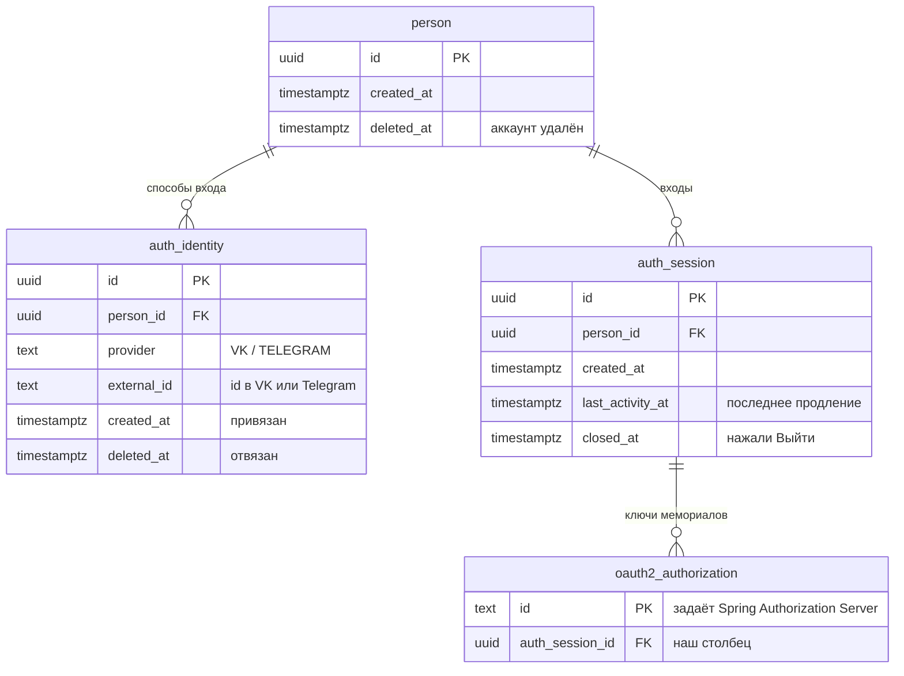
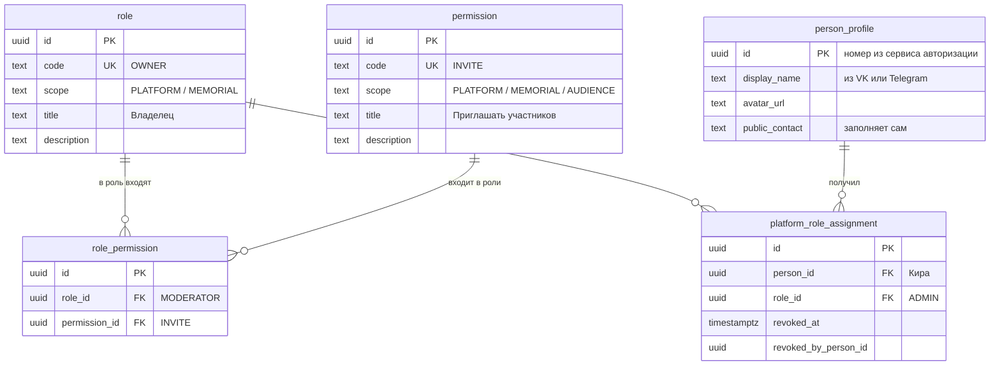
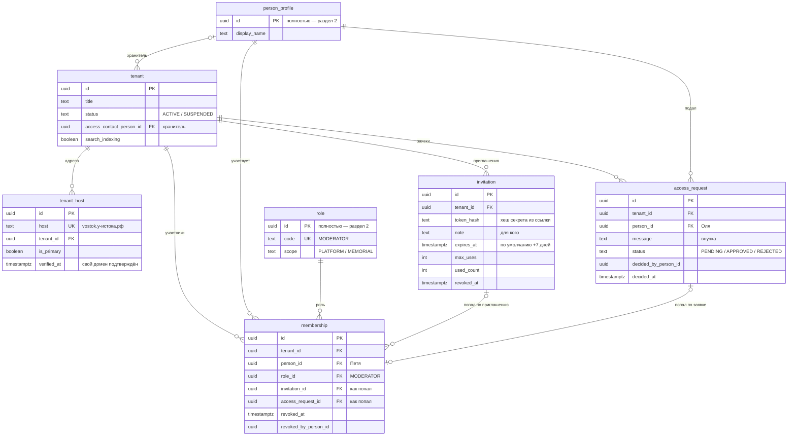
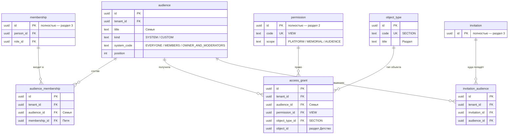

# Таблицы: вход, роли, права, аудитории

Проект таблиц по решениям из `Access-decisions.md`. Черновик: при переносе в модель и в миграции уточняется.

Где что живёт:
- **сервис авторизации** — своя база: как человек входит;
- **бэк-сервис** (gefest) — всё остальное: профиль, роли и права, мемориалы.

Соглашения — как в существующих миграциях бэк-сервиса (`0001-content-schema.sql`):
- У каждой таблицы `id` — `uuid`, по умолчанию `uuidv7()`. Все ссылки между таблицами — по `id`.
- У ролей и прав, кроме `id`, есть постоянный уникальный `code` (`OWNER`, `INVITE`): по нему роль или право ищет программа (решение 36).
- Служебные поля у каждой таблицы бэк-сервиса, на схемах не показаны: `version`, `created_at`, `updated_at`, `created_by_person_id`, `updated_by_person_id` (→ `person_profile.id`), `created_via`, `updated_via` — канал: `SITE` / `TELEGRAM_BOT` / `VK_BOT` (решение 12а), `deleted_at`.
- Таблицы мемориала содержат `tenant_id`, база прячет их строки от других мемориалов (RLS, ADR 0009). Ссылки внутри мемориала — составные (`tenant_id`, `x_id`): на запись чужого мемориала сослаться нельзя.
- Как читать схему: `||--o{` — «один ко многим», `|o--o{` — «необязательно, один ко многим»; `PK` — ключ строки, `FK` — ссылка, `UK` — уникальное значение. Таблица из другого раздела показана коротко — только нужные столбцы, полностью — в своём разделе.

---

## 1. Сервис авторизации

| Таблица | Что хранит | Правила |
|---|---|---|
| `person` | Номер человека. Этот же номер — `id` профиля в бэк-сервисе | |
| `auth_identity` | Способ входа: VK или Telegram | Один и тот же VK — только у одного человека среди действующих: уникально (`provider`, `external_id`) где `deleted_at is null` (решения 5, 27). Нельзя отвязать последний способ входа — вопрос 46, не решён |
| `auth_session` | Главный вход | Час без продлений — вход закрыт (решения 4, 31) |
| `oauth2_authorization` | Пропуск (5 минут) и ключ продления (час), выданные бэк-сервису для сайта мемориала. Стандартная таблица Spring Authorization Server: её `id` — строка с UUID, задаёт Spring | Наш столбец `auth_session_id`: «Выйти» закрывает все ключи этого входа, продление обновляет `auth_session.last_activity_at` (решение 31) |

---

## 2. Бэк-сервис: профиль, роли и права

Таблицы платформы — без `tenant_id`, не принадлежат ни одному мемориалу.

| Таблица | Что хранит | Правила |
|---|---|---|
| `person_profile` | Профиль: имя, аватар, публичный контакт (решение 34). `id` — номер человека из сервиса авторизации | Создаётся при первом входе; имя и аватар обновляются при каждом входе. Удаление аккаунта — имя «Удалённый пользователь», `deleted_at` |
| `role` | Справочник ролей: `ADMIN` (платформа); `OWNER`, `MODERATOR`, `MEMBER` (мемориал) | `code` постоянный и уникальный, название можно менять. Роли, о которых знает программа, создаёт миграция — с постоянным `id`, одинаковым во всех базах (решение 36) |
| `permission` | Справочник прав: платформы (`VIEW_ALL_MEMORIALS`, `SUSPEND_MEMORIAL`, `HIDE_POST`), ролей мемориала (`VIEW_ALL`, `INVITE`, `MANAGE_AUDIENCES`, `MODERATE_POSTS`, `MANAGE_MODERATORS`), аудиторий (`VIEW`, `CONTRIBUTE`, `DOWNLOAD_ORIGINALS`) | Так же, как у ролей |
| `role_permission` | Какие права входят в роль: `MODERATOR` → `INVITE` | Уникально (`role_id`, `permission_id`). Пометки роли и права совпадают: в роль мемориала — только права мемориала, права аудиторий — ни в одну роль. Проверяет код при записи |
| `platform_role_assignment` | Кому выдана роль платформы: Кира → `ADMIN` | Только роли с пометкой `PLATFORM` — проверяет код при записи. Одна действующая выдача роли человеку: уникально (`person_id`, `role_id`) где `revoked_at is null` |

---

## 3. Бэк-сервис: мемориал и участники

| Таблица | Что хранит | Правила |
|---|---|---|
| `tenant` (есть) | Мемориал | Новые поля: `access_contact_person_id` — хранитель (раздел 8.3 `Access.md`), `search_indexing`. `status = SUSPENDED` — приостановлен администратором (решение 21) |
| `tenant_host` (есть) | Адрес мемориала | Сейчас ключ — `host`; добавляем `id`, `host` остаётся уникальным. Новое поле `verified_at`. Без изоляции по мемориалу: по этой таблице мемориал и определяется |
| `membership` | Участник и его роль в мемориале: Петя → `MODERATOR` | Только роли с пометкой `MEMORIAL` — проверяет код при записи. Один действующий участник на человека: уникально (`tenant_id`, `person_id`) где `revoked_at is null`. Владелец один: уникально (`tenant_id`) где `role_id` — `id` роли `OWNER` (постоянный, его задаёт миграция) и `revoked_at is null` (решения 13, 36). Окончание — только `revoked_at` (решение 26). У создателя `invitation_id` и `access_request_id` пусты |
| `invitation` | Ссылка-приглашение | Принявший получает роль `MEMBER`. Срок по умолчанию 7 дней (решение 30) |
| `access_request` | Заявка на доступ | Одна нерассмотренная заявка на человека: уникально (`tenant_id`, `person_id`) где `status = 'PENDING'` (решение 30) |

---

## 4. Бэк-сервис: аудитории и выдачи

| Таблица | Что хранит | Правила |
|---|---|---|
| `audience` | Аудитория: «Семья», «Друзья» и системные «Все» (`EVERYONE`), «Все участники» (`MEMBERS`), «Владелец и модераторы» (`OWNER_AND_MODERATORS`) | Системные есть у каждого мемориала, их состав вычисляется. Одна системная каждого вида: уникально (`tenant_id`, `system_code`) |
| `audience_membership` | Кто входит в свою аудиторию: Петя в «Семье» | Уникально (`audience_id`, `membership_id`). Ссылается на участие, а не на человека (решение 24): отозвали участие — человек выпал из аудиторий. Только для своих аудиторий, состав системных не хранится |
| `object_type` | Справочник типов объектов, на которые выдаются права: `TENANT` — мемориал, `SECTION` — раздел, `ITEM` — пост, `SUBJECT` — человек мемориала, `APPEARANCE` — оформление, `TRIBUTE` — запись памятной книги. Общий для всех мемориалов, без `tenant_id` | `code` постоянный и уникальный. Типы, о которых знает программа, создаёт миграция с постоянным `id` |
| `access_grant` | Что аудитории разрешено на объект: «Семья — `VIEW` — раздел „Детство“» | Только права с пометкой `AUDIENCE` — проверяет код при записи. Уникально (`audience_id`, `permission_id`, `object_type_id`, `object_id`) где `deleted_at is null`. `object_id` проверяет приложение. Черновик — выдача `VIEW` аудитории «Владелец и модераторы», и она не сочетается с другими (решение 38). «Всем» нельзя `CONTRIBUTE` и `DOWNLOAD_ORIGINALS` (решение 17). `DOWNLOAD_ORIGINALS` — только на мемориал (решение 39) |
| `invitation_audience` | В какие аудитории попадёт принявший приглашение (решение 25) | Уникально (`invitation_id`, `audience_id`). Удаляется вместе с аудиторией |

Кроме того, у `media_asset` (есть) новое поле `original_closed` — «Оригинал закрыт», по умолчанию `false` (решение 39).

---

## Не вошло

- **Журнал безопасности** (решение 29) — описание и таблицы отдельно, по частям.
- **История видимости** (`VisibilityDecision`) — отложено, открытый вопрос 16 в `Access.md`.
- **Права аудиторий** лежат в общей таблице `permission` с пометкой `AUDIENCE`; вопрос 41 ещё не закрыт.
