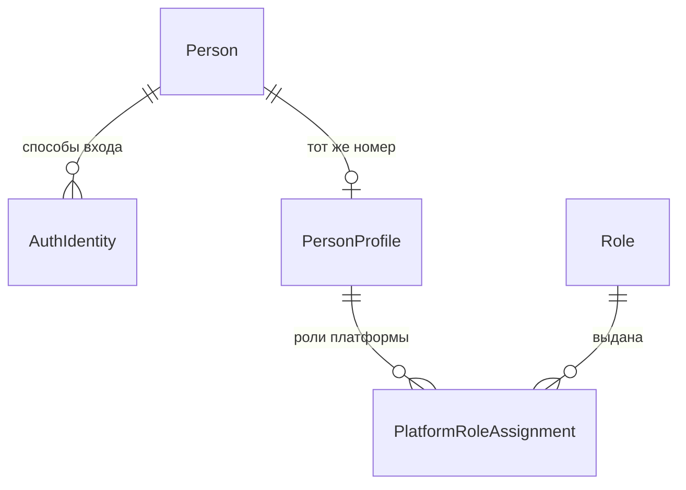
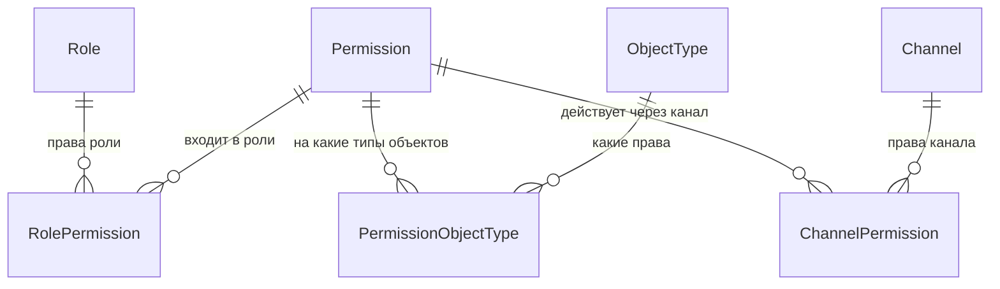
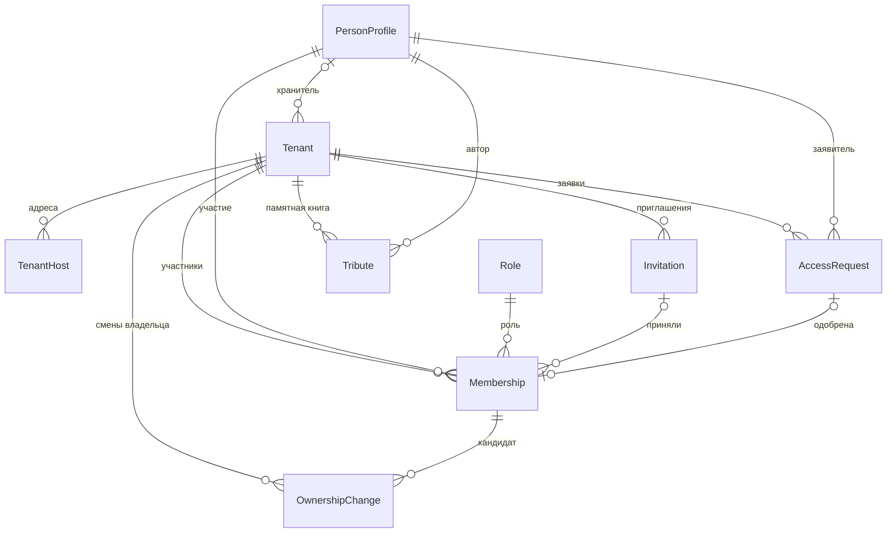
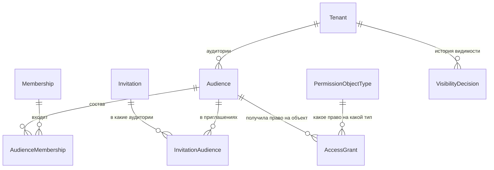

# Доменная модель: роли, доступ и вход

**Версия:** 0.3 (черновик)
**Дата:** 2026-10-29
**Выделено из:** `Main.md` — для обсуждения ролевой модели и авторизации

Рабочая выжимка: всё из `Main.md`, что касается людей, ролей, аудиторий, прав, видимости и входа, собрано в одном месте. Номера разделов совпадают с `Main.md`, поэтому ссылки вида «раздел 8.1» ведут туда же. Сюда перенесены решения разбора (`Access-decisions.md`), вопросы разбора — в `Access-questions.md`; следующий шаг — перенести изменения в `Main.md`. Таблицы — `Access-schema.md`.

---

## 1. Обзор

Где что живёт (решения 1, 34):

| Сервис | Что хранит |
|---|---|
| Сервис аутентификации (`auth.у-истока.рф`) | Как человек входит: номер человека (`Person`), способы входа (`AuthIdentity`), сессии входа и выданные пропуска |
| Бэк-сервис | Кто человек на платформе и что ему можно: профиль (`PersonProfile`), роли и права, каналы и их права, мемориалы с участниками, аудиториями и выдачами прав |

**Люди и роли платформы — вне мемориалов**

`Person` и `AuthIdentity` — в сервисе аутентификации, остальное — в бэк-сервисе. `PersonProfile.id` — тот же номер, что `Person.id`; внешнего ключа между базами нет.

**Роли, права и каналы — справочники, общие для всех мемориалов**

Что даёт каждое право и у кого оно — [«Все права»](#все-права).

**Мемориал и участники**

**Аудитории и выдачи прав**

### Служебные поля

Есть у каждой сущности бэк-сервиса. В таблицах ниже они сведены в одну строку. У сущностей сервиса аутентификации свои служебные поля — `createdAt` и `deletedAt`.

| Атрибут | Описание |
|---|---|
| `version` | Номер версии записи, растёт при каждом изменении. Историю прежних значений не хранит |
| `createdAt`, `updatedAt` | Когда запись создана и когда изменена в последний раз |
| `createdByPersonId`, `updatedByPersonId` | Кто создал и кто изменил в последний раз. Ссылаются на профиль человека (`PersonProfile`); пусто, если действие выполнила система |
| `createdViaChannelId`, `updatedViaChannelId` | Канал, через который сделано действие (`Channel`): сайт, бот Telegram, бот VK (решения 12а, 51). Бэк-сервис берёт канал только из пропуска (решение 32). В истории видно: «пост добавила Кира через бота Telegram» |
| `deletedAt` | Момент мягкого удаления, пусто, пока запись не удалена. Запись скрывается, но физически не стирается; оригиналы медиа не удаляются в любом случае (NFR по сохранности) |

---

## 2. Тенант и адресация

### Адрес платформы

- Адрес платформы — `у-истока.рф`: «Мои мемориалы», «Создать мемориал», профиль и публичный контакт (решение 33).
- Поверх мемориалов в бэк-сервисе для обычных людей только два запроса: «мемориалы этого человека» — только те, где он участник, с адресами — и «создать мемориал». Оба читают только участия этого человека — через политику изоляции «свои участия человека», без функций в базе; всё остальное работает внутри одного мемориала, изоляция в базе (RLS) для него обязательна (решения 52, 68).
- Администрирование — отдельный модуль бэк-сервиса на `admin.у-истока.рф` (раздел 3, «Администратор платформы»).

Поля `Tenant`, связанные с доступом:

| Атрибут | Описание |
|---|---|
| `status` | `ACTIVE` / `SUSPENDED`. `SUSPENDED` — мемориал приостановлен администратором платформы и временно не открывается: посетители и участники видят страницу «Мемориал приостановлен» без содержимого, в «Мои мемориалы» он остаётся с пометкой, бот с ним не работает; администратор видит всё и снимает приостановку (решения 21, 42, 62) |
| `publicationStatus` | `DRAFT` — черновик: его видят только те, у кого `VIEW_ALL`, остальным — «не найдено» (404); `PUBLISHED` — опубликован, виден своим аудиториям (решения 58, 72) |
| `accessContactPersonId` | Хранитель, к которому гостям закрытого мемориала обращаться за доступом. Только действующий владелец (`OWNER`) этого мемориала. Назначает тот, у кого `MANAGE_SETTINGS`, — владелец (решение 64). Гостю показывается его публичный контакт (`PersonProfile.publicContact`), даже когда мемориал закрыт (раздел 8.3). Может отсутствовать. Владельца убрать нельзя (решение 61), поэтому поле меняется только при передаче роли — это позже (раздел 12, вопрос 7) |
| `searchIndexing` | Разрешить поисковикам показывать мемориал. По умолчанию — нет: страницы отдаются с `noindex`. Меняет тот, у кого право `MANAGE_SETTINGS`, — владелец (решение 49). Это просьба к поисковикам, а не защита — доступ ограничивают аудитории |

### TenantHost

Подтверждённый адрес: адрес мемориала или самой платформы. У мемориала пока только поддомен платформы — `vostok.у-истока.рф`; собственные домены (`a-vostok.ru`) отложены (решение 45, раздел 12, вопрос 17). Адреса самой платформы — `у-истока.рф` и `admin.у-истока.рф` (решение 56).

| Атрибут | Описание |
|---|---|
| `id` | Ключ записи (`uuid`); имя хоста — отдельное уникальное поле |
| `host` | Нормализованное имя хоста, уникально по всей платформе. Хранится так, как приходит в заголовке `Host`: кириллический домен — в punycode (`vostok.xn----8sbxitrhe.xn--p1ai`) |
| `tenantId` | Мемориал. Пусто у адресов самой платформы: по ним открываются страницы платформы или администрирование (решение 56) |
| `isPrimary` | Используется для генерации абсолютных ссылок |
| `version`, `createdAt`, `updatedAt`, `createdByPersonId`, `updatedByPersonId`, `createdViaChannelId`, `updatedViaChannelId`, `deletedAt` | Служебные поля, см. раздел 1 |

**Мемориал определяется по хосту запроса:**

- Хост из заголовка `Host` нормализуется — нижний регистр, без порта — и ищется точным совпадением среди `TenantHost.host`. Мемориал известен до любой проверки прав: авторизация и журналирование берут его из контекста запроса.
- Идентификатор мемориала никогда не принимается от клиента — ни параметром, ни заголовком: иначе клиент сам выбирает, чьи данные читать.
- Неизвестный хост — нейтральная страница платформы; мемориала «по умолчанию» нет.
- Перенаправление с неосновного хоста на основной (`isPrimary`) — не по умолчанию; включает тот, у кого `MANAGE_SETTINGS`, — владелец (решение 64).
- Cookie и сессии привязываются строго к хосту мемориала: `Domain` не задаётся. Cookie на родительском домене платформы уходила бы на все поддомены, и сессия одного мемориала утекала бы в другой. Настройки по умолчанию в ряде фреймворков ведут себя иначе — это легко упустить.
- Веб-клиент и API работают на одном хосте мемориала через обратный прокси: без CORS и с обычной передачей cookie.
- После входа сервис аутентификации возвращает человека только на адреса из `TenantHost` — мемориалов и самой платформы (решения 3, 45, 56).

---

## 3. Люди и доступ

### Person

Человек — номер, общий для всей системы. Живёт в сервисе аутентификации (решение 1).

Обоснование исключения из ADR-0001: один и тот же человек может быть родственником в нескольких мемориалах, и заводить ему отдельную учётную запись под каждый — значит требовать повторной авторизации на каждом мемориале. Изоляция при этом не страдает: доступ к данным мемориала дают только участие (`Membership`, тенант-скоупное), аудитория «Все» или право платформы — сама по себе запись о человеке прав не даёт нигде.

Вне мемориалов (решение 28): `Person` и `AuthIdentity` — в сервисе аутентификации; профили людей (`PersonProfile`), роли и права, роли платформы (`PlatformRoleAssignment`), справочники типов объектов и каналов — в бэк-сервисе.

| Атрибут | Описание |
|---|---|
| `id` | Номер человека. Этот же номер — `id` его профиля в бэк-сервисе |
| `createdAt` | |
| `deletedAt` | Аккаунт удалён (раздел 12, вопрос 24) |

### PersonProfile

Кто человек на платформе: имя, аватар, публичный контакт. Живёт в бэк-сервисе (решение 34). Это не копия, а его данные: все ссылки на человека в бэк-сервисе — участие, авторы, служебные поля, журнал — ведут сюда.

| Атрибут | Описание |
|---|---|
| `id` | Номер человека из сервиса аутентификации (`Person.id`) |
| `displayName` | Имя из профиля VK или Telegram |
| `avatarUrl` | |
| `publicContact` | Публичный контакт: всё, что человек сам укажет — Telegram, телефон, почта, что угодно. Простой текст, может отсутствовать. Из профиля VK или Telegram ничего не подставляется. Общий для всех мемориалов, человек меняет его сам на `у-истока.рф`. Виден любому посетителю мемориала, где человек назначен хранителем (`Tenant.accessContactPersonId`), — даже без входа |
| `version`, `createdAt`, `updatedAt`, `createdByPersonId`, `updatedByPersonId`, `createdViaChannelId`, `updatedViaChannelId`, `deletedAt` | Служебные поля, см. раздел 1 |

- Профиль создаётся в одном месте — когда бэк-сервис впервые видит пропуск человека, из любого канала (решение 53). Имя и аватар бэк-сервис получает у сервиса аутентификации по пропуску — стандартным запросом «кто это» (UserInfo в OpenID Connect) — и обновляет при каждом входе (решение 66); имя, изменённое в VK или Telegram, обновится при следующем входе.
- Синхронизации данных между сервисами нет. Прямые вызовы от сервиса аутентификации к бэк-сервису — только удаление аккаунта, слияние учёток (решения 5, 7) и проверка адреса возврата (решение 56).
- Имя, аватар и публичный контакт видят посетители публичного мемориала — это распространение персональных данных, на него нужно отдельное согласие (решение 48, «Согласия» ниже).

### AuthIdentity

Способ входа. VK и Telegram — две записи одного вида. Живёт в сервисе аутентификации.

| Атрибут | Описание |
|---|---|
| `personId` | |
| `provider` | `VK` / `TELEGRAM` |
| `externalId` | Идентификатор в системе провайдера |
| `displayName`, `avatarUrl` | Имя и аватар из VK или Telegram. Обновляются при каждом входе, для бота — из данных отправителя сообщения (решение 66) |
| `createdAt` | Когда способ привязан |
| `deletedAt` | Когда отвязан |

- Уникальность по паре (`provider`, `externalId`) — среди действующих, не отвязанных записей (решение 27): отвязанный VK можно привязать заново.
- Один человек может привязать несколько способов входа. Новый способ привязывается только из своей открытой сессии и только входом через него: сессия подтверждает, что это сам человек, вход — что VK или Telegram принадлежит ему (решение 46).
- Способ входа, уже привязанный к другому человеку, привязать нельзя: «Этот способ входа уже используется другой учётной записью». Слияние учёток — позже (решение 5, раздел 12, вопрос 19).
- Последний способ входа отвязать нельзя: иначе человек больше не войдёт, а его мемориалы останутся без владельца (решение 46).

### Вход

Вход — только через VK и Telegram. Они требуют заранее зарегистрировать адреса, на которых работает вход: Telegram — один домен на бота, VK — каждый адрес возврата. Мемориалов много, у каждого свой поддомен, поэтому вход идёт через сервис аутентификации на общем домене платформы (`auth.у-истока.рф`). Это обычная схема единого входа, как у Google, Keycloak, Auth0 (решение 31):

1. Гость на хосте мемориала нажимает «Войти» — его перенаправляют в сервис аутентификации.
2. Там он входит через VK или Telegram; сервис аутентификации помнит его главной сессией.
3. Его возвращают с одноразовым кодом — только на адреса из `TenantHost`: мемориалов и самой платформы (решения 3, 45, 56). Код живёт около минуты и годится одному хосту; на каждом шаге — `state` и PKCE (`vk-login-pkce.md`).
4. Бэк-сервис меняет код на пропуск (access token, 5 минут) и ключ продления (refresh token, час) и хранит их у себя, в сессии мемориала. Браузеру — только cookie со случайным идентификатором, привязанная к хосту мемориала (раздел 2).

- **Пропуск.** В пропуске — человек и канал (`SITE`); мемориала в нём нет. Пропуск бэк-сервис проверяет сам, по подписи сервиса аутентификации, а роли, аудитории и выдачи — по базе на каждом запросе: иначе отзыв доступа не сработает сразу (решения 2, 32).
- **Активность** — запросы человека: открыть страницу, нажать кнопку. Когда пропуск истёк, бэк-сервис на следующем запросе получает новый, а ключ продления каждый раз выдаётся заново на час. Нет запросов час — нужен вход заново (решения 4, 31). Продление в любом мемориале продлевает и главный вход: в соседний мемориал человек заходит без повторного входа.
- **«Выйти»** — выход из всех мемориалов: сервис аутентификации закрывает главную сессию, и ключи, выданные от неё, больше не продлеваются; в мемориалах это срабатывает не позже чем через 5 минут (решения 4, 31, 55).
- Если сервис аутентификации недоступен, вошедшие работают до конца пропуска; войти заново нельзя.
- Реализация — Spring Security и Spring Authorization Server: главная сессия — Spring Session, выданные ключи — `oauth2_authorization`; от какой главной сессии выдан ключ — в стандартных атрибутах авторизации, таблицы фреймворка не меняем (решение 55, `Access-schema.md`, раздел 1).

### Боты

Чат с платформой — только наши боты в Telegram и VK; позже, возможно, другие мессенджеры. Человек пишет боту, бот добавляет посты в мемориал. Внешние приложения (Claude, ChatGPT и другие), чужие агенты и MCP-сервер к платформе не подключаются (раздел «Боты и их токены» в `Access-decisions.md`).

- **Устройство.** Приложение бота — отдельный сервис: приём сообщений, языковая модель и список действий модели. Каждое действие — запрос к обычному API бэк-сервиса, как у фронта. Языковая модель — российского поставщика по API, с договором поручения обработки; своей модели пока нет (решение 48).
- **Пропуск.** Бот узнаёт человека по id отправителя сообщения (`AuthIdentity`) и получает пропуск у сервиса аутентификации — без входа человека и экрана подтверждения: бот — зарегистрированный клиент сервиса аутентификации. Пропуск живёт 5 минут и устроен как пропуск сайта; канал в нём — `TELEGRAM_BOT` или `VK_BOT` (решения 8, 12, 32).
- **Кто.** Работать с мемориалом через бота — добавлять посты и файлы — могут только его владелец и модераторы: в наборе прав канала бота только права их ролей, прав аудиторий в нём нет (решения 10, 11, 51). В пропуске мемориала нет: бот работает во всех мемориалах, где у человека есть права из набора бота, и уточняет в чате, в какой добавлять. Правила вне прав — например, «автор видит своё» — через бота не действуют. Участник добавляет посты только на сайте. Создать мемориал через бота может любой, кто вошёл (решение 47).
- **Что может** — список действий бота (решение 9): читать то, что видит человек; создавать посты и контент там, куда человеку можно добавлять; менять и удалять созданное ботом; загружать файлы; скачивать оригиналы, если это право есть у человека; создать мемориал. **Никогда:** открывать контент другим, менять аудитории, участников, права и настройки, трогать не своё. Посты, созданные через бота, — черновики: открывают их на сайте (решение 50).
- **Защита в три слоя** (решения 8, 37, 51): модель может вызвать только действия из списка — опасных в нём нет, удаление — с подтверждением в чате; бэк-сервис пропускает от бота только права из набора канала — всё новое для бота закрыто; бэк-сервис проверяет права человека. Действие выполняется, только если право есть **и** у человека, **и** в наборе канала.
- **Где отвечает.** Только в личных чатах: в групповом чате ответы с закрытыми воспоминаниями увидят все (решение 37).
- **Отзыв.** Снятие участия или роли действует сразу; отвязка Telegram или VK — для бота с задержкой до 5 минут, пока не истечёт выданный пропуск (решение 12).
- **История.** Токенов агентов нет: у каждого изменения записан канал (`createdViaChannelId`, `updatedViaChannelId`) — «пост добавила Кира через бота Telegram» (решения 12а, 51).

Отложено: может ли бот регистрировать человека, который ещё не входил на сайт (раздел 12, вопрос 20). Профиль в любом случае создаётся при первом пропуске (решение 53).

### Создание мемориала

Мемориал создаёт сам человек после входа: кнопкой «Создать мемориал» на `у-истока.рф` или в разговоре с ботом (решения 23, 47). Не больше 20 мемориалов на человека: предел — в настройках, меняется без изменения кода; если кому-то нужно больше, администратор поднимает ему предел (`RAISE_MEMORIAL_LIMIT`). В предел считаются мемориалы, где человек — владелец, включая приостановленные; где хранить поднятый предел — решим вместе с подпиской (решение 63). Создатель становится владельцем: участие с ролью «Владелец» без приглашения и заявки. Владелец у мемориала один, модераторов назначает он (`MANAGE_MODERATORS`, решение 13).

### Роли и права

Роль даёт права на весь мемориал — в том числе видеть всё (`VIEW_ALL`); аудитории (`Audience`) дают права на отдельные объекты — видеть, публиковать, скачивать оригиналы. Роли и права хранятся в базе бэк-сервиса (решения 22, 22а, 36, 41, 49):

- роли (`Role`) и права (`Permission`) — общие справочники с пометкой `scope`: `PLATFORM` — платформа, `MEMORIAL` — мемориал, `AUDIENCE` — права, которые выдаются аудиториям (такая пометка бывает только у прав);
- какие права входят в роль — `RolePermission`; права аудиторий не входят ни в одну роль;
- код проверяет право по его постоянному коду и никогда не проверяет роль; право, на которое в коде никто не ссылается, ничего не открывает; новая роль — новые записи в базе, без изменения кода;
- у каждого правила вида «владелец и модераторы могут…» — своё право; на роль владельца опираются только правила структуры мемориала: владелец один, хранитель — владелец, владельца нельзя убрать, передача роли (решения 49, 61);
- роли и права, о которых знает программа, создаёт миграция — с постоянным кодом и постоянным `id`, одинаковыми во всех базах.

Роли мемориала одинаковы для всех мемориалов (решение 22а):

| Роль (`code`) | Права роли |
|---|---|
| Владелец (`OWNER`) | Один на мемориал — создатель (решение 13). Всё, что у модератора, и ещё: назначать и снимать модераторов (`MANAGE_MODERATORS`), одобрять заявки (`APPROVE_REQUESTS`), убирать участников (`REMOVE_MEMBERS`), менять настройки мемориала (`MANAGE_SETTINGS`), скрывать записи памятной книги (`MODERATE_TRIBUTES`), открывать «Всем» (`OPEN_TO_EVERYONE`, решение 76), читать журнал мемориала (`VIEW_JOURNAL`, решение 77). Передать роль владельца — смена владельца (`OwnershipChange`, решение 73) |
| Модератор (`MODERATOR`) | Видеть всё (`VIEW_ALL`); приглашать участников и видеть заметки приглашений (`INVITE`); настраивать аудитории, видимость и выдачи прав, видеть участников и состав аудиторий, закрывать оригиналы отдельных файлов (`MANAGE_AUDIENCES`); скрывать и удалять чужие посты (`MODERATE_POSTS`); скачивать любые оригиналы (`DOWNLOAD_ALL_ORIGINALS`); добавлять посты (`MANAGE_POSTS`); наполнять структуру — разделы, люди мемориала, оформление (`MANAGE_STRUCTURE`, решения 50, 57) |
| Участник (`MEMBER`) | Своих прав у роли нет: только то, что выдано его аудиториям (`AccessGrant`), — видеть, публиковать, скачивать оригиналы |

«Главного владельца» нет: владелец один, остальные, кто управляет мемориалом, — модераторы.

#### Все права

Три уровня — через что право выдаётся и на что действует (решения 22, 22а, 41, 49–51, 57, 64, 65).

**Права платформы** — роль платформы (`PlatformRoleAssignment`), действуют во всех мемориалах:

| Право | Что даёт | У кого |
|---|---|---|
| `VIEW_ALL_MEMORIALS` | Видеть все мемориалы, в том числе закрытые | Администратор |
| `SUSPEND_MEMORIAL` | Приостанавливать мемориал и снимать приостановку | Администратор |
| `HIDE_POST` | Скрывать пост по жалобе или требованию закона, видеть скрытое и снимать скрытие (решение 65) | Администратор |
| `RAISE_MEMORIAL_LIMIT` | Поднимать человеку предел мемориалов | Администратор |
| `ASSIGN_OWNER` | Назначать нового владельца, если прежний недоступен (решение 73) | Администратор |
| `VIEW_ALL_JOURNALS` | Читать весь журнал безопасности (решение 77) | Администратор |
| `MANAGE_PLATFORM_ROLES` | Назначать и снимать роли платформы (решение 65) | Администратор |

**Права ролей мемориала** — роль в мемориале (`Membership.roleId`), действуют на весь мемориал:

| Право | Что даёт | У кого |
|---|---|---|
| `VIEW_ALL` | Видеть всё, включая черновики | Владелец, модератор |
| `MANAGE_POSTS` | Добавлять посты (черновиком), свои менять и удалять | Владелец, модератор |
| `MANAGE_STRUCTURE` | Разделы, люди мемориала, оформление — добавлять, менять и удалять | Владелец, модератор |
| `INVITE` | Создавать и отзывать приглашения, видеть заметки к ним (решение 65) | Владелец, модератор |
| `MANAGE_AUDIENCES` | Создавать и менять аудитории и их состав; выдавать и отзывать права аудиториям, кроме открытия «Всем» (`OPEN_TO_EVERYONE`); публиковать и возвращать в черновик; видеть участников и состав аудиторий; закрывать оригинал отдельного файла | Владелец, модератор |
| `MODERATE_POSTS` | Скрывать модерацией и удалять чужие посты, снимать скрытие | Владелец, модератор |
| `DOWNLOAD_ALL_ORIGINALS` | Скачивать любые оригиналы, в том числе закрытые | Владелец, модератор |
| `MANAGE_MODERATORS` | Назначать и снимать модераторов | Владелец |
| `APPROVE_REQUESTS` | Смотреть, одобрять и отклонять заявки на доступ (решение 65) | Владелец |
| `REMOVE_MEMBERS` | Убирать участников, кроме владельца (решение 61) | Владелец |
| `MANAGE_SETTINGS` | Настройки мемориала: название, хранитель, показ поисковикам, основной адрес и перенаправление на него (решение 64) | Владелец |
| `OPEN_TO_EVERYONE` | Открывать «Всем»: выдавать `VIEW` аудитории «Все» (решение 76) | Владелец |
| `VIEW_JOURNAL` | Читать журнал безопасности своего мемориала (решение 77) | Владелец |
| `MODERATE_TRIBUTES` | Скрывать модерацией записи памятной книги и снимать скрытие | Владелец |

**Права аудиторий** — выдача аудитории на объект (`AccessGrant`); у участника других прав нет:

| Право | Что даёт | На что | «Всем» |
|---|---|---|---|
| `VIEW` | Видеть объект | Мемориал, раздел, пост, человек мемориала, оформление, запись памятной книги | Можно |
| `CONTRIBUTE` | Добавлять посты в раздел, который человек видит по всей цепочке (решение 70) | Мемориал или раздел с подразделами | Нельзя |
| `WRITE_TRIBUTE` | Писать в памятную книгу; нужен и `VIEW` на мемориал | Мемориал | Нельзя |
| `DOWNLOAD_ORIGINALS` | Скачивать оригиналы и полные метаданные | Мемориал | Нельзя |

**Через каналы** (решение 51): через сайт действуют все права, через ботов — только `VIEW_ALL`, `MANAGE_POSTS` и `DOWNLOAD_ALL_ORIGINALS`.

**Не права, а правила:** автор видит своё, пока он участник; менять пост может только его автор, чужой владелец и модераторы скрывают и удаляют (`MODERATE_POSTS`); создать мемориал может любой, кто вошёл, — не больше 20; бот меняет и удаляет только созданное через бота; владелец у мемориала один, хранитель — владелец, убрать владельца нельзя — он уходит, передав роль или удалив аккаунт (решения 61, 73).

`CONTRIBUTE` и `MANAGE_POSTS` пересекаются: оба дают добавлять посты. `CONTRIBUTE` — участникам, в открытые им разделы; `MANAGE_POSTS` — тем, кто управляет мемориалом, в любой раздел. Если у человека есть оба, главнее `MANAGE_POSTS`: пост создаётся черновиком (решение 67). Разделы, людей мемориала и оформление меняет только `MANAGE_STRUCTURE`.

#### Role

| Атрибут | Описание |
|---|---|
| `code` | Постоянный код: `ADMIN` — платформа; `OWNER`, `MODERATOR`, `MEMBER` — мемориал. Не меняется никогда |
| `scope` | `PLATFORM` / `MEMORIAL` |
| `title`, `description` | Название и описание, их можно менять |
| `version`, `createdAt`, `updatedAt`, `createdByPersonId`, `updatedByPersonId`, `createdViaChannelId`, `updatedViaChannelId`, `deletedAt` | Служебные поля, см. раздел 1 |

#### Permission

| Атрибут | Описание |
|---|---|
| `code` | Постоянный код; полный список — [«Все права»](#все-права) выше |
| `scope` | `PLATFORM` / `MEMORIAL` / `AUDIENCE` |
| `title`, `description` | Название и описание, их можно менять |
| `version`, `createdAt`, `updatedAt`, `createdByPersonId`, `updatedByPersonId`, `createdViaChannelId`, `updatedViaChannelId`, `deletedAt` | Служебные поля, см. раздел 1 |

#### RolePermission

Какие права входят в роль: `MODERATOR` → `INVITE`.

| Атрибут | Описание |
|---|---|
| `roleId`, `permissionId` | |
| `version`, `createdAt`, `updatedAt`, `createdByPersonId`, `updatedByPersonId`, `createdViaChannelId`, `updatedViaChannelId`, `deletedAt` | Служебные поля, см. раздел 1 |

Уникальность по (`roleId`, `permissionId`). Пометки роли и права совпадают: в роль мемориала — только права мемориала, в роль платформы — только права платформы. Проверяет код при записи.

#### Channel

Канал — через что человек действует: сайт или наш бот (решение 51). Канал записывает в пропуск сервис аутентификации (решение 32), бэк-сервис находит его по коду. Справочник общий для всех мемориалов, строки создаёт миграция с постоянным `id`.

| Атрибут | Описание |
|---|---|
| `code` | Постоянный код: `SITE` — сайт, `TELEGRAM_BOT` — бот Telegram, `VK_BOT` — бот VK. Новый мессенджер — новая строка |
| `title` | Название: «Бот Telegram» |
| `version`, `createdAt`, `updatedAt`, `createdByPersonId`, `updatedByPersonId`, `createdViaChannelId`, `updatedViaChannelId`, `deletedAt` | Служебные поля, см. раздел 1 |

#### ChannelPermission

Какие права действуют через канал: бот Telegram → `VIEW_ALL`. Действие проходит, только если право есть и у человека (роль, аудитории), и в наборе канала из пропуска (решение 51).

| Атрибут | Описание |
|---|---|
| `channelId`, `permissionId` | |
| `version`, `createdAt`, `updatedAt`, `createdByPersonId`, `updatedByPersonId`, `createdViaChannelId`, `updatedViaChannelId`, `deletedAt` | Служебные поля, см. раздел 1 |

Уникальность по (`channelId`, `permissionId`). Сайту миграция выдаёт все права ([«Все права»](#все-права)). Каналам ботов — только права ролей мемориала, нужные для действий бота (решение 9): `VIEW_ALL`, `MANAGE_POSTS`, `DOWNLOAD_ALL_ORIGINALS`; `MANAGE_STRUCTURE` у ботов нет (решение 57). Прав аудиторий у ботов нет, поэтому участник с мемориалом через бота не работает (решения 10, 11). Новое право сайту добавляет та же миграция, что его создаёт; ботам — только отдельным решением: всё новое для бота закрыто.

### Администратор платформы

Роли и права платформы — для тех, кто ведёт платформу, а не для семей (решение 22). Сейчас одна роль — «Администратор» (`ADMIN`) с правами (решение 21):

- видеть все мемориалы, в том числе закрытые (`VIEW_ALL_MEMORIALS`);
- приостановить мемориал — он временно не открывается (`SUSPEND_MEMORIAL`, `Tenant.status`, решение 62);
- скрыть отдельный пост — на случай жалобы или требования закона, видеть скрытое и снимать скрытие (`HIDE_POST`, решение 65);
- поднять человеку предел мемориалов (`RAISE_MEMORIAL_LIMIT`, решения 23, 49);
- назначать и снимать роли платформы (`MANAGE_PLATFORM_ROLES`, решение 65);
- назначать нового владельца, если прежний недоступен (`ASSIGN_OWNER`, решение 73);
- читать весь журнал безопасности (`VIEW_ALL_JOURNALS`, решение 77).

Править чужие тексты администратор не может. Удалять мемориал целиком тоже не может: удаление не отменить, решим отдельно (раздел 12, вопрос 10).

Скрытие поста администратором — отдельная отметка у поста: `Item.platformHiddenAt`, кто скрыл (`platformHiddenByPersonId`) и причина (`platformHiddenReason`). Такой пост не видит никто, кроме администратора; владелец и модераторы видят «Скрыто администрацией платформы» и снять отметку не могут. Их собственное скрытие постов — другое и снимается ими (решение 42).

Администрирование — отдельный модуль бэк-сервиса со своим адресом `admin.у-истока.рф`: пускает только с правом платформы, и только у него своя роль базы с доступом ко всем мемориалам — обычные запросы под ней не ходят (решение 52). В отдельный сервис не выносим: своих данных у администрирования нет, оно меняет данные мемориалов, владелец которых — бэк-сервис. Отдельным сервисом становится только то, у чего появятся свои данные, — например, жалобы (сервис модерации); данные мемориалов он меняет через API бэк-сервиса (решения 33, 52).

#### PlatformRoleAssignment

Кому выдана роль платформы: Кира → «Администратор».

| Атрибут | Описание |
|---|---|
| `personId` | |
| `roleId` | Только роли с пометкой `PLATFORM` — проверяет код при записи |
| `revokedAt`, `revokedByPersonId` | Отзыв роли |
| `version`, `createdAt`, `updatedAt`, `createdByPersonId`, `updatedByPersonId`, `createdViaChannelId`, `updatedViaChannelId`, `deletedAt` | Служебные поля, см. раздел 1 |

Одна действующая выдача роли человеку: уникальность по (`personId`, `roleId`) среди не отозванных. Назначает и снимает роль тот, у кого `MANAGE_PLATFORM_ROLES` (решение 65).

### Membership

Участие человека в мемориале и его роль. Роль даёт права на весь мемориал, аудитории, в которые он входит (`Audience`), — права на отдельные объекты. Тенант-скоупная сущность.

| Атрибут | Описание |
|---|---|
| `tenantId` | |
| `personId` | Профиль человека (`PersonProfile`) |
| `roleId` | Роль мемориала (`Role` с пометкой `MEMORIAL`): владелец, модератор или участник |
| `invitationId`, `accessRequestId` | Как человек попал в мемориал: по приглашению или по одобренной заявке. Пусто у создателя мемориала |
| `revokedAt`, `revokedByPersonId` | Отзыв участия. Окончание участия отмечается только отзывом, `deletedAt` не ставится (решение 26). В истории видно: «Петя был участником с 1 марта по 28 октября, убрала Аня» |
| `version`, `createdAt`, `updatedAt`, `createdByPersonId`, `updatedByPersonId`, `createdViaChannelId`, `updatedViaChannelId`, `deletedAt` | Служебные поля, см. раздел 1 |

- Одно действующее участие на человека в мемориале; владелец у мемориала один — это проверяет база (решения 13, 36).
- Участие владельца нельзя отозвать — ни ему самому, ни кому-то другому (решение 61). Уйти он может, передав роль или удалив аккаунт; тогда новый владелец назначается через смену владельца (`OwnershipChange`, решение 73).
- Уникальность — только среди не отозванных: убранного человека можно пригласить снова (решение 27).
- Роль `GUEST` в модели отсутствует: гость — это отсутствие участия, а не запись о нём.

**Отзыв доступа.** Доступ отбирает тот, у кого `REMOVE_MEMBERS`, — владелец (решение 49); самого владельца убрать нельзя (решение 61). Человек сразу становится для мемориала гостем и выпадает из всех аудиторий мемориала (решение 24). Запись об участии не стирается, а помечается отозванной. Всё, что человек оставил, — записи памятной книги и добавленный контент — остаётся в мемориале. Позвать его снова — новое участие, аудитории назначаются заново.

### OwnershipChange

Смена владельца (решение 73): передача роли самим владельцем (`TRANSFER`) или заявка участника на владение (`CLAIM`). Тенант-скоупная сущность.

| Атрибут | Описание |
|---|---|
| `tenantId` | |
| `kind` | `TRANSFER` — передаёт владелец, принимает кандидат; `CLAIM` — просит участник, решает администратор |
| `candidateMembershipId` | Кому перейдёт роль — действующий участник |
| `message` | Для заявки: почему |
| `status` | `PENDING` / `ACCEPTED` / `REJECTED` / `CANCELLED` |
| `ownerNotifiedAt`, `decideAfter` | Для заявки: когда платформа сообщила владельцу и не раньше какого момента решает администратор — через 30 дней, срок в настройках. Владельца нет (удалил аккаунт) — решает сразу |
| `decidedByPersonId`, `decidedAt` | Кто и когда решил: кандидат, владелец или администратор (`ASSIGN_OWNER`) |
| `version`, `createdAt`, `updatedAt`, `createdByPersonId`, `updatedByPersonId`, `createdViaChannelId`, `updatedViaChannelId`, `deletedAt` | Служебные поля, см. раздел 1 |

Одна нерассмотренная смена на мемориал. Смена — в одной транзакции: прежний владелец, если он ещё участник, становится модератором, кандидат — владельцем, хранитель меняется вместе с ролью; событие пишется в журнал (решение 74).

### Audience

Аудитория — группа людей внутри мемориала, которой открывают объекты: «Семья», «Друзья», «Одноклассники». Создают и меняют аудитории владелец и модераторы (`MANAGE_AUDIENCES`, решение 22а). Тенант-скоупная сущность: аудитории одного мемориала не видны в другом.

| Атрибут | Описание |
|---|---|
| `tenantId` | |
| `title` | Название |
| `kind` | `SYSTEM` — есть у каждого мемориала, не удаляется и не редактируется; `CUSTOM` — своя аудитория мемориала |
| `systemCode` | Для системных: `EVERYONE` — «Все», включая не вошедших; `MEMBERS` — «Все участники». Их состав вычисляется, а не хранится. Одна системная аудитория каждого вида на мемориал. Аудитории «Владелец и модераторы» нет: черновик — статус объекта (решение 58) |
| `position` | Порядок в интерфейсе |
| `version`, `createdAt`, `updatedAt`, `createdByPersonId`, `updatedByPersonId`, `createdViaChannelId`, `updatedViaChannelId`, `deletedAt` | Служебные поля, см. раздел 1 |

Вместе с мемориалом создаются системные аудитории и две обычные — «Семья» и «Друзья»; их можно переименовать, удалить, добавить свои.

**Удаление аудитории** (решения 54, 68) — мягко, кодом, в одной транзакции: удаляются её выдачи (`AccessGrant`), состав (`AudienceMembership`) и строки приглашений (`InvitationAudience`, решение 25). Объект, у которого это была последняя выдача `VIEW`, становится черновиком (решение 58). Системные аудитории не удаляются.

### AudienceMembership

Кто входит в свою аудиторию: Петя в «Семье». Один участник может входить в несколько аудиторий.

| Атрибут | Описание |
|---|---|
| `tenantId`, `audienceId`, `membershipId` | |
| `version`, `createdAt`, `updatedAt`, `createdByPersonId`, `updatedByPersonId`, `createdViaChannelId`, `updatedViaChannelId`, `deletedAt` | Служебные поля, см. раздел 1 |

Ссылается на участие, а не на человека (решение 24): отозвали участие — человек выпал из всех аудиторий мемориала; в аудиторию нельзя добавить того, кто не участник. Уникальность по (`audienceId`, `membershipId`) — среди неудалённых: убранного из аудитории можно вернуть (решения 27, 68). Только для своих аудиторий: состав системных не хранится.

### AccessGrant

Выдача права: **кто** — **какое право** — **на что**. Единственное место, где хранится, кто что видит и может в мемориале, кроме роли (`Membership.roleId`). Тенант-скоупная сущность. Выдают и отзывают владелец и модераторы (`MANAGE_AUDIENCES`, решение 22а).

| Атрибут | Описание |
|---|---|
| `tenantId` | |
| `audienceId` | Кому: аудитория, в том числе системная — «Все» или «Все участники» |
| `permissionObjectTypeId` | Какое право на какой тип объекта — разрешённая пара из `PermissionObjectType`. Выдать право на неподходящий тип база не даёт: выдать `CONTRIBUTE` на пост нельзя (решение 41) |
| `objectId` | На какой объект этого типа |
| `version`, `createdAt`, `updatedAt`, `createdByPersonId`, `updatedByPersonId`, `createdViaChannelId`, `updatedViaChannelId`, `deletedAt` | Служебные поля, см. раздел 1 |

Уникальность по (`audienceId`, `permissionObjectTypeId`, `objectId`) — среди не удалённых (решение 27). Целостность `objectId` проверяет приложение, а не внешний ключ БД — плата за одну таблицу на все права: при записи выдачи объект должен быть из того же мемориала и того типа, что в паре (решение 54). Новое право — новая строка `Permission` и её пары в `PermissionObjectType`, а не новая сущность.

Права аудиторий — ниже; все права модели — [«Все права»](#все-права).

| Право | На что выдаётся | Что даёт | Правила |
|---|---|---|---|
| `VIEW` | мемориал, раздел, пост, человек, оформление, запись памятной книги | Видеть объект (раздел 8.1) | Черновик — статус объекта, а не выдача (решение 58). Выдать `VIEW` «Всем» — право `OPEN_TO_EVERYONE` (решение 76) |
| `CONTRIBUTE` | мемориал или раздел (с подразделами) | Добавлять посты и их контент | Добавить пост в раздел можно, если видишь этот раздел по всей цепочке, а `CONTRIBUTE` выдан на него, на раздел выше или на мемориал; само `CONTRIBUTE` раздел не открывает (решения 15, 70). «Всем» не выдаётся (решения 17, 44) |
| `WRITE_TRIBUTE` | мемориал | Писать в памятную книгу (раздел 9) | Нужен и `VIEW` на мемориал. «Всем» не выдаётся (решения 17, 18, 44) |
| `DOWNLOAD_ORIGINALS` | мемориал | Скачивать оригиналы и видеть полные технические метаданные (раздел 8.2) | «Всем» не выдаётся (решение 17). Отдельный файл закрывает флажок «Оригинал закрыт» (решение 39) |

**«Всем» — только просмотр** (решения 17, 44). Аудитории «Все» выдаётся только `VIEW`. Публиковать — добавлять посты и писать в памятную книгу — и скачивать оригиналы владелец или модератор (`MANAGE_AUDIENCES`) разрешает аудиториям участников: например, «Семья» — `CONTRIBUTE` на раздел «Детство» и `WRITE_TRIBUTE`, «Друзья» — только `WRITE_TRIBUTE`. Кто не участник мемориала, не публикует ничего: сначала его приглашают и добавляют в аудиторию.

Если владелец или модератор (`MANAGE_AUDIENCES`) выдаёт `CONTRIBUTE` аудитории, которой раздел не открыт, сайт предупреждает: «Друзья не видят этот раздел, добавлять в него они не смогут» (решение 15).

Участник с правом `CONTRIBUTE`:

- добавляет посты и их контент в разделы, которые видит по всей цепочке, если `CONTRIBUTE` выдан на этот раздел, раздел выше или мемориал (решение 70);
- добавленное сразу видно всем, кому открыт раздел: новый пост получает `VIEW` для «Всех», границу задают мемориал и разделы;
- может сам выбрать аудитории своего поста из аудиторий мемориала (например, только «Семья»): по правилу дверей это может лишь сузить круг, но не расширить его за пределы раздела;
- меняет и удаляет только своё (`createdByPersonId`), чужое — нет.

Владелец и модераторы скрывают и удаляют чужие посты (решение 22а).

### ObjectType и PermissionObjectType

`ObjectType` — справочник типов объектов, на которые выдаются права: `TENANT` — мемориал, `SECTION` — раздел, `ITEM` — пост, `SUBJECT` — человек мемориала, `APPEARANCE` — оформление, `TRIBUTE` — запись памятной книги. `PermissionObjectType` — какое право на какой тип можно выдать: связь «многие ко многим» между `Permission` и `ObjectType`, только для прав с пометкой `AUDIENCE`. Оба справочника общие для всех мемориалов, строки создаёт миграция с постоянными `id` (решение 41).

| Право | Типы объектов |
|---|---|
| `VIEW` | `TENANT`, `SECTION`, `ITEM`, `SUBJECT`, `APPEARANCE`, `TRIBUTE` |
| `CONTRIBUTE` | `TENANT`, `SECTION` |
| `WRITE_TRIBUTE` | `TENANT` |
| `DOWNLOAD_ORIGINALS` | `TENANT` |

### AccessRequest

Запрос на участие в мемориале. Рассматривает её — смотрит, одобряет или отклоняет — тот, у кого `APPROVE_REQUESTS`, — владелец (решения 49, 65); одобряя, он выбирает аудитории, в которые войдёт человек.

| Атрибут | Описание |
|---|---|
| `tenantId`, `personId` | |
| `message` | Кем приходится, от заявителя |
| `status` | `PENDING` / `APPROVED` / `REJECTED` |
| `decidedByPersonId`, `decidedAt` | |
| `version`, `createdAt`, `updatedAt`, `createdByPersonId`, `updatedByPersonId`, `createdViaChannelId`, `updatedViaChannelId`, `deletedAt` | Служебные поля, см. раздел 1 |

У человека в одном мемориале может быть только одна нерассмотренная заявка (`PENDING`); новую можно подать, когда прошлую одобрили или отклонили (решение 30). Участник подаёт заявку, только если мемориал ему не открыт; одобряя, владелец добавляет его участие в аудитории — нового участия не создаётся (решения 69, 72).

### Invitation

Приглашение по ссылке. Владелец или модератор (`INVITE`) создаёт ссылку и отправляет её сам, например в мессенджер. Человек переходит по ней, входит через VK или Telegram и сразу становится участником — без одобрения. Если ссылку открывает тот, кто уже участник, она просто открывает мемориал и ничего не создаёт (решение 69).

Два способа попасть в мемориал дополняют друг друга: заявка (`AccessRequest`) — для незнакомых, приглашение — чтобы быстро позвать своих.

| Атрибут | Описание |
|---|---|
| `tenantId` | |
| `tokenHash` | Хеш секрета из ссылки; сам секрет не хранится |
| `note` | Для кого или зачем: «двоюродные братья», «одноклассники» — видят только владелец и модераторы (`INVITE`) |
| `expiresAt` | До какого момента ссылка действует. По умолчанию — 7 дней, срок в настройках; другой срок или «бессрочно» (пусто) модератор выбирает сознательно при создании ссылки (решение 30) |
| `maxUses`, `usedCount` | Сколько человек может принять приглашение и сколько уже приняли; пусто в `maxUses` — без ограничения |
| `revokedAt`, `revokedByPersonId` | Отзыв ссылки — право `INVITE` (решение 65). Окончание — только отзывом, `deletedAt` не ставится (решение 26) |
| `version`, `createdAt`, `updatedAt`, `createdByPersonId`, `updatedByPersonId`, `createdViaChannelId`, `updatedViaChannelId`, `deletedAt` | Служебные поля, см. раздел 1 |

В какие аудитории войдёт принявший — `InvitationAudience`; указать можно любую аудиторию, для системных это ничего не меняет (решение 71). Приглашение даёт роль участника (`MEMBER`); модератором участника назначает владелец (решение 13).

### InvitationAudience

В какие аудитории попадёт принявший приглашение — по строке на аудиторию (решение 25).

| Атрибут | Описание |
|---|---|
| `tenantId`, `invitationId`, `audienceId` | |
| `version`, `createdAt`, `updatedAt`, `createdByPersonId`, `updatedByPersonId`, `createdViaChannelId`, `updatedViaChannelId`, `deletedAt` | Служебные поля, см. раздел 1 |

Уникальность по (`invitationId`, `audienceId`) — среди неудалённых (решения 27, 68). Удалили аудиторию — её строки удаляет код вместе с ней, мягко (решения 54, 68).

### Журнал безопасности

Нужен: описываем в модели и закладываем; что из него и когда реализовывать, владелец платформы выдаёт по частям (решение 29). Черновик:

- **что записывается:** входы и выходы, привязка и отвязка способов входа; приглашения, заявки и их решения, выдача и отзыв участия; назначение и снятие ролей мемориала и платформы; изменения аудиторий и выдач прав; действия администратора (приостановка мемориала, скрытие поста);
- **где:** входы и способы входа — в сервисе аутентификации; участие, роли, аудитории, права и действия администратора — в бэк-сервисе;
- **одно событие:** когда, кто (человек), через какой канал (`SITE`, `TELEGRAM_BOT`, `VK_BOT`), что произошло, над каким объектом, в каком мемориале.

Задним числом журнал не восстановить: события, которые не записывались, потеряны. Как он соотносится с историей видимости — раздел 12, вопрос 16.

Устройство (решение 74): два журнала — `SecurityEvent` в бэк-сервисе и `AuthEvent` в сервисе аутентификации. Только добавление: строки не меняются и не удаляются. Событие пишется в той же транзакции, что и само изменение. До запуска пишем главное: входы и выходы, способы входа, удаление аккаунта, участие, роли и смену владельца, аудитории и выдачи прав, публикацию, действия администратора. Таблицы — `Access-schema.md`, раздел 6. Журнал своего мемориала читает владелец (`VIEW_JOURNAL`), весь журнал — администратор (`VIEW_ALL_JOURNALS`); IP и браузер при входе храним; сколько хранить журнал — с юристом (решение 77, раздел 12, вопрос 27).

### Согласия

По 152-ФЗ до того, как на платформу придут люди, нужны три отдельных согласия — каждое отдельным документом, не пунктом пользовательского соглашения (решение 48):

- на обработку данных;
- на распространение имени, аватара и публичного контакта — их видят посетители публичного мемориала;
- на передачу воспоминаний языковой модели — бот спрашивает его перед первой обработкой.

Каждое согласие — отдельная запись: какое, на какую версию документа, когда дано, когда отозвано. Предложение решения 7 — хранить их в сервисе аутентификации. Тексты согласий и остальное — с юристом (раздел 12, вопрос 23).

---

## 4. Медиа

**Срок жизни временных ссылок.** Непубличные медиа отдаются по временным ссылкам после проверки прав. Для изображения это безразлично: файл загружается за секунды. Длинная запись, воспроизводимая дольше срока действия ссылки, прервётся на середине. Требуется срок с запасом либо обновление ссылки в процессе воспроизведения. Ссылка, выданная до отзыва доступа, работает до конца своего срока.

---

## 8. Видимость и её история

### 8.1 Аудитории и наследование

Видимость объекта — не уровень из фиксированной шкалы, а выдачи права `VIEW` (`AccessGrant`, раздел 3) аудиториям: кто его видит. Роль даёт права на весь мемориал (`VIEW_ALL` — видеть всё), аудитории — права на отдельные объекты.

Видимость настраивается у всего, что видит посетитель: мемориала (`Tenant`), разделов (`Section`), постов (`Item`), людей (`Subject`), оформления (`TenantAppearance`), записей памятной книги (`Tribute`). Отдельно от аудиторий — статус публикации (решение 58): у мемориала, раздела и поста — «черновик» или «опубликован», у поста и записи памятной книги ещё «скрыт модерацией». Аудитории говорят, кому объект виден, когда он опубликован; выбрать их можно заранее, при публикации они не теряются. Черновик видят те, у кого `VIEW_ALL`, и автор, пока он участник. Опубликовать и вернуть в черновик — право `MANAGE_AUDIENCES`, у бота его нет. Опубликованный объект виден хотя бы одной аудитории: убрали последнюю — объект становится черновиком.

Пост, скрытый модерацией, видят те, у кого `VIEW_ALL`, и автор — с пометкой «Скрыто модератором». Скрыть и снять скрытие — право `MODERATE_POSTS`; автор скрытие не снимает. Скрытие администратором (решение 42) — отдельная отметка поверх всего.

**Внутри объекта — объединение.** Объект видит каждый, кто входит хотя бы в одну из аудиторий с `VIEW` на него: пост для «Семьи» и «Друзей» видят и те, и другие.

**По цепочке — пересечение.** Видимость наследуется от родителя к ребёнку: чтобы увидеть объект, нужно пройти все звенья цепочки, как двери:

- посты — `Tenant` → `Section` → вложенные `Section` → `Item`; контент поста виден тем, кому виден пост, своей настройки у него нет;
- люди, оформление, памятная книга — `Tenant` → `Subject` / `TenantAppearance` / `Tribute`.

Пример: раздел открыт «Семье», пост в нём — «Семье» и «Друзьям». Пост видит только «Семья»: друзей не пропускает раздел. Если раздел открыт «Семье», а пост — только «Друзьям», пост видят лишь те, кто входит в обе аудитории. Когда звенья не пересекаются, интерфейс предупреждает: «Это не увидит никто, кроме владельца и модераторов».

Владелец и модераторы видят всё (`VIEW_ALL`, решение 22а). Автор видит свои посты и записи памятной книги, даже если они закрыты от его аудиторий, — пока он участник мемориала: после отзыва участия он гость и видит только открытое «Всем» (решения 14, 43).

**По умолчанию** — какие выдачи создаются вместе с объектом:

| Объект | При создании | Почему |
|---|---|---|
| Мемориал, раздел; пост владельца или модератора — по `MANAGE_POSTS`, в том числе через бота | Черновик | открытие всегда осознанное действие; бот публиковать не может (решения 9, 50, 57, 58) |
| Пост участника с правом `CONTRIBUTE` и без `MANAGE_POSTS` (решение 67) | Опубликован, `VIEW` для «Все» | вклад сразу виден, границу задают мемориал и разделы |
| Человек, оформление | `VIEW` для «Все» | их закрывает мемориал, пока он закрыт; люди мемориала — только умершие (решение 75) |
| Запись памятной книги | Опубликована, `VIEW` для «Все»; аудитории выбирает автор (реализация — позже) | |

| Аудитория или статус | Чем заменяет прежнюю шкалу |
|---|---|
| «Все» (`EVERYONE`) | `PUBLIC` |
| «Семья», «Друзья» | `FAMILY`, `FRIENDS` — теперь обычные аудитории, создаются вместе с мемориалом |
| Статус «черновик» (решение 58) | `DRAFT`: у поста — черновик, у мемориала — «полностью приватный» |

**Медиафайлы своей видимости не имеют**: файл виден тому, кто видит хотя бы одно место, где он используется, — пост (по всей его цепочке), обложку (`TenantAppearance`) или портрет (`Subject`). Файл, который нигде не используется, видят те, у кого `VIEW_ALL`, и тот, кто его загрузил, пока он участник (решение 14).

**Кто видит людей** (решение 19):

- список участников мемориала и состав аудиторий (кто в «Семье», кто в «Друзьях») видят только владелец и модераторы (`MANAGE_AUDIENCES`);
- имя и аватар автора поста или записи памятной книги видит каждый, кто видит сам пост или запись.

**Проверка — в одном месте.** Кто что видит, записано в коде бэк-сервиса один раз — отдельным сервисом (`VisibilityService`): проверка для одного объекта и условие для списков. Страница поста, лента, поиск, файлы и бот сами ничего не проверяют, а вызывают его (решение 35).

### 8.2 Оригиналы медиафайлов

Оригинал (`MediaVariant.kind = ORIGINAL`) и полные технические метаданные (`MediaAsset.technicalMetadataJson`) — отдельное право, а не следствие просмотра: в метаданных бывают координаты съёмки, оригинал может весить десятки мегабайт.

- Кто может скачивать оригиналы — выдачи `DOWNLOAD_ORIGINALS` на мемориал: например, «Семья может скачивать оригиналы». Оригинал нового фото скачивается по этой настройке, отдельно разрешать не нужно (решение 16). Нет выдач — оригиналы скачивают только те, у кого `DOWNLOAD_ALL_ORIGINALS`, — владелец и модераторы (решение 49).
- Отдельный файл владелец или модератор (`MANAGE_AUDIENCES`) может закрыть флажком «Оригинал закрыт» (`MediaAsset.originalClosed`, по умолчанию снят): тогда его оригинал скачивают только те, у кого `DOWNLOAD_ALL_ORIGINALS`. Выдач `DOWNLOAD_ORIGINALS` на отдельный файл нет (решение 39).
- «Всем» `DOWNLOAD_ORIGINALS` не выдаётся (решение 17).
- Оригинал никогда не доступнее самого файла: скачать его может только тот, кто видит файл.
- Полные метаданные доступны тем же, кому доступен оригинал.

### 8.3 Закрытый мемориал

Если человек — посторонний или участник — не входит ни в одну аудиторию с `VIEW` на опубликованный мемориал, он видит не «не найдено», а страницу закрытого мемориала:

- название мемориала (`Tenant.title`);
- сообщение: «Мемориал закрыт настройками приватности. Для получения доступа обратитесь к хранителю мемориала»;
- контакт хранителя — публичный контакт (`PersonProfile.publicContact`) человека из `Tenant.accessContactPersonId`, если хранитель назначен и контакт заполнен;
- кнопку «Запросить доступ»: гость входит через VK или Telegram и оставляет заявку (`AccessRequest`), владелец (`APPROVE_REQUESTS`) её одобряет и выбирает аудитории. Участник тоже может запросить доступ: одобрение добавляет его участие в аудитории, нового участия не создаётся (решение 72).

Название и контакт — единственное, что закрытый мемориал раскрывает посторонним. Хранитель мемориала — его владелец (`OWNER`).

Закрытые от человека пост или раздел, наоборот, отвечают «Страница не найдена» (404), а не «Доступ запрещён» (403): иначе видно, что такой объект есть, а по адресу иногда и о чём он (решение 20).

**Состояния мемориала** (решение 72):

| Состояние | Как записано | Кто видит содержимое | Что видят остальные |
|---|---|---|---|
| Черновик | `publicationStatus = DRAFT` | Владелец и модераторы | «Не найдено» (404) |
| Открыт всем | `PUBLISHED`, `VIEW` на мемориал у «Всех» | Все; внутри — по аудиториям разделов и постов | — |
| Закрыт для посторонних | `PUBLISHED`, `VIEW` у аудиторий участников, не у «Всех» | Участники — открытое их аудиториям; владелец и модераторы — всё | Посторонние — страница «Мемориал закрыт», не 404 |
| Открыт части участников | `PUBLISHED`, `VIEW` только у отдельных аудиторий, например «Семья» | Эти аудитории, владелец и модераторы | Посторонние и участники вне этих аудиторий — страница «Мемориал закрыт» с кнопкой «Запросить доступ» |
| Приостановлен | `status = SUSPENDED` поверх любого состояния | Только администратор | Страница «Мемориал приостановлен» (решение 62) |
| Удалён | — | — | «Не найдено» (404); само удаление — позже (решение 21) |

«Закрыт для посторонних» — не отдельный статус, а выдача `VIEW` на мемориал только аудиториям участников; в интерфейсе — один переключатель.

### 8.4 VisibilityDecision

Решение о видимости фиксируется как событие, а не как перезапись поля. История ведётся для каждого объекта с настройкой видимости: мемориала, разделов, постов, людей, оформления, записей памятной книги, а также для доступа к оригиналам. У контента своей видимости нет — он виден тем, кому виден пост (решение 28).

**Реализация — позже**: сначала видимость работает без истории. Возможно, история станет выборкой из журнала безопасности (раздел 12, вопрос 16). Устройство уточним вместе с этим вопросом: типы объектов — из `ObjectType` (решение 41), оригиналы отдельного файла — флажок «Оригинал закрыт» (решение 39), кто и когда — служебные поля (решение 26).

| Атрибут | Описание |
|---|---|
| `tenantId` | |
| `objectType`, `objectId` | Чья видимость изменилась: `TENANT` / `SECTION` / `ITEM` / `SUBJECT` / `APPEARANCE` / `TRIBUTE`, для оригиналов — `TENANT_ORIGINALS` / `MEDIA_ORIGINALS` |
| `fromAudiences`, `toAudiences` | Наборы аудиторий до и после |
| `decidedByPersonId`, `decidedAt` | |
| `note` | Пояснение, если нужно |
| `version`, `createdAt`, `updatedAt`, `createdByPersonId`, `updatedByPersonId`, `createdViaChannelId`, `updatedViaChannelId`, `deletedAt` | Служебные поля, см. раздел 1 |

Текущие права хранятся в выдачах (`AccessGrant`); `VisibilityDecision` даёт историю. Ссылка на объект — пара «тип и идентификатор»: целостность такой ссылки проверяет приложение, а не внешний ключ БД — плата за одну историю на все виды объектов. Механизм согласования между родственниками надстраивается поверх этой истории без изменения структуры.

---

## 9. Памятная книга

### Tribute

Воспоминание, оставленное участником мемориала. Не является `Content`: набор атрибутов и правила публикации другие.

| Атрибут | Описание |
|---|---|
| `tenantId` | |
| `authorPersonId` | Автор — профиль человека (`PersonProfile`) |
| `body` | Текст воспоминания |
| `status` | `PUBLISHED` / `HIDDEN` — скрыта модерацией (решение 58) |
| `moderationHiddenAt`, `moderationHiddenByPersonId` | Когда и кто скрыл запись |
| `version`, `createdAt`, `updatedAt`, `createdByPersonId`, `updatedByPersonId`, `createdViaChannelId`, `updatedViaChannelId`, `deletedAt` | Служебные поля, см. раздел 1 |

Писать в памятную книгу может участник из аудитории, которой владелец или модератор (`MANAGE_AUDIENCES`) выдал право «Писать в памятную книгу» (`WRITE_TRIBUTE`) на мемориал, если он видит мемориал. «Всем» это право не выдаётся: кто не участник (например, бывший ученик), сначала получает приглашение и попадает в такую аудиторию (решения 17, 18, 44).

Кому видна запись, решает её автор (**реализация — позже**: сначала записи видны всем, кому виден мемориал). Автор видит свою запись, пока он участник мемориала (решение 43). Скрыть запись модерацией (`HIDDEN`) и снять скрытие может тот, у кого `MODERATE_TRIBUTES`, — владелец (решения 49, 58). Автор скрытие не снимает и видит свою запись с пометкой «Скрыто модератором». Удаление не предусмотрено: `HIDDEN` сохраняет запись.

---

## 10. Принятые решения по модели

| Вопрос | Решение |
|---|---|
| Где что живёт | Сервис аутентификации — как человек входит (`Person`, `AuthIdentity`, сессии); бэк-сервис — профиль, роли и права, мемориалы (решения 1, 34) |
| Профиль | Создаётся, когда бэк-сервис впервые видит пропуск человека, из любого канала; имя и аватар хранятся у способа входа, бэк-сервис получает их по пропуску (решения 53, 66) |
| Роли и аудитории | Роль (`Membership.roleId`: владелец, модератор, участник) даёт права на весь мемориал; аудитории (`Audience`) — права на отдельные объекты. Роли «соавтор» нет: публиковать участникам разрешают аудиториям (`CONTRIBUTE`, `WRITE_TRIBUTE`) |
| Роли и права в базе | Общие справочники `Role`, `Permission`, `RolePermission` с пометкой `scope`; постоянные коды; код проверяет право, а не роль (решения 22, 22а, 36, 41); список — [«Все права»](#все-права) |
| Права вместо проверок ролей | У каждого правила — своё право; на роль владельца опирается только структура мемориала; черновик — статус объекта (решения 49, 58) |
| Наполнение | `MANAGE_POSTS` — посты, `MANAGE_STRUCTURE` — разделы, люди мемориала, оформление; оба права у владельца и модератора, у бота — только посты; чужие посты не правят, а скрывают и удаляют (решения 50, 57) |
| Владелец и модераторы | Владелец один — создатель мемориала; модераторов назначает и снимает только он; передача роли владельца — позже; убрать владельца нельзя (решения 13, 61) |
| Выдачи прав | Одна сущность `AccessGrant` «аудитория — право на тип объекта — объект» для видимости (`VIEW`), постов (`CONTRIBUTE`), памятной книги (`WRITE_TRIBUTE`) и оригиналов (`DOWNLOAD_ORIGINALS`); разрешённые пары — `PermissionObjectType` (решение 41) |
| «Всем» — только просмотр | «Всем» не выдаются `CONTRIBUTE`, `WRITE_TRIBUTE` и `DOWNLOAD_ORIGINALS` (решения 17, 44) |
| Кто публикует | Только аудитории с правом: посты — `CONTRIBUTE` на раздел, раздел выше или мемориал, если раздел виден по всей цепочке (решение 70), памятная книга — `WRITE_TRIBUTE` на мемориал (решения 15, 18, 44) |
| Аудитории | Создают владелец и модераторы, внутри мемориала; «Семья» и «Друзья» создаются вместе с мемориалом; у объекта может быть несколько аудиторий; состав аудитории ссылается на участие (решение 24) |
| Удаление аудитории | Мягко, кодом, в одной транзакции — вместе с её выдачами, составом и строками приглашений; объект без выдач `VIEW` становится черновиком (решения 54, 68) |
| Люди мемориала | Только умершие: мемориала живого человека нет, живые родственники — участники (решение 75) |
| Открыть «Всем» | Только владелец — право `OPEN_TO_EVERYONE`; модераторы управляют аудиториями участников (решение 76) |
| Логика — в коде | Без триггеров, хранимых функций и каскадных удалений в базе; база держит ключи, ссылки, уникальность и изоляцию мемориалов (решение 68) |
| Наследование видимости | Внутри объекта — объединение аудиторий, по цепочке родителей — пересечение |
| Поисковики | `Tenant.searchIndexing`, по умолчанию мемориал не индексируется (`noindex`) |
| Публикация | Черновик и скрытие модерацией — статус объекта, а не аудитории; мемориал, раздел и пост по `MANAGE_POSTS` создаются черновиками; опубликовать — `MANAGE_AUDIENCES`; «Все» по умолчанию у людей и оформления — их закрывает мемориал (решения 38, 58) |
| Видимость поста | Одна настройка на весь пост (`Item`); по умолчанию пост по `MANAGE_POSTS` — черновик, по `CONTRIBUTE` — опубликован с «Все» (решения 50, 57, 58); у единиц контента своей настройки нет |
| Видимость медиафайла | Своей нет: виден тому, кто видит хотя бы одно место его использования; неиспользуемый — владельцу, модераторам и тому, кто загрузил |
| Оригиналы | `DOWNLOAD_ORIGINALS` выдаётся только на мемориал; отдельный файл закрывает флажок «Оригинал закрыт» (решения 16, 39) |
| Видимость памятной книги | Аудитории записи выбирает её автор, по умолчанию «Все»; владелец может скрыть запись |
| Автор видит своё | Пока он участник мемориала (решения 14, 43) |
| Скрытое | Закрытые пост и раздел отвечают 404, а не 403 (решение 20) |
| Как попасть в мемориал | Заявка (`AccessRequest`), которую одобряет владелец, или приглашение по ссылке (`Invitation`) без одобрения |
| Отзыв доступа | Доступ отбирается сразу, человек выпадает из аудиторий, участие помечается отозванным; оставленное человеком остаётся |
| Добавление контента участниками | Право выдаётся аудитории на мемориал или раздел (с подразделами); раздел нужно видеть по всей цепочке (решение 70); добавленное сразу видно, автор может сузить круг; менять и удалять можно только своё |
| Вход | Только VK и Telegram (`AuthIdentity.provider`) через сервис аутентификации `auth.у-истока.рф`: единый вход, пропуск на 5 минут и ключ продления на час, «Выйти» — из всех мемориалов; возврат — только на подтверждённые адреса (решения 3, 4, 31, 32, 55, 56) |
| Способы входа | Занятый другим человеком привязать нельзя; новый — только из своей сессии входом через него; последний не отвязать (решения 5, 46) |
| Боты | Только наши боты в Telegram и VK; пропуск с каналом; через бота действуют только права из набора канала — с мемориалом работают владелец и модераторы, создать мемориал может любой, кто вошёл; внешних агентов и MCP нет (решения 8–12а, 37, 47, 51) |
| Закрытый мемориал | Посторонний и участник, которому мемориал не открыт, видят название, сообщение о закрытости, контакт хранителя и «Запросить доступ» (раздел 8.3, решение 72) |
| Состояния мемориала | Черновик — остальным 404; открыт всем; закрыт для посторонних — страница «Мемориал закрыт»; приостановлен — «Мемориал приостановлен»; удалён — 404 (решение 72) |
| Контакт хранителя | Ссылка на человека (`Tenant.accessContactPersonId`), только действующий владелец; сам контакт — `PersonProfile.publicContact`, свободный текст, общий для всех мемориалов |
| Создание мемориала | Создаёт сам человек после входа — кнопкой или через бота, не больше 20 мемориалов, где он владелец; создатель — владелец (решения 23, 47, 63) |
| Администратор платформы | Роль «Администратор» в базе: видит все мемориалы, приостанавливает мемориал, скрывает пост, поднимает предел мемориалов, назначает роли платформы; модуль бэк-сервиса на `admin.у-истока.рф` со своей ролью базы (решения 21, 22, 33, 42, 52, 65) |
| Приостановленный мемориал | Посетители и участники видят страницу «Мемориал приостановлен», в «Мои мемориалы» — с пометкой; бот не работает; администратор видит всё (решение 62) |
| Изоляция мемориалов | RLS в базе для всех обычных запросов; поверх мемориалов — только «мои мемориалы» и «создать мемориал» через политику «свои участия человека» и администрирование под своей ролью базы (решения 52, 68) |
| Журнал безопасности | Два журнала — `SecurityEvent` в бэк-сервисе и `AuthEvent` в сервисе аутентификации; только добавление, в той же транзакции; главное пишется с первой версии (решения 29, 74) |
| Смена владельца | Передача владельцем, заявка участника с ожиданием 30 дней и решением администратора, удаление аккаунта владельца (решение 73) |
| Персональные данные | Три отдельных согласия до запуска; языковая модель для ботов — российского поставщика по API (решение 48) |

---

## 11. Соответствие принятым решениям

| Решение | Как отражено |
|---|---|
| ADR-0001: `tenant_id` везде | Все сущности мемориала — с `tenantId`. Вне мемориалов: `Person` и `AuthIdentity` (сервис аутентификации), `PersonProfile`, `Role`, `Permission`, `RolePermission`, `PlatformRoleAssignment`, `ObjectType`, `PermissionObjectType`, `Channel`, `ChannelPermission` (бэк-сервис) — раздел 3 |
| Публикация — осознанное действие | Новые мемориал, раздел и пост владельца или модератора создаются черновиками (решение 58) |
| История решений о видимости | `VisibilityDecision` для всех объектов с настройкой видимости; реализация — позже (раздел 12, вопрос 16) |

---

## 12. Открытые вопросы

| # | Вопрос | Блокирует |
|---|---|---|
| 7 | Преемственность: мемориал живёт десятилетиями, а владелец может пропасть. **Решено** (решение 73): передача роли владельцем, заявка участника на владение, удаление аккаунта владельца. **Открыто:** несколько владельцев; наследник, который не участник мемориала | `Membership`, раздел 3 |
| 10 | Администрирование платформы. **Решено** (решения 21–23, 33, 42 в `Access-decisions.md`): роль «Администратор» в базе и её права, вход `admin.у-истока.рф`, мемориал создаёт сам человек. **Открыто:** удаление мемориала целиком (решение 21); модератор платформы и поддержка — когда понадобятся (решение 22) | `Tenant`, роли платформы |
| 11 | **Отложено:** не касается ролевой модели, вернёмся при деплое. Поддомены и HTTPS. DNS домена `у-истока.рф` — в Timeweb: записи A для `@` и `*` на IP сервера, когда сервер будет готов. Сертификаты — один из вариантов: Caddy выпускает сертификат на каждый поддомен при первом заходе (on-demand TLS), спрашивая бэк, есть ли такой хост, — доступ к DNS не нужен, лимит Let's Encrypt — 50 сертификатов в неделю на домен; или один wildcard-сертификат `*.у-истока.рф` через проверку в DNS — нужны API DNS Timeweb и модуль Caddy для него | Деплой, `TenantHost` |
| 12 | **Отложено:** не касается ролевой модели. Смена `Tenant.slug`: либо переносит поддомен платформы — появляется новый хост, старый перенаправляет на него, чтобы разосланные ссылки не сломались; либо `slug` нужен только при создании мемориала, и тогда отдельное поле в `Tenant` не нужно | `Tenant.slug`, `TenantHost` |
| 13 | **Отложено:** не касается ролевой модели. Вид хоста `TenantHost.kind`: `PLATFORM` — поддомен платформы, `CUSTOM` — собственный домен. От вида зависят подтверждение владения, выпуск сертификата и можно ли удалить хост; без поля вид вычисляется по окончанию имени | `TenantHost` |
| 14 | Родословная из мемориалов: люди мемориалов связываются в дерево, общие дедушки и бабушки — общие узлы. **Отложено:** решаем, когда дойдём до дерева. Что решить: своё дерево у каждой семьи с подсказками совпадений (как Ancestry, MyHeritage) или одно общее дерево, один профиль на человека, правят все (как FamilySearch, Geni) — от этого зависит, нужны ли общие группы доступа. Предложения, пока не принятые: дерево — ещё один вид пространства со своими `Membership`, `Audience`, `AccessGrant` и своей изоляцией, новой ролевой модели не нужно; дерево не открывает мемориалы — узел показывает имя и годы жизни и ссылается на мемориал, а что внутри, решает владелец мемориала; `Person` уже глобальный, `Subject` остаётся в мемориале и позже получает ссылку на узел. Живые родственники в дереве — персональные данные живых (152-ФЗ): по умолчанию скрыты от всех, кроме близких | `Subject`, `Person`, `Membership`, `Audience`, `AccessGrant` |
| 15 | Перенос может молча расширить круг: пост, открытый «Всем», внутри раздела «Только семья» видит только семья; после переноса в открытый раздел его видят все. Предложение, пока не принятое: если при переносе поста или раздела круг расширяется, сайт предупреждает «После переноса пост увидят: Все (было: Семья)». **Отложено** | Перенос `Section` и `Item` |
| 16 | Две истории про одно событие: история видимости (`VisibilityDecision`, раздел 8.4) и журнал безопасности (раздел 3, решение 29) записывают одни и те же изменения выдач — со временем разойдутся. Предложение, пока не принятое: событие пишется один раз, в журнал безопасности; история видимости объекта — выборка записей журнала о нём. **Отложено** | `VisibilityDecision`, журнал безопасности |
| 17 | Собственные домены мемориалов (`a-vostok.ru`). **Отложено** (решение 45 в `Access-decisions.md`): пока у мемориала только поддомен платформы. Когда вернёмся: подтверждение владения доменом (`TenantHost.verifiedAt`), выпуск сертификата (вопрос 11), возврат после входа только на подтверждённые домены | `TenantHost` |
| 18 | Потеря доступа: как владелец восстанавливает вход, если потерял VK (решение 6). **Отложено** | `AuthIdentity` |
| 19 | Слияние учёток одного человека; подсказка «у вас уже есть учётная запись, вход через VK» по совпадению номера телефона — без автоматической привязки, хранится не номер, а HMAC от него (решение 5). **Отложено** | `Person`, `AuthIdentity` |
| 20 | Может ли бот регистрировать человека, который ещё не входил на сайт (решение 8). Профиль тогда создаётся по общему правилу — при первом пропуске (решение 53); согласия нужно получить в боте (решение 48). Проверить при реализации: id отправителя в боте совпадает с id из входа на сайт. **Отложено** | Боты, `Person` |
| 21 | Чтение без нажатий час и дольше считается бездействием, и вход закрывается. Если это неудобно — сайт, пока вкладка открыта, сообщает бэк-сервису «я здесь» (решение 31). **Не решено** | Вход |
| 22 | Из разбора остались не решены: флаги cookie сессии мемориала (`HttpOnly`, `Secure`, `SameSite=Lax`, префикс `__Host-`), общий срок сессии независимо от активности, ограничение частоты запросов (вход, заявки на доступ). **Решить при реализации** | Вход, `AccessRequest` |
| 23 | Персональные данные — с юристом до запуска (решение 48): тексты согласий; что видят посетители, если человек не дал согласия на распространение; данные самих умерших — по ст. 9 ч. 7 152-ФЗ согласие за умершего дают наследники (норму сверить); бот передаёт языковой модели воспоминания других людей — всё, что видит модератор (`VIEW_ALL`), а согласие (решение 48) даёт только тот, кто пишет боту (решение 60) | Согласия, `PersonProfile`, боты |
| 24 | Удаление аккаунта: что становится с постами и записями памятной книги человека. Предложение, пока не принятое (решение 7): человек выбирает — удалить его записи или оставить без имени. Владелец удалить аккаунт может — мемориал остаётся без владельца до назначения нового (решение 73). **Отложено** | `Person`, `PersonProfile` |
| 25 | Доступ администратора к содержимому мемориалов: сейчас `VIEW_ALL_MEMORIALS` открывает всё и всегда. Предложение, пока не принятое (решение 59): без повода — только название и служебные данные; содержимое — по жалобе или с разрешения владельца, на время и с записью в журнал. **Отложено** | Права платформы |
| 26 | Где хранить поднятый человеку предел мемориалов: вместе с тарифом — в том, «что оплачено» (решение 63, `business/Monetization.md`). **Отложено** до подписки | `RAISE_MEMORIAL_LIMIT`, тарифы |
| 27 | Журнал безопасности. **Решено** (решение 77): журнал мемориала читает владелец (`VIEW_JOURNAL`), весь журнал — администратор (`VIEW_ALL_JOURNALS`); IP и браузер при входе храним. **Открыто:** сколько хранить журнал — с юристом, до запуска | `SecurityEvent`, `AuthEvent` |

---

## 13. Разбор

Разбор — по вопросам `Access-questions.md`: 1–48 — первый и второй проходы, 49–55 — третий, ревью модели на то, что аукнется потом, 56–72 — четвёртый, несогласованности и дыры. Решения — `Access-decisions.md`, они перенесены в разделы выше; отложенное — в разделе 12.
