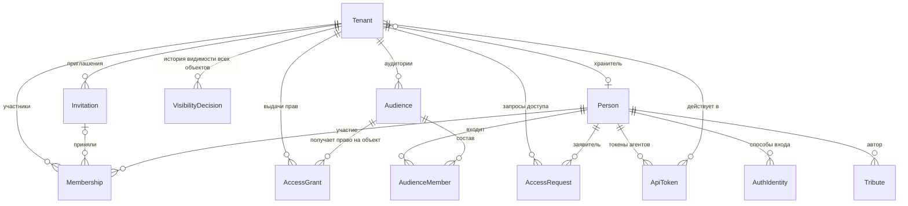

# Доменная модель: роли, доступ и вход

**Версия:** 0.1 (черновик)
**Дата:** 2026-10-27
**Выделено из:** `Main.md` — для обсуждения ролевой модели и авторизации

Рабочая выжимка: всё из `Main.md`, что касается людей, ролей, аудиторий, прав, видимости и входа, собрано в одном месте. Текст перенесён без изменений, номера разделов совпадают с `Main.md`, поэтому ссылки вида «раздел 8.1» ведут туда же. После обсуждения замечаний (раздел 13) изменения переносятся обратно в `Main.md`, и модели синхронизируются.

---

## 1. Обзор

### Служебные поля

Есть у каждой сущности модели. В таблицах ниже они сведены в одну строку.

| Атрибут | Описание |
|---|---|
| `version` | Номер версии записи, растёт при каждом изменении. Историю прежних значений не хранит |
| `createdAt`, `updatedAt` | Когда запись создана и когда изменена в последний раз |
| `createdByApiTokenId`, `updatedByApiTokenId` | Через какой токен агента сделано действие (`ApiToken`, раздел 3 основного документа); пусто, если человек действовал сам. Вместе с `…ByPersonId` дают «Агент Киры от имени Киры» |
| `createdByPersonId`, `updatedByPersonId` | Кто создал и кто изменил в последний раз. Ссылаются на `Person`; пусто, если действие выполнила система |
| `deletedAt` | Момент мягкого удаления, пусто, пока запись не удалена. Запись скрывается, но физически не стирается; оригиналы медиа не удаляются в любом случае (NFR по сохранности) |

---

## 2. Тенант и адресация

Поля `Tenant`, связанные с доступом:

| Атрибут | Описание |
|---|---|
| `accessContactPersonId` | Хранитель, к которому гостям закрытого мемориала обращаться за доступом. Только действующий владелец (`OWNER`) этого мемориала. Гостю показывается его публичный контакт (`Person.publicContact`), даже когда мемориал закрыт (раздел 8.3). Может отсутствовать. При отзыве участия этого человека поле очищается (**реализация — позже**) |
| `searchIndexing` | Разрешить поисковикам показывать мемориал. По умолчанию — нет: страницы отдаются с `noindex`. Меняет владелец. Это просьба к поисковикам, а не защита — доступ ограничивают аудитории |

### TenantHost

Хост, по которому мемориал доступен. Один тенант — несколько хостов: поддомен платформы (`vostok.<домен платформы>`) и собственные домены (`a-vostok.ru`).

| Атрибут | Описание |
|---|---|
| `host` | Нормализованное имя хоста, уникально по всей платформе |
| `tenantId` | |
| `isPrimary` | Используется для генерации абсолютных ссылок |
| `verifiedAt` | Момент подтверждения владения доменом |
| `version`, `createdAt`, `updatedAt`, `createdByPersonId`, `updatedByPersonId`, `createdByApiTokenId`, `updatedByApiTokenId`, `deletedAt` | Служебные поля, см. раздел 1 |

**Мемориал определяется по хосту запроса:**

- Хост из заголовка `Host` нормализуется — нижний регистр, без порта — и ищется точным совпадением среди `TenantHost.host`. Мемориал известен до любой проверки прав: авторизация и журналирование берут его из контекста запроса.
- Идентификатор мемориала никогда не принимается от клиента — ни параметром, ни заголовком: иначе клиент сам выбирает, чьи данные читать.
- Неизвестный хост — нейтральная страница платформы; мемориала «по умолчанию» нет.
- Перенаправление с неосновного хоста на основной (`isPrimary`) — по решению владельца, не по умолчанию.
- Cookie и сессии привязываются строго к хосту мемориала: `Domain` не задаётся. Cookie на родительском домене платформы уходила бы на все поддомены, и сессия одного мемориала утекала бы в другой. Настройки по умолчанию в ряде фреймворков ведут себя иначе — это легко упустить.
- Веб-клиент и API работают на одном хосте мемориала через обратный прокси: без CORS и с обычной передачей cookie.

---

## 3. Люди и доступ

### Person

Человек, авторизовавшийся на платформе. **Единственная сущность вне тенанта.**

Обоснование исключения из ADR-0001: один и тот же человек может быть родственником в нескольких мемориалах, и заводить ему отдельную учётную запись под каждый — значит требовать повторной авторизации на каждом мемориале. Изоляция при этом не страдает, поскольку любой доступ к данным тенанта идёт через `Membership`, который тенант-скоупный: сама по себе `Person` не даёт прав нигде.

| Атрибут | Описание |
|---|---|
| `id` | |
| `displayName` | Имя из профиля провайдера |
| `avatarUrl` | |
| `publicContact` | Публичный контакт: что человек сам решил показать — Telegram, телефон, почта, что угодно. Простой текст, может отсутствовать. Общий для всех мемориалов. Виден любому посетителю мемориала, где человек назначен хранителем (`Tenant.accessContactPersonId`), — даже без входа |
| `version`, `createdAt`, `updatedAt`, `createdByPersonId`, `updatedByPersonId`, `createdByApiTokenId`, `updatedByApiTokenId`, `deletedAt` | Служебные поля, см. раздел 1 |

### AuthIdentity

Способ входа. VK и Telegram — две записи одного вида.

| Атрибут | Описание |
|---|---|
| `personId` | |
| `provider` | `VK` / `TELEGRAM` |
| `externalId` | Идентификатор в системе провайдера |
| `linkedAt` | |
| `version`, `createdAt`, `updatedAt`, `createdByPersonId`, `updatedByPersonId`, `createdByApiTokenId`, `updatedByApiTokenId`, `deletedAt` | Служебные поля, см. раздел 1 |

Уникальность по паре (`provider`, `externalId`). Один человек может привязать несколько способов входа к одной учётной записи.

### ApiToken

Токен агента или MCP-сервера: секретный ключ, по которому программа обращается к API от имени человека. Выдаёт сам человек, в своём мемориале.

| Атрибут | Описание |
|---|---|
| `tenantId` | Мемориал, в котором действует токен |
| `personId` | От чьего имени действует |
| `title` | Имя, под которым действия видны в истории: «Агент Киры» |
| `tokenHash` | Хеш ключа; сам ключ показывается один раз при выдаче и не хранится |
| `expiresAt` | До какого момента действует |
| `revokedAt`, `revokedByPersonId` | Отзыв: человек или владелец мемориала может отозвать токен в любой момент |
| `lastUsedAt` | Когда токен использовался последний раз |
| `version`, `createdAt`, `updatedAt`, `createdByPersonId`, `updatedByPersonId`, `createdByApiTokenId`, `updatedByApiTokenId`, `deletedAt` | Служебные поля, см. раздел 1 |

**Права токена урезаны**: он может меньше, чем человек, который его выдал, и никогда больше.

- Может: читать то, что видит человек; загружать медиафайлы; создавать посты и контент там, куда человеку разрешено добавлять; менять и удалять то, что создал этот же токен.
- Не может: открывать контент другим — всё созданное токеном остаётся «Только владельцы», пока человек сам не откроет; менять аудитории, участников, права, настройки мемориала; трогать то, что создано не им.

Каждое действие токена записывается в служебные поля как «человек + токен» (`…ByPersonId` и `…ByApiTokenId`): в истории видно, что сделал агент, а что — человек сам.

### Вход через общий домен

VK и Telegram требуют заранее зарегистрировать адреса, на которых работает вход: Telegram — один домен на бота, VK — каждый адрес возврата. Мемориалов много, у части свои домены, поэтому вход идёт через один общий домен платформы (`auth.ochag.family`):

1. Гость на хосте мемориала нажимает «Войти» — его перенаправляют на общий домен.
2. Там он входит через VK или Telegram; общий домен помнит его своей сессией.
3. Его возвращают на хост мемориала с одноразовым кодом с коротким сроком жизни.
4. Мемориал обменивает код на свою сессию: cookie остаётся привязанной к хосту мемориала (раздел 2, `TenantHost`).

Войдя один раз, человек входит в другие мемориалы без повторного входа через VK или Telegram — достаточно перехода на общий домен и обратно.

### Membership

Роль человека в конкретном мемориале: что он может **делать**. Что он может **видеть**, определяют аудитории, в которые он входит (`Audience`). Тенант-скоупная сущность.

| Атрибут | Описание |
|---|---|
| `tenantId` | |
| `personId` | |
| `role` | `OWNER` — всё: наполнение, публикация, участники и аудитории; `MEMBER` — просмотр того, что открыто его аудиториям, и памятная книга |
| `grantedByPersonId` | Кто выдал |
| `grantedAt` | |
| `invitationId`, `accessRequestId` | Как человек попал в мемориал: по приглашению или по одобренной заявке. Пусто у создателя мемориала |
| `revokedAt`, `revokedByPersonId` | Отзыв доступа владельцем |
| `version`, `createdAt`, `updatedAt`, `createdByPersonId`, `updatedByPersonId`, `createdByApiTokenId`, `updatedByApiTokenId`, `deletedAt` | Служебные поля, см. раздел 1 |

Роль `GUEST` в модели отсутствует: гость — это отсутствие членства, а не запись о нём.

**Отзыв доступа.** Владелец отбирает доступ — человек сразу становится для мемориала гостем: его аудитории для него больше не действуют. Запись об участии не стирается, а помечается отозванной. Всё, что человек оставил, — записи памятной книги и добавленный контент — остаётся в мемориале. Позвать его снова — новое участие.

### Audience

Аудитория — группа людей внутри мемориала, которой открывают объекты: «Семья», «Друзья», «Одноклассники». Создают и меняют аудитории только владельцы. Тенант-скоупная сущность: аудитории одного мемориала не видны в другом.

| Атрибут | Описание |
|---|---|
| `tenantId` | |
| `title` | Название |
| `kind` | `SYSTEM` — есть у каждого мемориала, не удаляется и не редактируется; `CUSTOM` — создана владельцем |
| `systemCode` | Для системных: `EVERYONE` — все, включая неавторизованных; `MEMBERS` — все участники мемориала; `OWNERS` — только владельцы. Состав системных аудиторий вычисляется, а не хранится |
| `position` | Порядок в интерфейсе |
| `version`, `createdAt`, `updatedAt`, `createdByPersonId`, `updatedByPersonId`, `createdByApiTokenId`, `updatedByApiTokenId`, `deletedAt` | Служебные поля, см. раздел 1 |

Вместе с мемориалом создаются системные аудитории и две обычные — «Семья» и «Друзья»; их можно переименовать, удалить, добавить свои.

### AccessGrant

Выдача права: **кто** — **какое право** — **на что**. Единственное место, где хранится, кто что видит и может в мемориале, кроме роли владельца (`Membership.role`). Тенант-скоупная сущность. Выдают и отзывают только владельцы.

| Атрибут | Описание |
|---|---|
| `tenantId` | |
| `audienceId` | Кому: аудитория (раздел 3, `Audience`), в том числе системная — «Все», «Все участники», «Только владельцы» |
| `permission` | Какое право: `VIEW` / `CONTRIBUTE` / `DOWNLOAD_ORIGINALS` |
| `objectType`, `objectId` | На что: `TENANT` / `SECTION` / `ITEM` / `SUBJECT` / `APPEARANCE` / `TRIBUTE` / `MEDIA_ASSET` и идентификатор объекта |
| `version`, `createdAt`, `updatedAt`, `createdByPersonId`, `updatedByPersonId`, `createdByApiTokenId`, `updatedByApiTokenId`, `deletedAt` | Служебные поля, см. раздел 1 |

Уникальность по (`audienceId`, `permission`, `objectType`, `objectId`). Ссылка на объект — пара «тип и идентификатор»: её целостность проверяет приложение, а не внешний ключ БД — плата за одну таблицу на все права. Новое право — новое значение `permission`, а не новая сущность.

| Право | На что выдаётся | Что даёт |
|---|---|---|
| `VIEW` | мемориал, раздел, пост, человек, оформление, запись памятной книги | Видеть объект (раздел 8.1) |
| `CONTRIBUTE` | мемориал или раздел (с подразделами) | Добавлять посты и их контент |
| `DOWNLOAD_ORIGINALS` | мемориал или медиафайл | Скачивать оригиналы и видеть полные технические метаданные (раздел 8.2) |

Участник с правом `CONTRIBUTE`:

- добавляет посты и их контент в мемориал или разделы, на которые выдано право;
- добавленное сразу видно всем, кому открыт раздел: новый пост получает `VIEW` для «Всех», границу задают мемориал и разделы;
- может сам выбрать аудитории своего поста из аудиторий мемориала (например, только «Семья»): по правилу дверей это может лишь сузить круг, но не расширить его за пределы раздела;
- меняет и удаляет только своё (`createdByPersonId`), чужое — нет.

Владелец по-прежнему может всё, в том числе менять и скрывать добавленное участниками.

### AudienceMember

Кто входит в обычную аудиторию. Один человек может входить в несколько аудиторий.

| Атрибут | Описание |
|---|---|
| `tenantId`, `audienceId`, `personId` | |
| `version`, `createdAt`, `updatedAt`, `createdByPersonId`, `updatedByPersonId`, `createdByApiTokenId`, `updatedByApiTokenId`, `deletedAt` | Служебные поля, см. раздел 1 |

### AccessRequest

Запрос на участие в мемориале. Одобряя запрос, владелец выбирает аудитории, в которые войдёт человек.

| Атрибут | Описание |
|---|---|
| `tenantId`, `personId` | |
| `message` | Кем приходится, от заявителя |
| `status` | `PENDING` / `APPROVED` / `REJECTED` |
| `decidedByPersonId`, `decidedAt` | |
| `version`, `createdAt`, `updatedAt`, `createdByPersonId`, `updatedByPersonId`, `createdByApiTokenId`, `updatedByApiTokenId`, `deletedAt` | Служебные поля, см. раздел 1 |

### Invitation

Приглашение по ссылке. Владелец создаёт ссылку и отправляет её сам, например в мессенджер. Человек переходит по ней, входит через VK или Telegram и сразу становится участником — без одобрения.

Два способа попасть в мемориал дополняют друг друга: заявка (`AccessRequest`) — для незнакомых, приглашение — чтобы владелец быстро позвал своих.

| Атрибут | Описание |
|---|---|
| `tenantId` | |
| `tokenHash` | Хеш секрета из ссылки; сам секрет не хранится |
| `note` | Для кого или зачем: «двоюродные братья», «одноклассники» — видит только владелец |
| `audienceIds` | В какие аудитории войдёт принявший приглашение |
| `expiresAt` | До какого момента ссылка действует; пусто — бессрочно |
| `maxUses`, `usedCount` | Сколько человек может принять приглашение и сколько уже приняли; пусто в `maxUses` — без ограничения |
| `revokedAt`, `revokedByPersonId` | Отзыв ссылки владельцем |
| `version`, `createdAt`, `updatedAt`, `createdByPersonId`, `updatedByPersonId`, `createdByApiTokenId`, `updatedByApiTokenId`, `deletedAt` | Служебные поля, см. раздел 1 |

Приглашение даёт роль `MEMBER`. Приглашение в совладельцы — вместе с вопросом о преемственности (раздел 12).

---

## 4. Медиа

**Срок жизни временных ссылок.** Непубличные медиа отдаются по временным ссылкам после проверки роли. Для изображения это безразлично: файл загружается за секунды. Длинная запись, воспроизводимая дольше срока действия ссылки, прервётся на середине. Требуется срок с запасом либо обновление ссылки в процессе воспроизведения.

---

## 8. Видимость и её история

### 8.1 Аудитории и наследование

Видимость объекта — не уровень из фиксированной шкалы, а выдачи права `VIEW` (`AccessGrant`, раздел 3) аудиториям: кто его видит. Роли отвечают за действия, аудитории — за просмотр.

Видимость настраивается у всего, что видит посетитель: мемориала (`Tenant`), разделов (`Section`), постов (`Item`), людей (`Subject`), оформления (`TenantAppearance`), записей памятной книги (`Tribute`). Нет ни одной выдачи `VIEW` — объект видят только владельцы.

**Внутри объекта — объединение.** Объект видит каждый, кто входит хотя бы в одну из аудиторий с `VIEW` на него: пост для «Семьи» и «Друзей» видят и те, и другие.

**По цепочке — пересечение.** Видимость наследуется от родителя к ребёнку: чтобы увидеть объект, нужно пройти все звенья цепочки, как двери:

- посты — `Tenant` → `Section` → вложенные `Section` → `Item`; контент поста виден тем, кому виден пост, своей настройки у него нет;
- люди, оформление, памятная книга — `Tenant` → `Subject` / `TenantAppearance` / `Tribute`.

Пример: раздел открыт «Семье», пост в нём — «Семье» и «Друзьям». Пост видит только «Семья»: друзей не пропускает раздел. Если раздел открыт «Семье», а пост — только «Друзьям», пост видят лишь те, кто входит в обе аудитории. Когда звенья не пересекаются, интерфейс предупреждает владельца: «Это не увидит никто, кроме вас».

Владельцы видят всё всегда.

**По умолчанию** — какие выдачи создаются вместе с объектом:

| Объект | Выдачи `VIEW` при создании | Почему |
|---|---|---|
| Мемориал, раздел, пост владельца | нет — видят только владельцы | открытие всегда осознанное действие |
| Пост участника с правом `CONTRIBUTE` | «Все» | вклад сразу виден, границу задают мемориал и разделы |
| Человек, оформление | «Все» | их закрывает мемориал, пока он закрыт |
| Запись памятной книги | «Все»; аудитории выбирает автор (реализация — позже) | |

| Аудитория | Чем заменяет прежнюю шкалу |
|---|---|
| «Все» (`EVERYONE`) | `PUBLIC` |
| «Семья», «Друзья» | `FAMILY`, `FRIENDS` — теперь обычные аудитории, создаются вместе с мемориалом |
| «Только владельцы» (`OWNERS`) или отсутствие выдач | `DRAFT`: у поста — черновик, у мемориала — «полностью приватный» |

**Медиафайлы своей видимости не имеют**: файл виден тому, кто видит хотя бы одно место, где он используется, — пост (по всей его цепочке), обложку (`TenantAppearance`) или портрет (`Subject`). Файл, который нигде не используется, видят только владельцы.

### 8.2 Оригиналы медиафайлов

Оригинал (`MediaVariant.kind = ORIGINAL`) и полные технические метаданные (`MediaAsset.technicalMetadataJson`) — отдельное право, а не следствие просмотра: в метаданных бывают координаты съёмки, оригинал может весить десятки мегабайт.

- Кто может скачивать оригиналы — выдачи `DOWNLOAD_ORIGINALS` на мемориал и на медиафайл. Действуют обе: по пересечению, как в цепочке видимости. Нет выдач на мемориал — оригиналы скачивают только владельцы.
- Оригинал никогда не доступнее самого файла: скачать его может только тот, кто видит файл.
- Полные метаданные доступны тем же, кому доступен оригинал.

### 8.3 Закрытый мемориал

Если гость не входит ни в одну аудиторию с `VIEW` на мемориал, он видит не «не найдено», а страницу закрытого мемориала:

- название мемориала (`Tenant.title`);
- сообщение: «Мемориал закрыт настройками приватности. Для получения доступа обратитесь к хранителю мемориала»;
- контакт хранителя — публичный контакт (`Person.publicContact`) человека из `Tenant.accessContactPersonId`, если хранитель назначен и контакт заполнен;
- кнопку «Запросить доступ»: гость входит через VK или Telegram и оставляет заявку (`AccessRequest`), владелец её одобряет и выбирает аудитории.

Название и контакт — единственное, что закрытый мемориал раскрывает посторонним. Хранитель мемориала — его владелец (`OWNER`).

### 8.4 VisibilityDecision

Решение о видимости фиксируется как событие, а не как перезапись поля. История ведётся для каждого объекта с настройкой видимости: мемориала, разделов, постов, контента, людей, оформления, записей памятной книги, а также для доступа к оригиналам.

**Реализация — позже**: сначала видимость работает без истории.

| Атрибут | Описание |
|---|---|
| `tenantId` | |
| `objectType`, `objectId` | Чья видимость изменилась: `TENANT` / `SECTION` / `ITEM` / `SUBJECT` / `APPEARANCE` / `TRIBUTE`, для оригиналов — `TENANT_ORIGINALS` / `MEDIA_ORIGINALS` |
| `fromAudiences`, `toAudiences` | Наборы аудиторий до и после |
| `decidedByPersonId`, `decidedAt` | |
| `note` | Пояснение, если нужно |
| `version`, `createdAt`, `updatedAt`, `createdByPersonId`, `updatedByPersonId`, `createdByApiTokenId`, `updatedByApiTokenId`, `deletedAt` | Служебные поля, см. раздел 1 |

Текущие права хранятся в выдачах (`AccessGrant`); `VisibilityDecision` даёт историю. Ссылка на объект — пара «тип и идентификатор»: целостность такой ссылки проверяет приложение, а не внешний ключ БД — плата за одну историю на все виды объектов. Механизм согласования между родственниками надстраивается поверх этой истории без изменения структуры.

---

## 9. Памятная книга

### Tribute

Воспоминание, оставленное родственником. Не является `Content`: автор — не владелец мемориала, набор атрибутов и правила публикации другие.

| Атрибут | Описание |
|---|---|
| `tenantId` | |
| `authorPersonId` | |
| `body` | Текст воспоминания |
| `status` | `PUBLISHED` / `HIDDEN` |
| `version`, `createdAt`, `updatedAt`, `createdByPersonId`, `updatedByPersonId`, `createdByApiTokenId`, `updatedByApiTokenId`, `deletedAt` | Служебные поля, см. раздел 1 |

Кому видна запись, решает её автор (**реализация — позже**: сначала записи видны всем, кому виден мемориал). Владелец может скрыть любую запись (`HIDDEN`). Удаление не предусмотрено: `HIDDEN` сохраняет запись.

---

## 10. Принятые решения по модели

| Вопрос | Решение |
|---|---|
| Роли и видимость | Разделены: роль (`Membership.role`: `OWNER` / `MEMBER`) — что человек может делать; аудитории (`Audience`) — что он видит. Роли «соавтор» нет: добавлять контент владелец разрешает аудиториям (`AccessGrant`, право `CONTRIBUTE`) |
| Выдачи прав | Одна сущность `AccessGrant` «аудитория — право — объект» для видимости (`VIEW`), добавления контента (`CONTRIBUTE`) и оригиналов (`DOWNLOAD_ORIGINALS`) |
| Аудитории | Создают только владельцы, внутри мемориала; «Семья» и «Друзья» создаются вместе с мемориалом; у объекта может быть несколько аудиторий |
| Наследование видимости | Внутри объекта — объединение аудиторий, по цепочке родителей — пересечение |
| Поисковики | `Tenant.searchIndexing`, по умолчанию мемориал не индексируется (`noindex`) |
| Аудитории по умолчанию | Без выдач `VIEW` (видят только владельцы) у мемориала, раздела и поста — открытие всегда осознанное действие; «Все» у людей и оформления — их закрывает мемориал |
| Видимость поста | Одна настройка на весь пост (`Item`), по умолчанию «Только владельцы»; у единиц контента своей настройки нет |
| Видимость медиафайла | Своей нет: виден тому, кто видит хотя бы одно место его использования; неиспользуемый — только владельцам |
| Видимость памятной книги | Аудитории записи выбирает её автор, по умолчанию «Все»; владелец может скрыть запись |
| Как попасть в мемориал | Заявка (`AccessRequest`), которую одобряет владелец, или приглашение по ссылке (`Invitation`) без одобрения |
| Отзыв доступа | Доступ отбирается сразу, участие помечается отозванным; оставленное человеком остаётся |
| Добавление контента участниками | Право выдаётся аудитории на мемориал или раздел (с подразделами); добавленное сразу видно, автор может сузить круг; менять и удалять можно только своё |
| Способы входа | Только VK и Telegram (`AuthIdentity.provider`), через общий домен входа с передачей сессии на хост мемориала |
| Агенты и MCP | `ApiToken` от имени человека, с урезанными правами: добавляет черновики, не публикует и не управляет; действия помечаются токеном |
| Закрытый мемориал | Гость видит название, сообщение о закрытости, контакт хранителя и «Запросить доступ» (раздел 8.3) |
| Контакт хранителя | Ссылка на человека (`Tenant.accessContactPersonId`), только действующий владелец; сам контакт — `Person.publicContact`, свободный текст, общий для всех мемориалов |

---

## 11. Соответствие принятым решениям

| Решение | Как отражено |
|---|---|
| ADR-0001: `tenant_id` везде | Все сущности тенант-скоупные, кроме `Person` и `AuthIdentity` — исключение обосновано в разделе 3 |
| Публикация — осознанное действие | Новый пост владельца создаётся без выдач `VIEW` |
| История решений о видимости | `VisibilityDecision` для всех объектов с настройкой видимости; реализация — позже |

---

## 12. Открытые вопросы

| # | Вопрос | Блокирует |
|---|---|---|
| 7 | Преемственность: мемориал живёт десятилетиями, а владелец может пропасть. Несколько владельцев, передача владения, наследник — чтобы мемориал не «осиротел» | `Membership`, раздел 3 |
| 10 | Администрирование платформы: кто создаёт и приостанавливает мемориалы (`Tenant.status`), назначает первого владельца, подключает и подтверждает домены (`TenantHost.verifiedAt`); видит ли администратор содержимое закрытых мемориалов. **Отложено** вместе с админской частью; пока мемориалы создаются SQL-запросом | `Tenant`, `TenantHost` |

---

## 13. Замечания к разбору

Найдены при сравнении модели с принятой практикой аутентификации и авторизации (OAuth 2.0 Security BCP, OWASP ASVS). Статус каждого — «на обсуждение»; принятые решения переносятся в разделы выше и в `Main.md`.

### 13.1 Безопасность входа

1. **Возврат с общего домена на мемориал не защищён.** Шаги 1–4 раздела «Вход через общий домен» не говорят, куда можно вернуть человека с кодом. Нужно: возврат только на хосты из `TenantHost`; код одноразовый, живёт не дольше минуты и годится только для хоста, которому выдан; код меняется на сессию сервером, а не браузером; `state` и PKCE на каждом шаге.
2. **Сессии не описаны.** Раздел 2 задаёт только привязку cookie к хосту. Не хватает: сессия на сервере, в cookie — случайный идентификатор, в БД — его хеш; сроки по бездействию и абсолютный; новый идентификатор после входа; флаги `HttpOnly; Secure; SameSite=Lax`, префикс `__Host-`; что делает «Выйти» — один мемориал, все мемориалы, все устройства.
3. **«Отзыв сразу» и права в токене.** Если роли и аудитории положить в токен (JWT), отзыв сработает только после его истечения. В токене — только «кто это»; роли и аудитории проверяются на каждом запросе по БД, кэш сбрасывается при изменении. Принятый риск: выданная временная ссылка на файл работает до конца своего срока и после отзыва.
4. **Привязка второго способа входа.** Только из своей открытой сессии и через повторный вход новым провайдером; никогда не склеивать учётные записи по совпадению имени; решить, что делать, если этот способ уже привязан к другому `Person` (запрет или слияние); нельзя отвязать последний способ входа.
5. **Мемориал без владельца.** Ничто не мешает отозвать последнего `OWNER`. Нужно правило «всегда есть хотя бы один активный владелец» (связано с вопросом 7).

### 13.2 Пробелы в правилах доступа

6. **Автор не видит своё.** Владельцы видят всё, участник — нет: свой пост, сужённый до аудитории, куда он сам не входит; пост своего токена («Только владельцы»); свой загруженный, но не прикреплённый медиафайл. Нужно правило «автор видит созданное им».
7. **Правила сочетания прав разные и записаны не все.** `VIEW` — пересечение по цепочке; `DOWNLOAD_ORIGINALS` — пересечение «мемориал и файл»; `CONTRIBUTE` на раздел действует на подразделы, то есть наследуется вниз. Нужно ли для `CONTRIBUTE` видеть раздел — не сказано. Свести в одну таблицу.
8. **Выдача `DOWNLOAD_ORIGINALS` на файл по умолчанию не задана.** Если её нет, владельцу придётся открывать оригиналы каждого файла вручную.
9. **Что нельзя выдавать «Всем».** Не запрещено выдать `CONTRIBUTE` и `DOWNLOAD_ORIGINALS` аудитории «Все», то есть людям без входа.
10. **Кто пишет в памятную книгу — права нет.** У `MEMBER` написано «памятная книга»; может ли гость — не сказано.
11. **Кто видит людей.** Не описано, кому видны список участников, состав аудиторий, имя и аватар автора записи.
12. **Скрытое — 404, а не 403.** Пост или раздел, который человек не видит, не должен выдавать своё существование. Сейчас 404 записан только для чужого тенанта.

### 13.3 Несогласованности

13. **`AudienceMember` ссылается на `Person`, а не на `Membership`.** После отзыва записи в аудиториях остаются, при повторном приглашении старые аудитории «оживают»; в аудиторию можно добавить человека без участия. Лучше ссылка на `membershipId` и название `AudienceMembership` — в пару к `Membership`.
14. **`Invitation.audienceIds` — список внутри записи.** При удалении аудитории ссылки повиснут. Лучше отдельная таблица.
15. **Две отметки окончания.** У `Membership`, `Invitation`, `ApiToken` есть и `revokedAt`, и `deletedAt`; `grantedByPersonId`/`grantedAt` дублируют `createdByPersonId`/`createdAt`. Решить, что что значит.
16. **Мягкое удаление и уникальность.** Уникальность `AccessGrant`, (`provider`, `externalId`) у `AuthIdentity` и участия — только среди неудалённых записей, иначе нельзя выдать то же заново.
17. **`ApiToken`.** Не сказано, что токен перестаёт действовать при отзыве участия; видит ли он оригиналы; раздел 10 («добавляет черновики») и раздел 3 расходятся в формулировках.
18. **Мелкие противоречия.** 8.4 перечисляет историю видимости «контента», а своей видимости у контента нет; `Person` названа «единственной сущностью вне тенанта», а в разделе 11 вне тенанта две — `Person` и `AuthIdentity`.
19. **Домен.** `auth.ochag.family`, `vostok.ochag.family` → `у-истока.рф`; `TenantHost.host` для кириллических доменов хранить в punycode.

### 13.4 Чего нет по сравнению с практикой

20. **Журнал безопасности:** входы, выдача и отзыв участия, ролей, аудиторий, прав, токенов. Служебные поля помнят только последнее изменение, `VisibilityDecision` — только видимость.
21. **Персональные данные (152-ФЗ):** запись согласия (когда и на какую версию политики); удаление аккаунта по просьбе человека — что становится с его записями памятной книги и постами (обезличивание).
22. **Восстановление доступа.** Потерял VK — потерял всё. Для владельцев — второй способ входа или процедура через администратора (вопрос 10).
23. **Злоупотребления.** Один ожидающий запрос доступа на человека, ограничение частоты; приглашение по умолчанию бессрочное и без лимита — лучше срок по умолчанию.
24. **Где что живёт при отдельном сервисе входа.** Предложение: `Person`, `AuthIdentity` и сессии — в сервисе входа; `Membership`, `Audience`, `AccessGrant`, `ApiToken` — в gefest, под RLS. Не записано.
