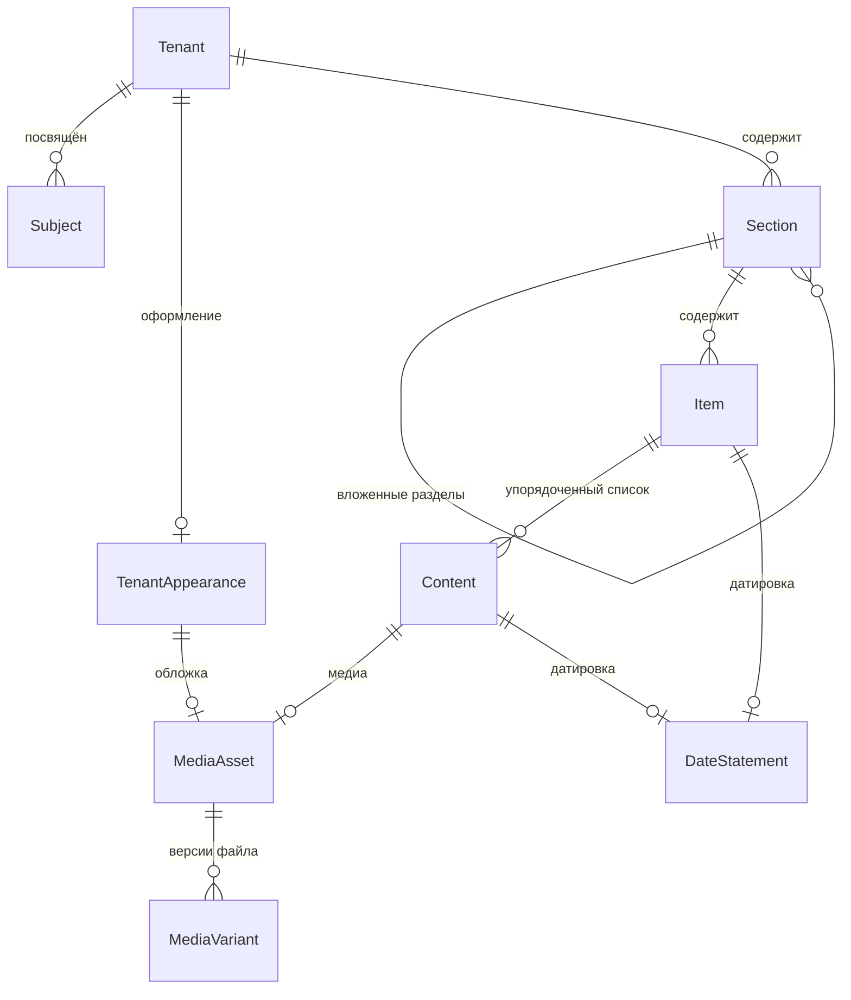

# Доменная модель: контент платформы «Очаг»

**Версия:** 0.1 (черновик)
**Дата:** 2026-10-17
**Выделено из:** доменная модель v0.1
**Основано на:** scope v0.4, ADR-0001 (мультитенантность)

Здесь описана часть модели, связанная с контентом: тенант, субъект и оформление мемориала, разделы, единицы контента, медиа и датировка. Хосты, люди и доступ (`Person`, `Membership`, `AccessRequest`) и памятная книга остаются в основном документе.

Модель концептуальная: сущности, атрибуты и связи предметной области. Типы полей, индексы и внешние ключи определяются позже, при проектировании схемы БД.

---

## 1. Обзор

### Служебные поля

Есть у каждой сущности этого документа. В таблицах ниже они сведены в одну строку.

| Атрибут | Описание |
|---|---|
| `version` | Номер версии записи, растёт при каждом изменении. Историю прежних значений не хранит |
| `createdAt`, `updatedAt` | Когда запись создана и когда изменена в последний раз |
| `createdByPersonId`, `updatedByPersonId` | Кто создал и кто изменил в последний раз. Ссылаются на `Person` из основного документа; пусто, если действие выполнила система |
| `deletedAt` | Момент мягкого удаления, пусто, пока запись не удалена. Запись скрывается, но физически не стирается; оригиналы медиа не удаляются в любом случае (NFR по сохранности) |

---

## 2. Тенант

### Tenant

Один мемориал. Корневая сущность изоляции: почти всё остальное принадлежит тенанту.

| Атрибут | Описание |
|---|---|
| `id` | Идентификатор |
| `slug` | Короткое имя, используется в поддомене (`vostok` → `vostok.ochag.family`). Уникально по платформе. Меняет владелец; хосты (`TenantHost`) при этом не меняются |
| `title` | Отображаемое название мемориала. Меняет владелец |
| `type` | Вид мемориала: `PERSON` — посвящён одному человеку, `FAMILY` — семейный архив. Определяет, сколько может быть `Subject` и что в шапке (см. ниже). Меняет владелец |
| `status` | Активен / приостановлен |
| `version`, `createdAt`, `updatedAt`, `createdByPersonId`, `updatedByPersonId`, `deletedAt` | Служебные поля, см. раздел 1 |

Вид мемориала задаётся явно, а не выводится из числа людей: семейный архив, где пока заведён один человек, остаётся семейным.

| `type` | Люди (`Subject`) | Шапка |
|---|---|---|
| `PERSON` | Не больше одного | Имя и годы жизни человека; пока человек не заведён — `title` |
| `FAMILY` | Сколько угодно | `title` («Семья Петровых») |

Перевести `FAMILY` в `PERSON`, когда людей двое и больше, нельзя.

### Subject

Человек, которому посвящён мемориал. Вынесен из `Tenant` отдельной сущностью: мемориал может быть посвящён нескольким людям (семейный архив), и сведения о человеке — это данные предметной области, а не настройки тенанта.

| Атрибут | Описание |
|---|---|
| `tenantId` | |
| `fullName` | |
| `bornOn`, `diedOn` | Даты жизни. Могут быть неполными — используется структура датировки из раздела 4 |
| `shortBio` | Краткая справка. HTML по тому же белому списку тегов, что текст стихов и записей блога. Может отсутствовать |
| `portraitMediaAssetId` | Портрет для шапки мемориала |
| `position` | Порядок, если субъектов несколько |
| `version`, `createdAt`, `updatedAt`, `createdByPersonId`, `updatedByPersonId`, `deletedAt` | Служебные поля, см. раздел 1 |

### TenantAppearance

Оформление мемориала: тема и обложка — изображение в полосе под шапкой. Один к одному с `Tenant`, но отдельной сущностью: `Tenant` — идентичность и изоляция, по нему определяется мемориал на каждом запросе; оформление меняется по другим причинам и в другое время, со своей версией. Запись есть у каждого мемориала: создаётся вместе с ним — тема по умолчанию `MINIMAL`, без обложки.

| Атрибут | Описание |
|---|---|
| `tenantId` | Мемориал; один к одному |
| `theme` | Готовая тема оформления из списка платформы; пока одна — `MINIMAL`. Цвета, шрифты и отступы темы определяет клиент; хранится только её имя |
| `coverMediaAssetId` | Изображение обложки — `MediaAsset` типа `IMAGE`. Пусто — обложки нет |
| `coverCaption` | Подпись к обложке: автор, название, год («Н. К. Рерих. „Гэсэр-хан“, 1941»). Для чужого произведения обязательна — право авторства |
| `coverCropDesktop` | Кадр обложки на широком экране: прямоугольник `x`, `y`, `width`, `height` в долях от размеров оригинала (0–1), не выходит за изображение: `x + width ≤ 1`, `y + height ≤ 1`. Пусто — изображение целиком |
| `coverCropPhone` | Кадр обложки на телефоне, в тех же долях |
| `version`, `createdAt`, `updatedAt`, `createdByPersonId`, `updatedByPersonId`, `deletedAt` | Служебные поля, см. раздел 1 |

Кадр хранится в долях, а не в пикселях: при замене оригинала сканом крупнее он не сбивается. Клиент обрезает изображение по кадру сам — производные версии для обложки не нужны.

Темы — закрытый список, а не произвольные цвета: каждая тема проверяется на читаемость и контраст.

---

## 3. Контент

### Section

Раздел мемориала. Сущность, а не константа в коде — у разных мемориалов разный состав разделов, и добавление нового типа контента не должно требовать миграции.

| Атрибут | Описание |
|---|---|
| `tenantId` | |
| `parentSectionId` | Родительский раздел. Пусто у раздела верхнего уровня |
| `slug` | Часть URL раздела, уникален в пределах родителя |
| `title` | «Стихи», «Фотографии», «О нём» |
| `description` | Описание раздела — несколько абзацев о том, что в нём собрано. HTML по тому же белому списку тегов, что текст стихов и записей блога. Может отсутствовать |
| `visibility` | Видимость раздела целиком |
| `position` | Порядок отображения среди разделов одного родителя |
| `layout` | Вид списка элементов: `LIST` / `GRID` / `CONTINUOUS` |
| `defaultOrdering` | Порядок элементов по умолчанию: `MANUAL` / `DATE_ASC` / `DATE_DESC` / `TITLE` |
| `version`, `createdAt`, `updatedAt`, `createdByPersonId`, `updatedByPersonId`, `deletedAt` | Служебные поля, см. раздел 1 |

Раздел не ограничивает тип контента: в одном разделе могут лежать элементы разных типов (фото, стихи, аудио). Четыре раздела первого мемориала — четыре записи; два раздела с фотографиями (снимки автора и снимки с ним) различаются принадлежностью к разным разделам, а не отдельным типом сущности.

Разделы образуют дерево: раздел с `parentSectionId` — вложенная страница со своим адресом (например, «О путешествиях» внутри «О нём»).

### Item

Контейнер для списка единиц контента разных видов: запись, аудио, видео, фото, текст идут подряд, порядок задаёт `Content.position`. Лежит в разделе.

| Атрибут | Описание |
|---|---|
| `sectionId` | |
| `slug` | Часть URL, уникален в пределах раздела |
| `title` | Заголовок |
| `dateStatementId` | Ссылка на `DateStatement` (см. раздел 4) |
| `position` | Порядок отображения среди элементов одного раздела |
| `version`, `createdAt`, `updatedAt`, `createdByPersonId`, `updatedByPersonId`, `deletedAt` | Служебные поля, см. раздел 1 |

### Content

Единица контента внутри `Item`. Общий тип для всех видов контента — обеспечивает требование расширяемости из scope: видимость и API работают с `Content`, а не с четырьмя параллельными сущностями.

**Общие атрибуты:**

| Атрибут | Описание |
|---|---|
| `itemId` | `Item`, в список которого входит единица контента |
| `type` | Дискриминатор: `POEM` / `PHOTO` / `BLOG_ENTRY` / `AUDIO` / `VIDEO` |
| `title` | Может отсутствовать (безымянное стихотворение, фото) |
| `description` | Комментарий владельца |
| `visibility` | `PUBLIC` / `FAMILY` / `DRAFT`, по умолчанию `DRAFT` |
| `dateStatementId` | Ссылка на `DateStatement` (см. раздел 4) |
| `position` | Порядковый номер внутри `Item` |
| `version`, `createdAt`, `updatedAt`, `createdByPersonId`, `updatedByPersonId`, `deletedAt` | Служебные поля, см. раздел 1 |

**Специфичные атрибуты по типам** (в БД — отдельные таблицы, связанные с таблицей общих полей: наследование joined):

| Тип | Атрибуты |
|---|---|
| `POEM` | `body` (текст), `firstLine` (для списков, если нет названия) |
| `BLOG_ENTRY` | `body`, `sourceUrl` (откуда перенесено), `publishedAt` (исходная дата публикации) |
| `PHOTO` | `mediaAssetId`, `capturedAt`, `place` |
| `AUDIO` | `mediaAssetId`, `recordedAt`, `place` |
| `VIDEO` | `mediaAssetId`, `recordedAt`, `place` |

### MediaAsset и MediaVariant

Файл и его версии. Разделены, поскольку у одного оригинала несколько производных.

**MediaAsset:**

| Атрибут | Описание |
|---|---|
| `tenantId` | |
| `mediaType` | `IMAGE` / `AUDIO` / `VIDEO` |
| `originalFilename` | |
| `contentHash` | Хеш содержимого — основа идемпотентности при повторном добавлении |
| `recordedAt` | Дата из технических метаданных, если есть |
| `durationSeconds` | Только для аудио и видео |
| `technicalMetadataJson` | Исходные метаданные целиком, как есть: EXIF для изображений, контейнер и кодеки для аудио и видео |
| `version`, `createdAt`, `updatedAt`, `createdByPersonId`, `updatedByPersonId`, `deletedAt` | Служебные поля, см. раздел 1 |

**MediaVariant:**

| Атрибут | Описание |
|---|---|
| `mediaAssetId` | |
| `kind` | `ORIGINAL` / `WEB` / `THUMBNAIL` / `POSTER` |
| `storageKey` | Ключ объекта в хранилище |
| `width`, `height`, `sizeBytes`, `mimeType` | Размеры — только для визуальных вариантов |
| `bitrate`, `codec` | Только для аудио и видео |
| `version`, `createdAt`, `updatedAt`, `createdByPersonId`, `updatedByPersonId`, `deletedAt` | Служебные поля, см. раздел 1 |

Назначение вариантов по типам:

| Тип | `ORIGINAL` | `WEB` | `THUMBNAIL` | `POSTER` |
|---|---|---|---|---|
| `IMAGE` | исходный файл | версия для страницы | миниатюра для списка | — |
| `AUDIO` | исходная запись | воспроизводимая версия | — | обложка, если есть |
| `VIDEO` | исходная запись | воспроизводимая версия | миниатюра для списка | кадр-заставка |

Оригинал никогда не удаляется (NFR по сохранности). Производные версии могут быть пересозданы.

---

## 4. Датировка

### DateStatement

Датировка как отдельная сущность. На неё ссылаются `Item` и `Content` через `dateStatementId`. Каждая запись принадлежит ровно одному владельцу и не разделяется между сущностями.

| Атрибут | Описание |
|---|---|
| `dateFrom`, `dateTo` | Границы интервала. Для точной даты совпадают |
| `precision` | `DAY` / `MONTH` / `YEAR` / `DECADE` / `UNKNOWN` |
| `displayText` | Как показывать: «1975», «конец 1970-х», «около 1980» |
| `version`, `createdAt`, `updatedAt`, `createdByPersonId`, `updatedByPersonId`, `deletedAt` | Служебные поля, см. раздел 1 |