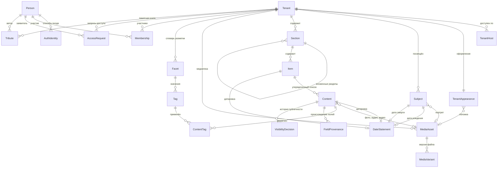

# Доменная модель: платформа «Очаг»

**Версия:** 0.1 (черновик)
**Дата:** 2026-10-23
**Основано на:** ADR-0001 (мультитенантность), ADR-0002 (резолвинг по хосту), ADR-0003 (фасетная разметка)

Модель концептуальная: сущности, атрибуты и связи предметной области. Типы полей, индексы и внешние ключи определяются позже, при проектировании схемы БД.

---

## 1. Обзор

### Служебные поля

Есть у каждой сущности модели. В таблицах ниже они сведены в одну строку.

| Атрибут | Описание |
|---|---|
| `version` | Номер версии записи, растёт при каждом изменении. Историю прежних значений не хранит |
| `createdAt`, `updatedAt` | Когда запись создана и когда изменена в последний раз |
| `createdByPersonId`, `updatedByPersonId` | Кто создал и кто изменил в последний раз. Ссылаются на `Person`; пусто, если действие выполнила система |
| `deletedAt` | Момент мягкого удаления, пусто, пока запись не удалена. Запись скрывается, но физически не стирается; оригиналы медиа не удаляются в любом случае (NFR по сохранности) |

---

## 2. Тенант и адресация

### Tenant

Один мемориал. Корневая сущность изоляции: почти всё остальное принадлежит тенанту.

| Атрибут | Описание |
|---|---|
| `id` | Идентификатор |
| `slug` | Короткое имя, используется в поддомене (`vostok` → `vostok.ochag.family`). Уникально по платформе. Меняет владелец; хосты (`TenantHost`) при этом не меняются |
| `title` | Отображаемое название мемориала. Меняет владелец |
| `type` | Вид мемориала: `PERSON` — посвящён одному человеку, `FAMILY` — семейный архив. Определяет, сколько может быть `Subject` и что в шапке (см. ниже). Меняет владелец |
| `status` | Активен / приостановлен |
| `version`, `createdAt`, `updatedAt`, `createdByPersonId`, `updatedByPersonId`, `deletedAt` | Служебные поля, см. раздел 1 |

Вид мемориала задаётся явно, а не выводится из числа людей: семейный архив, где пока заведён один человек, остаётся семейным.

| `type` | Люди (`Subject`) | Шапка |
|---|---|---|
| `PERSON` | Не больше одного | Имя и годы жизни человека; пока человек не заведён — `title` |
| `FAMILY` | Сколько угодно | `title` («Семья Петровых») |

Перевести `FAMILY` в `PERSON`, когда людей двое и больше, нельзя.

### Subject

Человек, которому посвящён мемориал. Вынесен из `Tenant` отдельной сущностью: мемориал может быть посвящён нескольким людям (семейный архив), и сведения о человеке — это данные предметной области, а не настройки тенанта.

| Атрибут | Описание |
|---|---|
| `tenantId` | |
| `fullName` | |
| `bornOn`, `diedOn` | Даты жизни. Могут быть неполными — используется структура датировки из раздела 5 |
| `shortBio` | Краткая справка. HTML по тому же белому списку тегов, что текст стихов и записей блога. Может отсутствовать |
| `portraitMediaAssetId` | Портрет для шапки мемориала |
| `position` | Порядок, если субъектов несколько |
| `version`, `createdAt`, `updatedAt`, `createdByPersonId`, `updatedByPersonId`, `deletedAt` | Служебные поля, см. раздел 1 |

### TenantAppearance

Оформление мемориала: тема и обложка — изображение в полосе под шапкой. Один к одному с `Tenant`, но отдельной сущностью: `Tenant` — идентичность и изоляция, по нему определяется мемориал на каждом запросе; оформление меняется по другим причинам и в другое время, со своей версией. Запись есть у каждого мемориала: создаётся вместе с ним — тема по умолчанию `MINIMAL`, без обложки.

| Атрибут | Описание |
|---|---|
| `tenantId` | Мемориал; один к одному |
| `theme` | Готовая тема оформления из списка платформы; пока одна — `MINIMAL`. Цвета, шрифты и отступы темы определяет клиент; хранится только её имя |
| `coverMediaAssetId` | Изображение обложки — `MediaAsset` типа `IMAGE`. Пусто — обложки нет |
| `coverCaption` | Подпись к обложке: автор, название, год («Н. К. Рерих. „Гэсэр-хан“, 1941»). Для чужого произведения обязательна — право авторства |
| `coverCropDesktop` | Кадр обложки на широком экране: прямоугольник `x`, `y`, `width`, `height` в долях от размеров оригинала (0–1), не выходит за изображение: `x + width ≤ 1`, `y + height ≤ 1`. Пусто — изображение целиком |
| `coverCropPhone` | Кадр обложки на телефоне, в тех же долях |
| `version`, `createdAt`, `updatedAt`, `createdByPersonId`, `updatedByPersonId`, `deletedAt` | Служебные поля, см. раздел 1 |

Кадр хранится в долях, а не в пикселях: при замене оригинала сканом крупнее он не сбивается. Клиент обрезает изображение по кадру сам — производные версии для обложки не нужны.

Темы — закрытый список, а не произвольные цвета: каждая тема проверяется на читаемость и контраст.

### TenantHost

Хост, по которому мемориал доступен. Один тенант — несколько хостов (поддомен платформы плюс кастомные домены). Основа резолвинга из ADR-0002.

| Атрибут | Описание |
|---|---|
| `host` | Нормализованное имя хоста, уникально по всей платформе |
| `tenantId` | |
| `isPrimary` | Используется для генерации абсолютных ссылок |
| `verifiedAt` | Момент подтверждения владения доменом |
| `version`, `createdAt`, `updatedAt`, `createdByPersonId`, `updatedByPersonId`, `deletedAt` | Служебные поля, см. раздел 1 |

---

## 3. Люди и доступ

### Person

Человек, авторизовавшийся на платформе. **Единственная сущность вне тенанта.**

Обоснование исключения из ADR-0001: один и тот же человек может быть родственником в нескольких мемориалах, и заводить ему отдельную учётную запись под каждый — значит требовать повторной авторизации на каждом мемориале. Изоляция при этом не страдает, поскольку любой доступ к данным тенанта идёт через `Membership`, который тенант-скоупный: сама по себе `Person` не даёт прав нигде.

| Атрибут | Описание |
|---|---|
| `id` | |
| `displayName` | Имя из профиля провайдера |
| `avatarUrl` | |
| `version`, `createdAt`, `updatedAt`, `createdByPersonId`, `updatedByPersonId`, `deletedAt` | Служебные поля, см. раздел 1 |

### AuthIdentity

Способ входа. VK и Telegram — две записи одного вида.

| Атрибут | Описание |
|---|---|
| `personId` | |
| `provider` | `VK` / `TELEGRAM` |
| `externalId` | Идентификатор в системе провайдера |
| `linkedAt` | |
| `version`, `createdAt`, `updatedAt`, `createdByPersonId`, `updatedByPersonId`, `deletedAt` | Служебные поля, см. раздел 1 |

Уникальность по паре (`provider`, `externalId`). Один человек может привязать несколько способов входа к одной учётной записи.

### Membership

Роль человека в конкретном мемориале. Тенант-скоупная сущность.

| Атрибут | Описание |
|---|---|
| `tenantId` | |
| `personId` | |
| `role` | `OWNER` / `RELATIVE` |
| `grantedByPersonId` | Кто выдал |
| `grantedAt` | |
| `version`, `createdAt`, `updatedAt`, `createdByPersonId`, `updatedByPersonId`, `deletedAt` | Служебные поля, см. раздел 1 |

Роль `GUEST` в модели отсутствует: гость — это отсутствие членства, а не запись о нём.

### AccessRequest

Запрос на получение роли родственника.

| Атрибут | Описание |
|---|---|
| `tenantId`, `personId` | |
| `message` | Кем приходится, от заявителя |
| `status` | `PENDING` / `APPROVED` / `REJECTED` |
| `decidedByPersonId`, `decidedAt` | |
| `version`, `createdAt`, `updatedAt`, `createdByPersonId`, `updatedByPersonId`, `deletedAt` | Служебные поля, см. раздел 1 |

---

## 4. Контент

### Section

Раздел мемориала. Сущность, а не константа в коде — у разных мемориалов разный состав разделов, и добавление нового типа контента не должно требовать миграции.

| Атрибут | Описание |
|---|---|
| `tenantId` | |
| `parentSectionId` | Родительский раздел. Пусто у раздела верхнего уровня |
| `slug` | Часть URL раздела, уникален в пределах родителя |
| `title` | «Стихи», «Фотографии», «О нём» |
| `description` | Описание раздела — несколько абзацев о том, что в нём собрано. HTML по тому же белому списку тегов, что текст стихов и записей блога. Может отсутствовать |
| `visibility` | Видимость раздела целиком |
| `position` | Порядок отображения среди разделов одного родителя |
| `layout` | Вид списка элементов: `LIST` / `GRID` / `CONTINUOUS` |
| `defaultOrdering` | Порядок элементов по умолчанию: `MANUAL` / `DATE_ASC` / `DATE_DESC` / `TITLE` |
| `version`, `createdAt`, `updatedAt`, `createdByPersonId`, `updatedByPersonId`, `deletedAt` | Служебные поля, см. раздел 1 |

Раздел не ограничивает тип контента: в одном разделе могут лежать элементы разных типов (фото, стихи, аудио). Четыре раздела первого мемориала — четыре записи; два раздела с фотографиями (снимки автора и снимки с ним) различаются принадлежностью к разным разделам, а не отдельным типом сущности.

Разделы образуют дерево: раздел с `parentSectionId` — вложенная страница со своим адресом (например, «О путешествиях» внутри «О нём»). Способ сгруппировать список без отдельной страницы остаётся за фасетами из ADR-0003.

### Item

Контейнер для списка единиц контента разных видов: запись, аудио, видео, фото, текст идут подряд, порядок задаёт `Content.position`. Лежит в разделе.

| Атрибут | Описание |
|---|---|
| `sectionId` | |
| `slug` | Часть URL, уникален в пределах раздела |
| `title` | Заголовок |
| `dateStatementId` | Ссылка на `DateStatement` (см. раздел 5) |
| `position` | Порядок отображения среди элементов одного раздела |
| `version`, `createdAt`, `updatedAt`, `createdByPersonId`, `updatedByPersonId`, `deletedAt` | Служебные поля, см. раздел 1 |

### Content

Единица контента внутри `Item`. Общий тип для всех видов контента — обеспечивает расширяемость: разметка, видимость, история решений и API работают с `Content`, а не с пятью параллельными сущностями.

**Общие атрибуты:**

| Атрибут | Описание |
|---|---|
| `itemId` | `Item`, в список которого входит единица контента |
| `type` | Дискриминатор: `POEM` / `PHOTO` / `BLOG_ENTRY` / `AUDIO` / `VIDEO` |
| `title` | Может отсутствовать (безымянное стихотворение, фото) |
| `description` | Комментарий владельца |
| `visibility` | `PUBLIC` / `FAMILY` / `DRAFT`, по умолчанию `DRAFT` |
| `dateStatementId` | Ссылка на `DateStatement` (см. раздел 5) |
| `position` | Порядковый номер внутри `Item` |
| `version`, `createdAt`, `updatedAt`, `createdByPersonId`, `updatedByPersonId`, `deletedAt` | Служебные поля, см. раздел 1 |

**Специфичные атрибуты по типам** (в БД — отдельные таблицы, связанные с таблицей общих полей: наследование joined):

| Тип | Атрибуты |
|---|---|
| `POEM` | `body` (текст), `firstLine` (для списков, если нет названия) |
| `BLOG_ENTRY` | `body`, `sourceUrl` (откуда перенесено), `publishedAt` (исходная дата публикации) |
| `PHOTO` | `mediaAssetId`, `capturedAt`, `place` |
| `AUDIO` | `mediaAssetId`, `recordedAt`, `place` |
| `VIDEO` | `mediaAssetId`, `recordedAt`, `place` |

### MediaAsset и MediaVariant

Файл и его версии. Разделены, поскольку у одного оригинала несколько производных.

**MediaAsset:**

| Атрибут | Описание |
|---|---|
| `tenantId` | |
| `mediaType` | `IMAGE` / `AUDIO` / `VIDEO` |
| `originalFilename` | |
| `contentHash` | Хеш содержимого — основа идемпотентности при повторном добавлении |
| `recordedAt` | Дата из технических метаданных, если есть |
| `durationSeconds` | Только для аудио и видео |
| `technicalMetadataJson` | Исходные метаданные целиком, как есть: EXIF для изображений, контейнер и кодеки для аудио и видео |
| `version`, `createdAt`, `updatedAt`, `createdByPersonId`, `updatedByPersonId`, `deletedAt` | Служебные поля, см. раздел 1 |

**MediaVariant:**

| Атрибут | Описание |
|---|---|
| `mediaAssetId` | |
| `kind` | `ORIGINAL` / `WEB` / `THUMBNAIL` / `POSTER` |
| `storageKey` | Ключ объекта в хранилище |
| `width`, `height`, `sizeBytes`, `mimeType` | Размеры — только для визуальных вариантов |
| `bitrate`, `codec` | Только для аудио и видео |
| `version`, `createdAt`, `updatedAt`, `createdByPersonId`, `updatedByPersonId`, `deletedAt` | Служебные поля, см. раздел 1 |

Назначение вариантов по типам:

| Тип | `ORIGINAL` | `WEB` | `THUMBNAIL` | `POSTER` |
|---|---|---|---|---|
| `IMAGE` | исходный файл | версия для страницы | миниатюра для списка | — |
| `AUDIO` | исходная запись | воспроизводимая версия | — | обложка, если есть |
| `VIDEO` | исходная запись | воспроизводимая версия | миниатюра для списка | кадр-заставка |

Оригинал никогда не удаляется (NFR по сохранности). Производные версии могут быть пересозданы.

---

### 4.1 Особенности аудио и видео

**Аудио и видео поддерживаются наравне с фото.** Оба вписываются без структурных изменений — `Section`, `Item`, `Content`, разметка и видимость работают с ними так же, как с фотографиями.

**Подготовка воспроизводимых версий — вне системы.** Приложение принимает файлы, готовые к воспроизведению, и не обрабатывает медиа. Фоновая обработка, очереди и воркеры в архитектуре не появляются.

**Поиск по записям — по названию и описанию.** Расшифровка звучащего в записи не ведётся. Поля `title` и `description` в общих атрибутах `Content` уже покрывают эту потребность, отдельных полей не требуется. Следствие: качество описания напрямую определяет находимость записи, поскольку иного текста у неё нет.

**Срок жизни временных ссылок.** Непубличные медиа отдаются по временным ссылкам после проверки роли. Для изображения это безразлично: файл загружается за секунды. Длинная запись, воспроизводимая дольше срока действия ссылки, прервётся на середине. Требуется срок с запасом либо обновление ссылки в процессе воспроизведения.

---

## 5. Датировка

Отдельный вопрос модели: даты в архиве часто неточны. «Около 1975», «конец 70-х», «лето, год неизвестен» — обычное состояние семейного архива.

Хранение единственного поля `date` вынуждает либо выдумывать точность, которой нет, либо оставлять поле пустым, теряя известное приближение. Оба варианта необратимо портят архив.

### DateStatement

Датировка как отдельная сущность. На неё ссылаются `Item` и `Content` через `dateStatementId`, `Subject` — через `bornOn` и `diedOn`. Каждая запись принадлежит ровно одному владельцу и не разделяется между сущностями.

| Атрибут | Описание |
|---|---|
| `dateFrom`, `dateTo` | Границы интервала. Для точной даты совпадают |
| `precision` | `DAY` / `MONTH` / `YEAR` / `DECADE` / `UNKNOWN` |
| `displayText` | Как показывать: «1975», «конец 1970-х», «около 1980» |
| `version`, `createdAt`, `updatedAt`, `createdByPersonId`, `updatedByPersonId`, `deletedAt` | Служебные поля, см. раздел 1 |

Фильтрация по фасету «период» работает по пересечению интервала с границами периода, что корректно обрабатывает неточные датировки.

---

## 6. Происхождение метаданных

У каждого значимого метаданного фиксируется, откуда взято значение и подтверждено ли оно человеком.

Причина: в семейном архиве проверить значение спустя годы будет не у кого. Достоверно известная дата и обоснованное предположение выглядят в базе одинаково, и через двадцать лет предположение станет фактом просто потому, что записано.

### 6.1 Две независимые оси

**Источник** — откуда значение взялось:

| Значение | Смысл |
|---|---|
| `TECHNICAL` | Извлечено из технических метаданных файла (EXIF, свойства контейнера) |
| `KNOWN` | Известно достоверно: память, подпись на обороте, документ, слова родственника |
| `INFERRED` | Предположение по косвенным признакам: соседние файлы, возраст людей на снимке, стилистика |
| `IMPORTED` | Перенесено из исходного источника как есть, не проверялось |
| `GENERATED` | Проставлено автоматически, без участия человека |

**Подтверждение** — просмотрел ли значение человек и согласился ли с ним. Не выводится из источника: `GENERATED`-значение может быть подтверждено и стать достоверным, `KNOWN` — остаться неподтверждённым, если внесено при массовом наполнении и не пересматривалось.

Отдельно от обоих — `precision` в датировке (раздел 5): она отвечает на вопрос «насколько точно», а не «кто это утверждает». Значение может быть точным до дня и при этом предположением.

### 6.2 FieldProvenance

Происхождение скалярных полей `Content`.

| Атрибут | Описание |
|---|---|
| `tenantId`, `contentId` | |
| `fieldName` | Какое поле описывается: `dateStatementId`, `place`, `title` и т.д. |
| `source` | Значение из перечисления выше |
| `confirmedByPersonId`, `confirmedAt` | Пусто, если не подтверждено |
| `evidence` | Основание: «подпись на обороте: Алтай, лето», «по дате соседних кадров» |
| `version`, `createdAt`, `updatedAt`, `createdByPersonId`, `updatedByPersonId`, `deletedAt` | Служебные поля, см. раздел 1 |

Отсутствие записи означает, что происхождение неизвестно — это допустимое состояние, а не ошибка.

**Отслеживаемые поля** (не весь набор атрибутов, а те, где ошибка необратима): `dateStatementId`, `place`, `capturedAt` / `recordedAt`, `title` при реконструкции.

Содержимое — текст стихотворения, файл, тело записи — не отслеживается: оно не выводится и не предполагается.

### 6.3 Происхождение разметки

Для тегов происхождение хранится не в `FieldProvenance`, а прямо в `ContentTag`: разметка — это уже отдельная запись, и выносить её описание в другую таблицу означало бы связывать строку со строкой без выигрыша.

`ContentTag` дополняется полями `source`, `confirmedByPersonId`, `confirmedAt`.

Компромисс осознанный: два механизма вместо одного универсального. Альтернатива — единая таблица с полиморфной ссылкой на цель — даёт единообразие ценой ссылочной целостности, которую в SQL при полиморфизме приходится проверять вручную.

### 6.4 Следствия

- На `Content` полезен производный признак наличия неподтверждённых метаданных — для очереди на пересмотр без соединения таблиц при каждой выборке
- Значения с источником `INFERRED` и `GENERATED` без подтверждения разумно показывать иначе: «около 1975» вместо «1975»
- Разметка становится трудоёмче: помимо значения указывается его происхождение. Это сознательная плата
- Механизм применим и к будущим типам контента без изменений: `fieldName` — строка, новые поля не требуют миграции

---

## 7. Разметка

Реализует ADR-0003.

### Facet

Измерение разметки. Словарь принадлежит тенанту.

| Атрибут | Описание |
|---|---|
| `tenantId` | |
| `code`, `title` | |
| `isSingleValue` | Допустимо ли одно значение на единицу контента |
| `applicableTypes` | Типы контента, к которым применим |
| `position` | Порядок в интерфейсе фильтров |
| `version`, `createdAt`, `updatedAt`, `createdByPersonId`, `updatedByPersonId`, `deletedAt` | Служебные поля, см. раздел 1 |

### Tag

Значение внутри фасета.

| Атрибут | Описание |
|---|---|
| `tenantId`, `facetId` | |
| `title` | Отображаемое имя |
| `normalizedTitle` | Для контроля дубликатов, уникально в пределах фасета |
| `position` | |
| `version`, `createdAt`, `updatedAt`, `createdByPersonId`, `updatedByPersonId`, `deletedAt` | Служебные поля, см. раздел 1 |

### ContentTag

Связь контента с тегом. Ограничение единственности из `Facet.isSingleValue` проверяется на этом уровне.

| Атрибут | Описание |
|---|---|
| `tenantId`, `contentId`, `tagId` | |
| `source` | Откуда взята разметка (раздел 6.1) |
| `confirmedByPersonId`, `confirmedAt` | Пусто, если не подтверждена |
| `version`, `createdAt`, `updatedAt`, `createdByPersonId`, `updatedByPersonId`, `deletedAt` | Служебные поля, см. раздел 1 |

---

## 8. Видимость и её история

### VisibilityDecision

Решение о публичности фиксируется как событие, а не как перезапись поля.

| Атрибут | Описание |
|---|---|
| `tenantId`, `contentId` | |
| `fromVisibility`, `toVisibility` | |
| `decidedByPersonId`, `decidedAt` | |
| `note` | Пояснение, если нужно |
| `version`, `createdAt`, `updatedAt`, `createdByPersonId`, `updatedByPersonId`, `deletedAt` | Служебные поля, см. раздел 1 |

Текущее значение `Content.visibility` остаётся денормализованным для скорости выборок; `VisibilityDecision` даёт историю. Механизм согласования между родственниками надстраивается поверх этой истории без изменения структуры.

---

## 9. Памятная книга

### Tribute

Воспоминание, оставленное родственником. Не является `Content`: автор — не владелец мемориала, набор атрибутов и правила публикации другие.

| Атрибут | Описание |
|---|---|
| `tenantId` | |
| `authorPersonId` | |
| `body` | Текст воспоминания |
| `status` | `PUBLISHED` / `HIDDEN` |
| `version`, `createdAt`, `updatedAt`, `createdByPersonId`, `updatedByPersonId`, `deletedAt` | Служебные поля, см. раздел 1 |

Скрытие выполняет владелец. Удаление не предусмотрено: `HIDDEN` сохраняет запись.

---

## 10. Принятые решения по модели

Принятые решения:

| Вопрос | Решение |
|---|---|
| Наследование `Content` в БД | Joined: таблица общих полей плюс таблицы специфичных |
| Привязка `Tribute` к единице контента | Возможна, вынесена в поздние релизы |
| Даты жизни | Отдельная сущность `Subject`, допускает нескольких субъектов на мемориал |
| Аудио и видео | Поддерживаются наравне с фото |
| Подготовка воспроизводимых версий | Вне системы, приложение медиа не обрабатывает |
| Вложенность разделов | Разделы образуют дерево: `Section.parentSectionId` |
| Тип контента в разделе | Раздел не ограничивает типы: в одном разделе допустимы элементы разных типов |
| Связь между единицами контента | Не нужна |
| Расшифровка аудиозаписей | Не ведётся. Поиск по `title` и `description` |
| Происхождение метаданных | Фиксируется источник и факт подтверждения человеком (раздел 6) |
| Контейнер единиц контента | `Item` в разделе, внутри — упорядоченный список `Content` разных типов |
| Представление раздела | `Section.layout` (`LIST` / `GRID` / `CONTINUOUS`) и `Section.defaultOrdering` (`MANUAL` / `DATE_ASC` / `DATE_DESC` / `TITLE`) |
| Человекочитаемые URL | `Item.slug`, уникален в пределах раздела |
| Датировка | Отдельная сущность `DateStatement`, у каждой записи ровно один владелец (`Item`, `Content` или `Subject`) |

---

## 11. Соответствие принятым решениям

| Решение | Как отражено |
|---|---|
| ADR-0001: `tenant_id` везде | Все сущности тенант-скоупные, кроме `Person` и `AuthIdentity` — исключение обосновано в разделе 3 |
| ADR-0002: резолвинг по хосту | `TenantHost` с уникальным `host` по всей платформе |
| ADR-0003: фасетный словарь | `Facet` / `Tag` / `ContentTag`, словарь принадлежит тенанту |
| Публикация — осознанное действие | `DRAFT` по умолчанию у `Content.visibility` |
| История решений о публичности | `VisibilityDecision` как отдельная сущность |
| NFR: оригиналы не удаляются | `MediaVariant.kind = ORIGINAL` не подлежит удалению; производные пересоздаваемы |
| Расширяемость типов контента | Дискриминатор `Content.type`; новый тип не требует новых связей для разметки и видимости |
| Вложенные разделы | `Section.parentSectionId` |
| Происхождение метаданных | `FieldProvenance` для полей, поля источника и подтверждения в `ContentTag` |

---

## 12. Открытые вопросы

| # | Вопрос | Блокирует |
|---|---|---|
| 1 | `groupByFacetId` у раздела — группировка списка элементов по фасету. Предложено, не утверждено | Модель `Section` |
