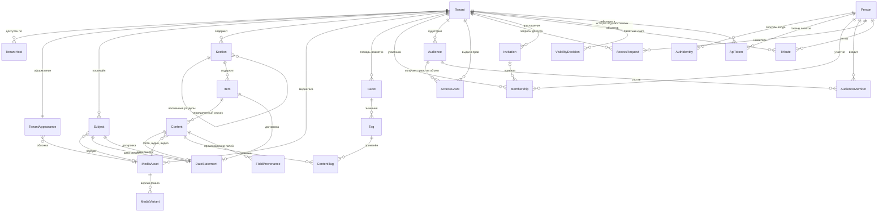

# Доменная модель: платформа «Очаг»

**Версия:** 0.1 (черновик)
**Дата:** 2026-10-23
**Основано на:** ADR-0001 (мультитенантность), ADR-0002 (резолвинг по хосту), ADR-0003 (фасетная разметка)

Модель концептуальная: сущности, атрибуты и связи предметной области. Типы полей, индексы и внешние ключи определяются позже, при проектировании схемы БД.

Модель описывает целевое состояние платформы целиком. Реализуется она частями: что уже сделано, видно по спекам бэка (`gefest/docs/specs`); части, отложенные на потом, помечены в тексте «Реализация — позже».

---

## 1. Обзор

### Служебные поля

Есть у каждой сущности модели. В таблицах ниже они сведены в одну строку.

| Атрибут | Описание |
|---|---|
| `version` | Номер версии записи, растёт при каждом изменении. Историю прежних значений не хранит |
| `createdAt`, `updatedAt` | Когда запись создана и когда изменена в последний раз |
| `createdByApiTokenId`, `updatedByApiTokenId` | Через какой токен агента сделано действие (`ApiToken`, раздел 3 основного документа); пусто, если человек действовал сам. Вместе с `…ByPersonId` дают «Агент Киры от имени Киры» |
| `createdByPersonId`, `updatedByPersonId` | Кто создал и кто изменил в последний раз. Ссылаются на `Person`; пусто, если действие выполнила система |
| `deletedAt` | Момент мягкого удаления, пусто, пока запись не удалена. Запись скрывается, но физически не стирается; оригиналы медиа не удаляются в любом случае (NFR по сохранности) |

---

## 2. Тенант и адресация

### Tenant

Один мемориал. Корневая сущность изоляции: почти всё остальное принадлежит тенанту.

| Атрибут | Описание |
|---|---|
| `id` | Идентификатор |
| `slug` | Короткое имя, используется в поддомене (`vostok` → `vostok.ochag.family`). Уникально по платформе. Меняет владелец; хосты (`TenantHost`) при этом не меняются |
| `title` | Отображаемое название мемориала. Меняет владелец |
| `type` | Вид мемориала: `PERSON` — посвящён одному человеку, `FAMILY` — семейный архив. Определяет, сколько может быть `Subject` и что в шапке (см. ниже). Меняет владелец |
| `status` | Активен / приостановлен |
| `accessContact` | Контакт хранителя (владельца) для гостей закрытого мемориала: что владелец сам решил показать — Telegram, телефон, почта. Простой текст, может отсутствовать. Виден гостю, даже когда мемориал закрыт (раздел 8.3) |
| `searchIndexing` | Разрешить поисковикам показывать мемориал. По умолчанию — нет: страницы отдаются с `noindex`. Меняет владелец. Это просьба к поисковикам, а не защита — доступ ограничивают аудитории |
| `version`, `createdAt`, `updatedAt`, `createdByPersonId`, `updatedByPersonId`, `createdByApiTokenId`, `updatedByApiTokenId`, `deletedAt` | Служебные поля, см. раздел 1 |

Вид мемориала задаётся явно, а не выводится из числа людей: семейный архив, где пока заведён один человек, остаётся семейным.

| `type` | Люди (`Subject`) | Шапка |
|---|---|---|
| `PERSON` | Не больше одного | Имя и годы жизни человека; пока человек не заведён — `title` |
| `FAMILY` | Сколько угодно | `title` («Семья Петровых») |

Перевести `FAMILY` в `PERSON`, когда людей двое и больше, нельзя.

### Subject

Человек, которому посвящён мемориал. Вынесен из `Tenant` отдельной сущностью: мемориал может быть посвящён нескольким людям (семейный архив), и сведения о человеке — это данные предметной области, а не настройки тенанта.

| Атрибут | Описание |
|---|---|
| `tenantId` | |
| `fullName` | |
| `bornOn`, `diedOn` | Даты жизни. Могут быть неполными — используется структура датировки из раздела 5 |
| `shortBio` | Краткая справка. HTML по тому же белому списку тегов, что текст стихов и записей блога. Может отсутствовать |
| `portraitMediaAssetId` | Портрет для шапки мемориала |
| `position` | Порядок, если субъектов несколько |
| `version`, `createdAt`, `updatedAt`, `createdByPersonId`, `updatedByPersonId`, `createdByApiTokenId`, `updatedByApiTokenId`, `deletedAt` | Служебные поля, см. раздел 1 |

### TenantAppearance

Оформление мемориала: тема и обложка — изображение в полосе под шапкой. Один к одному с `Tenant`, но отдельной сущностью: `Tenant` — идентичность и изоляция, по нему определяется мемориал на каждом запросе; оформление меняется по другим причинам и в другое время, со своей версией. Запись есть у каждого мемориала: создаётся вместе с ним — тема по умолчанию `MINIMAL`, без обложки.

| Атрибут | Описание |
|---|---|
| `tenantId` | Мемориал; один к одному |
| `theme` | Готовая тема оформления из списка платформы; пока одна — `MINIMAL`. Цвета, шрифты и отступы темы определяет клиент; хранится только её имя |
| `coverMediaAssetId` | Изображение обложки — `MediaAsset` типа `IMAGE`. Пусто — обложки нет |
| `coverCaption` | Подпись к обложке: автор, название, год («Н. К. Рерих. „Гэсэр-хан“, 1941»). Для чужого произведения обязательна — право авторства |
| `coverCropDesktop` | Кадр обложки на широком экране: прямоугольник `x`, `y`, `width`, `height` в долях от размеров оригинала (0–1), не выходит за изображение: `x + width ≤ 1`, `y + height ≤ 1`. Пусто — изображение целиком |
| `coverCropPhone` | Кадр обложки на телефоне, в тех же долях |
| `version`, `createdAt`, `updatedAt`, `createdByPersonId`, `updatedByPersonId`, `createdByApiTokenId`, `updatedByApiTokenId`, `deletedAt` | Служебные поля, см. раздел 1 |

Кадр хранится в долях, а не в пикселях: при замене оригинала сканом крупнее он не сбивается. Клиент обрезает изображение по кадру сам — производные версии для обложки не нужны.

Темы — закрытый список, а не произвольные цвета: каждая тема проверяется на читаемость и контраст.

### TenantHost

Хост, по которому мемориал доступен. Один тенант — несколько хостов (поддомен платформы плюс кастомные домены). Основа резолвинга из ADR-0002.

| Атрибут | Описание |
|---|---|
| `host` | Нормализованное имя хоста, уникально по всей платформе |
| `tenantId` | |
| `isPrimary` | Используется для генерации абсолютных ссылок |
| `verifiedAt` | Момент подтверждения владения доменом |
| `version`, `createdAt`, `updatedAt`, `createdByPersonId`, `updatedByPersonId`, `createdByApiTokenId`, `updatedByApiTokenId`, `deletedAt` | Служебные поля, см. раздел 1 |

---

## 3. Люди и доступ

### Person

Человек, авторизовавшийся на платформе. **Единственная сущность вне тенанта.**

Обоснование исключения из ADR-0001: один и тот же человек может быть родственником в нескольких мемориалах, и заводить ему отдельную учётную запись под каждый — значит требовать повторной авторизации на каждом мемориале. Изоляция при этом не страдает, поскольку любой доступ к данным тенанта идёт через `Membership`, который тенант-скоупный: сама по себе `Person` не даёт прав нигде.

| Атрибут | Описание |
|---|---|
| `id` | |
| `displayName` | Имя из профиля провайдера |
| `avatarUrl` | |
| `version`, `createdAt`, `updatedAt`, `createdByPersonId`, `updatedByPersonId`, `createdByApiTokenId`, `updatedByApiTokenId`, `deletedAt` | Служебные поля, см. раздел 1 |

### AuthIdentity

Способ входа. VK и Telegram — две записи одного вида.

| Атрибут | Описание |
|---|---|
| `personId` | |
| `provider` | `VK` / `TELEGRAM` |
| `externalId` | Идентификатор в системе провайдера |
| `linkedAt` | |
| `version`, `createdAt`, `updatedAt`, `createdByPersonId`, `updatedByPersonId`, `createdByApiTokenId`, `updatedByApiTokenId`, `deletedAt` | Служебные поля, см. раздел 1 |

Уникальность по паре (`provider`, `externalId`). Один человек может привязать несколько способов входа к одной учётной записи.

### ApiToken

Токен агента или MCP-сервера: секретный ключ, по которому программа обращается к API от имени человека. Выдаёт сам человек, в своём мемориале.

| Атрибут | Описание |
|---|---|
| `tenantId` | Мемориал, в котором действует токен |
| `personId` | От чьего имени действует |
| `title` | Имя, под которым действия видны в истории: «Агент Киры» |
| `tokenHash` | Хеш ключа; сам ключ показывается один раз при выдаче и не хранится |
| `expiresAt` | До какого момента действует |
| `revokedAt`, `revokedByPersonId` | Отзыв: человек или владелец мемориала может отозвать токен в любой момент |
| `lastUsedAt` | Когда токен использовался последний раз |
| `version`, `createdAt`, `updatedAt`, `createdByPersonId`, `updatedByPersonId`, `createdByApiTokenId`, `updatedByApiTokenId`, `deletedAt` | Служебные поля, см. раздел 1 |

**Права токена урезаны**: он может меньше, чем человек, который его выдал, и никогда больше.

- Может: читать то, что видит человек; загружать медиафайлы; создавать посты и контент там, куда человеку разрешено добавлять; менять и удалять то, что создал этот же токен.
- Не может: открывать контент другим — всё созданное токеном остаётся «Только владельцы», пока человек сам не откроет; менять аудитории, участников, права, настройки мемориала; трогать то, что создано не им.

Каждое действие токена записывается в служебные поля как «человек + токен» (`…ByPersonId` и `…ByApiTokenId`): в истории видно, что сделал агент, а что — человек сам.

### Вход через общий домен

VK и Telegram требуют заранее зарегистрировать адреса, на которых работает вход: Telegram — один домен на бота, VK — каждый адрес возврата. Мемориалов много, у части свои домены, поэтому вход идёт через один общий домен платформы (`auth.ochag.family`):

1. Гость на хосте мемориала нажимает «Войти» — его перенаправляют на общий домен.
2. Там он входит через VK или Telegram; общий домен помнит его своей сессией.
3. Его возвращают на хост мемориала с одноразовым кодом с коротким сроком жизни.
4. Мемориал обменивает код на свою сессию: cookie остаётся привязанной к хосту мемориала (ADR-0002).

Войдя один раз, человек входит в другие мемориалы без повторного входа через VK или Telegram — достаточно перехода на общий домен и обратно.

### Membership

Роль человека в конкретном мемориале: что он может **делать**. Что он может **видеть**, определяют аудитории, в которые он входит (`Audience`). Тенант-скоупная сущность.

| Атрибут | Описание |
|---|---|
| `tenantId` | |
| `personId` | |
| `role` | `OWNER` — всё: наполнение, публикация, участники и аудитории; `MEMBER` — просмотр того, что открыто его аудиториям, и памятная книга |
| `grantedByPersonId` | Кто выдал |
| `grantedAt` | |
| `invitationId`, `accessRequestId` | Как человек попал в мемориал: по приглашению или по одобренной заявке. Пусто у создателя мемориала |
| `revokedAt`, `revokedByPersonId` | Отзыв доступа владельцем |
| `version`, `createdAt`, `updatedAt`, `createdByPersonId`, `updatedByPersonId`, `createdByApiTokenId`, `updatedByApiTokenId`, `deletedAt` | Служебные поля, см. раздел 1 |

Роль `GUEST` в модели отсутствует: гость — это отсутствие членства, а не запись о нём.

**Отзыв доступа.** Владелец отбирает доступ — человек сразу становится для мемориала гостем: его аудитории для него больше не действуют. Запись об участии не стирается, а помечается отозванной. Всё, что человек оставил, — записи памятной книги и добавленный контент — остаётся в мемориале. Позвать его снова — новое участие.

### Audience

Аудитория — группа людей внутри мемориала, которой открывают объекты: «Семья», «Друзья», «Одноклассники». Создают и меняют аудитории только владельцы. Тенант-скоупная сущность: аудитории одного мемориала не видны в другом.

| Атрибут | Описание |
|---|---|
| `tenantId` | |
| `title` | Название |
| `kind` | `SYSTEM` — есть у каждого мемориала, не удаляется и не редактируется; `CUSTOM` — создана владельцем |
| `systemCode` | Для системных: `EVERYONE` — все, включая неавторизованных; `MEMBERS` — все участники мемориала; `OWNERS` — только владельцы. Состав системных аудиторий вычисляется, а не хранится |
| `position` | Порядок в интерфейсе |
| `version`, `createdAt`, `updatedAt`, `createdByPersonId`, `updatedByPersonId`, `createdByApiTokenId`, `updatedByApiTokenId`, `deletedAt` | Служебные поля, см. раздел 1 |

Вместе с мемориалом создаются системные аудитории и две обычные — «Семья» и «Друзья»; их можно переименовать, удалить, добавить свои.

### AccessGrant

Выдача права: **кто** — **какое право** — **на что**. Единственное место, где хранится, кто что видит и может в мемориале, кроме роли владельца (`Membership.role`). Тенант-скоупная сущность. Выдают и отзывают только владельцы.

| Атрибут | Описание |
|---|---|
| `tenantId` | |
| `audienceId` | Кому: аудитория (раздел 3, `Audience`), в том числе системная — «Все», «Все участники», «Только владельцы» |
| `permission` | Какое право: `VIEW` / `CONTRIBUTE` / `DOWNLOAD_ORIGINALS` |
| `objectType`, `objectId` | На что: `TENANT` / `SECTION` / `ITEM` / `SUBJECT` / `APPEARANCE` / `TRIBUTE` / `MEDIA_ASSET` и идентификатор объекта |
| `version`, `createdAt`, `updatedAt`, `createdByPersonId`, `updatedByPersonId`, `createdByApiTokenId`, `updatedByApiTokenId`, `deletedAt` | Служебные поля, см. раздел 1 |

Уникальность по (`audienceId`, `permission`, `objectType`, `objectId`). Ссылка на объект — пара «тип и идентификатор»: её целостность проверяет приложение, а не внешний ключ БД — плата за одну таблицу на все права. Новое право — новое значение `permission`, а не новая сущность.

| Право | На что выдаётся | Что даёт |
|---|---|---|
| `VIEW` | мемориал, раздел, пост, человек, оформление, запись памятной книги | Видеть объект (раздел 8.1) |
| `CONTRIBUTE` | мемориал или раздел (с подразделами) | Добавлять посты и их контент |
| `DOWNLOAD_ORIGINALS` | мемориал или медиафайл | Скачивать оригиналы и видеть полные технические метаданные (раздел 8.2) |

Участник с правом `CONTRIBUTE`:

- добавляет посты и их контент в мемориал или разделы, на которые выдано право;
- добавленное сразу видно всем, кому открыт раздел: новый пост получает `VIEW` для «Всех», границу задают мемориал и разделы;
- может сам выбрать аудитории своего поста из аудиторий мемориала (например, только «Семья»): по правилу дверей это может лишь сузить круг, но не расширить его за пределы раздела;
- меняет и удаляет только своё (`createdByPersonId`), чужое — нет.

Владелец по-прежнему может всё, в том числе менять и скрывать добавленное участниками.

### AudienceMember

Кто входит в обычную аудиторию. Один человек может входить в несколько аудиторий.

| Атрибут | Описание |
|---|---|
| `tenantId`, `audienceId`, `personId` | |
| `version`, `createdAt`, `updatedAt`, `createdByPersonId`, `updatedByPersonId`, `createdByApiTokenId`, `updatedByApiTokenId`, `deletedAt` | Служебные поля, см. раздел 1 |

### AccessRequest

Запрос на участие в мемориале. Одобряя запрос, владелец выбирает аудитории, в которые войдёт человек.

| Атрибут | Описание |
|---|---|
| `tenantId`, `personId` | |
| `message` | Кем приходится, от заявителя |
| `status` | `PENDING` / `APPROVED` / `REJECTED` |
| `decidedByPersonId`, `decidedAt` | |
| `version`, `createdAt`, `updatedAt`, `createdByPersonId`, `updatedByPersonId`, `createdByApiTokenId`, `updatedByApiTokenId`, `deletedAt` | Служебные поля, см. раздел 1 |

### Invitation

Приглашение по ссылке. Владелец создаёт ссылку и отправляет её сам, например в мессенджер. Человек переходит по ней, входит через VK или Telegram и сразу становится участником — без одобрения.

Два способа попасть в мемориал дополняют друг друга: заявка (`AccessRequest`) — для незнакомых, приглашение — чтобы владелец быстро позвал своих.

| Атрибут | Описание |
|---|---|
| `tenantId` | |
| `tokenHash` | Хеш секрета из ссылки; сам секрет не хранится |
| `note` | Для кого или зачем: «двоюродные братья», «одноклассники» — видит только владелец |
| `audienceIds` | В какие аудитории войдёт принявший приглашение |
| `expiresAt` | До какого момента ссылка действует; пусто — бессрочно |
| `maxUses`, `usedCount` | Сколько человек может принять приглашение и сколько уже приняли; пусто в `maxUses` — без ограничения |
| `revokedAt`, `revokedByPersonId` | Отзыв ссылки владельцем |
| `version`, `createdAt`, `updatedAt`, `createdByPersonId`, `updatedByPersonId`, `createdByApiTokenId`, `updatedByApiTokenId`, `deletedAt` | Служебные поля, см. раздел 1 |

Приглашение даёт роль `MEMBER`. Приглашение в совладельцы — вместе с вопросом о преемственности (раздел 12).

---

## 4. Контент

### Section

Раздел мемориала. Сущность, а не константа в коде — у разных мемориалов разный состав разделов, и добавление нового типа контента не должно требовать миграции.

| Атрибут | Описание |
|---|---|
| `tenantId` | |
| `parentSectionId` | Родительский раздел. Пусто у раздела верхнего уровня |
| `slug` | Часть URL раздела, уникален в пределах родителя |
| `title` | «Стихи», «Фотографии», «О нём» |
| `description` | Описание раздела — несколько абзацев о том, что в нём собрано. HTML по тому же белому списку тегов, что текст стихов и записей блога. Может отсутствовать |
| `position` | Порядок отображения среди разделов одного родителя |
| `layout` | Вид списка элементов: `LIST` / `GRID` / `CONTINUOUS` |
| `defaultOrdering` | Порядок элементов по умолчанию: `MANUAL` / `DATE_ASC` / `DATE_DESC` / `TITLE` |
| `version`, `createdAt`, `updatedAt`, `createdByPersonId`, `updatedByPersonId`, `createdByApiTokenId`, `updatedByApiTokenId`, `deletedAt` | Служебные поля, см. раздел 1 |

Раздел не ограничивает тип контента: в одном разделе могут лежать элементы разных типов (фото, стихи, аудио). Четыре раздела первого мемориала — четыре записи; два раздела с фотографиями (снимки автора и снимки с ним) различаются принадлежностью к разным разделам, а не отдельным типом сущности.

Разделы образуют дерево: раздел с `parentSectionId` — вложенная страница со своим адресом (например, «О путешествиях» внутри «О нём»). Способ сгруппировать список без отдельной страницы остаётся за фасетами из ADR-0003.

### Item

Контейнер для списка единиц контента разных видов: запись, аудио, видео, фото, текст идут подряд, порядок задаёт `Content.position`. Лежит в разделе.

| Атрибут | Описание |
|---|---|
| `sectionId` | |
| `slug` | Часть URL, уникален в пределах раздела |
| `title` | Заголовок |
| `dateStatementId` | Ссылка на `DateStatement` (см. раздел 5) |
| `position` | Порядок отображения среди элементов одного раздела |
| `version`, `createdAt`, `updatedAt`, `createdByPersonId`, `updatedByPersonId`, `createdByApiTokenId`, `updatedByApiTokenId`, `deletedAt` | Служебные поля, см. раздел 1 |

### Content

Единица контента внутри `Item`. Общий тип для всех видов контента — обеспечивает расширяемость: разметка, видимость, история решений и API работают с `Content`, а не с пятью параллельными сущностями.

**Общие атрибуты:**

| Атрибут | Описание |
|---|---|
| `itemId` | `Item`, в список которого входит единица контента |
| `type` | Дискриминатор: `POEM` / `PHOTO` / `BLOG_ENTRY` / `AUDIO` / `VIDEO` |
| `title` | Может отсутствовать (безымянное стихотворение, фото) |
| `description` | Комментарий владельца |
| `dateStatementId` | Ссылка на `DateStatement` (см. раздел 5) |
| `position` | Порядковый номер внутри `Item` |
| `version`, `createdAt`, `updatedAt`, `createdByPersonId`, `updatedByPersonId`, `createdByApiTokenId`, `updatedByApiTokenId`, `deletedAt` | Служебные поля, см. раздел 1 |

**Специфичные атрибуты по типам** (в БД — отдельные таблицы, связанные с таблицей общих полей: наследование joined):

| Тип | Атрибуты |
|---|---|
| `POEM` | `body` (текст), `firstLine` (для списков, если нет названия) |
| `BLOG_ENTRY` | `body`, `sourceUrl` (откуда перенесено), `publishedAt` (исходная дата публикации) |
| `PHOTO` | `mediaAssetId`, `capturedAt`, `place` |
| `AUDIO` | `mediaAssetId`, `recordedAt`, `place` |
| `VIDEO` | `mediaAssetId`, `recordedAt`, `place` |

### MediaAsset и MediaVariant

Файл и его версии. Разделены, поскольку у одного оригинала несколько производных.

**MediaAsset:**

| Атрибут | Описание |
|---|---|
| `tenantId` | |
| `mediaType` | `IMAGE` / `AUDIO` / `VIDEO` |
| `originalFilename` | |
| `contentHash` | Хеш содержимого — основа идемпотентности при повторном добавлении |
| `recordedAt` | Дата из технических метаданных, если есть |
| `durationSeconds` | Только для аудио и видео |
| `technicalMetadataJson` | Исходные метаданные целиком, как есть: EXIF для изображений, контейнер и кодеки для аудио и видео. Доступны тем, кому доступен оригинал |
| `version`, `createdAt`, `updatedAt`, `createdByPersonId`, `updatedByPersonId`, `createdByApiTokenId`, `updatedByApiTokenId`, `deletedAt` | Служебные поля, см. раздел 1 |

**MediaVariant:**

| Атрибут | Описание |
|---|---|
| `mediaAssetId` | |
| `kind` | `ORIGINAL` / `WEB` / `THUMBNAIL` / `POSTER` |
| `storageKey` | Ключ объекта в хранилище |
| `width`, `height`, `sizeBytes`, `mimeType` | Размеры — только для визуальных вариантов |
| `bitrate`, `codec` | Только для аудио и видео |
| `version`, `createdAt`, `updatedAt`, `createdByPersonId`, `updatedByPersonId`, `createdByApiTokenId`, `updatedByApiTokenId`, `deletedAt` | Служебные поля, см. раздел 1 |

Назначение вариантов по типам:

| Тип | `ORIGINAL` | `WEB` | `THUMBNAIL` | `POSTER` |
|---|---|---|---|---|
| `IMAGE` | исходный файл | версия для страницы | миниатюра для списка | — |
| `AUDIO` | исходная запись | воспроизводимая версия | — | обложка, если есть |
| `VIDEO` | исходная запись | воспроизводимая версия | миниатюра для списка | кадр-заставка |

Оригинал никогда не удаляется (NFR по сохранности). Производные версии могут быть пересозданы.

---

### 4.1 Особенности аудио и видео

**Аудио и видео поддерживаются наравне с фото.** Оба вписываются без структурных изменений — `Section`, `Item`, `Content`, разметка и видимость работают с ними так же, как с фотографиями.

**Подготовка воспроизводимых версий — вне системы.** Приложение принимает файлы, готовые к воспроизведению, и не обрабатывает медиа. Фоновая обработка, очереди и воркеры в архитектуре не появляются.

**Поиск по записям — по названию и описанию.** Расшифровка звучащего в записи не ведётся. Поля `title` и `description` в общих атрибутах `Content` уже покрывают эту потребность, отдельных полей не требуется. Следствие: качество описания напрямую определяет находимость записи, поскольку иного текста у неё нет.

**Срок жизни временных ссылок.** Непубличные медиа отдаются по временным ссылкам после проверки роли. Для изображения это безразлично: файл загружается за секунды. Длинная запись, воспроизводимая дольше срока действия ссылки, прервётся на середине. Требуется срок с запасом либо обновление ссылки в процессе воспроизведения.

---

## 5. Датировка

Отдельный вопрос модели: даты в архиве часто неточны. «Около 1975», «конец 70-х», «лето, год неизвестен» — обычное состояние семейного архива.

Хранение единственного поля `date` вынуждает либо выдумывать точность, которой нет, либо оставлять поле пустым, теряя известное приближение. Оба варианта необратимо портят архив.

### DateStatement

Датировка как отдельная сущность. На неё ссылаются `Item` и `Content` через `dateStatementId`, `Subject` — через `bornOn` и `diedOn`. Каждая запись принадлежит ровно одному владельцу и не разделяется между сущностями.

| Атрибут | Описание |
|---|---|
| `dateFrom`, `dateTo` | Границы интервала. Для точной даты совпадают |
| `precision` | `DAY` / `MONTH` / `YEAR` / `DECADE` / `UNKNOWN` |
| `displayText` | Как показывать: «1975», «конец 1970-х», «около 1980» |
| `version`, `createdAt`, `updatedAt`, `createdByPersonId`, `updatedByPersonId`, `createdByApiTokenId`, `updatedByApiTokenId`, `deletedAt` | Служебные поля, см. раздел 1 |

Фильтрация по фасету «период» работает по пересечению интервала с границами периода, что корректно обрабатывает неточные датировки.

---

## 6. Происхождение метаданных

У каждого значимого метаданного фиксируется, откуда взято значение и подтверждено ли оно человеком.

Причина: в семейном архиве проверить значение спустя годы будет не у кого. Достоверно известная дата и обоснованное предположение выглядят в базе одинаково, и через двадцать лет предположение станет фактом просто потому, что записано.

### 6.1 Две независимые оси

**Источник** — откуда значение взялось:

| Значение | Смысл |
|---|---|
| `TECHNICAL` | Извлечено из технических метаданных файла (EXIF, свойства контейнера) |
| `KNOWN` | Известно достоверно: память, подпись на обороте, документ, слова родственника |
| `INFERRED` | Предположение по косвенным признакам: соседние файлы, возраст людей на снимке, стилистика |
| `IMPORTED` | Перенесено из исходного источника как есть, не проверялось |
| `GENERATED` | Проставлено автоматически, без участия человека |

**Подтверждение** — просмотрел ли значение человек и согласился ли с ним. Не выводится из источника: `GENERATED`-значение может быть подтверждено и стать достоверным, `KNOWN` — остаться неподтверждённым, если внесено при массовом наполнении и не пересматривалось.

Отдельно от обоих — `precision` в датировке (раздел 5): она отвечает на вопрос «насколько точно», а не «кто это утверждает». Значение может быть точным до дня и при этом предположением.

### 6.2 FieldProvenance

Происхождение скалярных полей `Content`.

| Атрибут | Описание |
|---|---|
| `tenantId`, `contentId` | |
| `fieldName` | Какое поле описывается: `dateStatementId`, `place`, `title` и т.д. |
| `source` | Значение из перечисления выше |
| `confirmedByPersonId`, `confirmedAt` | Пусто, если не подтверждено |
| `evidence` | Основание: «подпись на обороте: Алтай, лето», «по дате соседних кадров» |
| `version`, `createdAt`, `updatedAt`, `createdByPersonId`, `updatedByPersonId`, `createdByApiTokenId`, `updatedByApiTokenId`, `deletedAt` | Служебные поля, см. раздел 1 |

Отсутствие записи означает, что происхождение неизвестно — это допустимое состояние, а не ошибка.

**Отслеживаемые поля** (не весь набор атрибутов, а те, где ошибка необратима): `dateStatementId`, `place`, `capturedAt` / `recordedAt`, `title` при реконструкции.

Содержимое — текст стихотворения, файл, тело записи — не отслеживается: оно не выводится и не предполагается.

### 6.3 Происхождение разметки

Для тегов происхождение хранится не в `FieldProvenance`, а прямо в `ContentTag`: разметка — это уже отдельная запись, и выносить её описание в другую таблицу означало бы связывать строку со строкой без выигрыша.

`ContentTag` дополняется полями `source`, `confirmedByPersonId`, `confirmedAt`.

Компромисс осознанный: два механизма вместо одного универсального. Альтернатива — единая таблица с полиморфной ссылкой на цель — даёт единообразие ценой ссылочной целостности, которую в SQL при полиморфизме приходится проверять вручную.

### 6.4 Следствия

- На `Content` полезен производный признак наличия неподтверждённых метаданных — для очереди на пересмотр без соединения таблиц при каждой выборке
- Значения с источником `INFERRED` и `GENERATED` без подтверждения разумно показывать иначе: «около 1975» вместо «1975»
- Разметка становится трудоёмче: помимо значения указывается его происхождение. Это сознательная плата
- Механизм применим и к будущим типам контента без изменений: `fieldName` — строка, новые поля не требуют миграции

---

## 7. Разметка

Реализует ADR-0003.

### Facet

Измерение разметки. Словарь принадлежит тенанту.

| Атрибут | Описание |
|---|---|
| `tenantId` | |
| `code`, `title` | |
| `isSingleValue` | Допустимо ли одно значение на единицу контента |
| `applicableTypes` | Типы контента, к которым применим |
| `position` | Порядок в интерфейсе фильтров |
| `version`, `createdAt`, `updatedAt`, `createdByPersonId`, `updatedByPersonId`, `createdByApiTokenId`, `updatedByApiTokenId`, `deletedAt` | Служебные поля, см. раздел 1 |

### Tag

Значение внутри фасета.

| Атрибут | Описание |
|---|---|
| `tenantId`, `facetId` | |
| `title` | Отображаемое имя |
| `normalizedTitle` | Для контроля дубликатов, уникально в пределах фасета |
| `position` | |
| `version`, `createdAt`, `updatedAt`, `createdByPersonId`, `updatedByPersonId`, `createdByApiTokenId`, `updatedByApiTokenId`, `deletedAt` | Служебные поля, см. раздел 1 |

### ContentTag

Связь контента с тегом. Ограничение единственности из `Facet.isSingleValue` проверяется на этом уровне.

| Атрибут | Описание |
|---|---|
| `tenantId`, `contentId`, `tagId` | |
| `source` | Откуда взята разметка (раздел 6.1) |
| `confirmedByPersonId`, `confirmedAt` | Пусто, если не подтверждена |
| `version`, `createdAt`, `updatedAt`, `createdByPersonId`, `updatedByPersonId`, `createdByApiTokenId`, `updatedByApiTokenId`, `deletedAt` | Служебные поля, см. раздел 1 |

---

## 8. Видимость и её история

### 8.1 Аудитории и наследование

Видимость объекта — не уровень из фиксированной шкалы, а выдачи права `VIEW` (`AccessGrant`, раздел 3) аудиториям: кто его видит. Роли отвечают за действия, аудитории — за просмотр.

Видимость настраивается у всего, что видит посетитель: мемориала (`Tenant`), разделов (`Section`), постов (`Item`), людей (`Subject`), оформления (`TenantAppearance`), записей памятной книги (`Tribute`). Нет ни одной выдачи `VIEW` — объект видят только владельцы.

**Внутри объекта — объединение.** Объект видит каждый, кто входит хотя бы в одну из аудиторий с `VIEW` на него: пост для «Семьи» и «Друзей» видят и те, и другие.

**По цепочке — пересечение.** Видимость наследуется от родителя к ребёнку: чтобы увидеть объект, нужно пройти все звенья цепочки, как двери:

- посты — `Tenant` → `Section` → вложенные `Section` → `Item`; контент поста виден тем, кому виден пост, своей настройки у него нет;
- люди, оформление, памятная книга — `Tenant` → `Subject` / `TenantAppearance` / `Tribute`.

Пример: раздел открыт «Семье», пост в нём — «Семье» и «Друзьям». Пост видит только «Семья»: друзей не пропускает раздел. Если раздел открыт «Семье», а пост — только «Друзьям», пост видят лишь те, кто входит в обе аудитории. Когда звенья не пересекаются, интерфейс предупреждает владельца: «Это не увидит никто, кроме вас».

Владельцы видят всё всегда.

**По умолчанию** — какие выдачи создаются вместе с объектом:

| Объект | Выдачи `VIEW` при создании | Почему |
|---|---|---|
| Мемориал, раздел, пост владельца | нет — видят только владельцы | открытие всегда осознанное действие |
| Пост участника с правом `CONTRIBUTE` | «Все» | вклад сразу виден, границу задают мемориал и разделы |
| Человек, оформление | «Все» | их закрывает мемориал, пока он закрыт |
| Запись памятной книги | «Все»; аудитории выбирает автор (реализация — позже) | |

| Аудитория | Чем заменяет прежнюю шкалу |
|---|---|
| «Все» (`EVERYONE`) | `PUBLIC` |
| «Семья», «Друзья» | `FAMILY`, `FRIENDS` — теперь обычные аудитории, создаются вместе с мемориалом |
| «Только владельцы» (`OWNERS`) или отсутствие выдач | `DRAFT`: у поста — черновик, у мемориала — «полностью приватный» |

**Медиафайлы своей видимости не имеют**: файл виден тому, кто видит хотя бы одно место, где он используется, — пост (по всей его цепочке), обложку (`TenantAppearance`) или портрет (`Subject`). Файл, который нигде не используется, видят только владельцы.

### 8.2 Оригиналы медиафайлов

Оригинал (`MediaVariant.kind = ORIGINAL`) и полные технические метаданные (`MediaAsset.technicalMetadataJson`) — отдельное право, а не следствие просмотра: в метаданных бывают координаты съёмки, оригинал может весить десятки мегабайт.

- Кто может скачивать оригиналы — выдачи `DOWNLOAD_ORIGINALS` на мемориал и на медиафайл. Действуют обе: по пересечению, как в цепочке видимости. Нет выдач на мемориал — оригиналы скачивают только владельцы.
- Оригинал никогда не доступнее самого файла: скачать его может только тот, кто видит файл.
- Полные метаданные доступны тем же, кому доступен оригинал.

### 8.3 Закрытый мемориал

Если гость не входит ни в одну аудиторию с `VIEW` на мемориал, он видит не «не найдено», а страницу закрытого мемориала:

- название мемориала (`Tenant.title`);
- сообщение: «Мемориал закрыт настройками приватности. Для получения доступа обратитесь к хранителю мемориала»;
- контакт хранителя (`Tenant.accessContact`), если владелец его заполнил;
- кнопку «Запросить доступ»: гость входит через VK или Telegram и оставляет заявку (`AccessRequest`), владелец её одобряет и выбирает аудитории.

Название и контакт — единственное, что закрытый мемориал раскрывает посторонним. Хранитель мемориала — его владелец (`OWNER`).

### 8.4 VisibilityDecision

Решение о видимости фиксируется как событие, а не как перезапись поля. История ведётся для каждого объекта с настройкой видимости: мемориала, разделов, постов, контента, людей, оформления, записей памятной книги, а также для доступа к оригиналам.

**Реализация — позже**: сначала видимость работает без истории.

| Атрибут | Описание |
|---|---|
| `tenantId` | |
| `objectType`, `objectId` | Чья видимость изменилась: `TENANT` / `SECTION` / `ITEM` / `SUBJECT` / `APPEARANCE` / `TRIBUTE`, для оригиналов — `TENANT_ORIGINALS` / `MEDIA_ORIGINALS` |
| `fromAudiences`, `toAudiences` | Наборы аудиторий до и после |
| `decidedByPersonId`, `decidedAt` | |
| `note` | Пояснение, если нужно |
| `version`, `createdAt`, `updatedAt`, `createdByPersonId`, `updatedByPersonId`, `createdByApiTokenId`, `updatedByApiTokenId`, `deletedAt` | Служебные поля, см. раздел 1 |

Текущие права хранятся в выдачах (`AccessGrant`); `VisibilityDecision` даёт историю. Ссылка на объект — пара «тип и идентификатор»: целостность такой ссылки проверяет приложение, а не внешний ключ БД — плата за одну историю на все виды объектов. Механизм согласования между родственниками надстраивается поверх этой истории без изменения структуры.

---

## 9. Памятная книга

### Tribute

Воспоминание, оставленное родственником. Не является `Content`: автор — не владелец мемориала, набор атрибутов и правила публикации другие.

| Атрибут | Описание |
|---|---|
| `tenantId` | |
| `authorPersonId` | |
| `body` | Текст воспоминания |
| `status` | `PUBLISHED` / `HIDDEN` |
| `version`, `createdAt`, `updatedAt`, `createdByPersonId`, `updatedByPersonId`, `createdByApiTokenId`, `updatedByApiTokenId`, `deletedAt` | Служебные поля, см. раздел 1 |

Кому видна запись, решает её автор (**реализация — позже**: сначала записи видны всем, кому виден мемориал). Владелец может скрыть любую запись (`HIDDEN`). Удаление не предусмотрено: `HIDDEN` сохраняет запись.

---

## 10. Принятые решения по модели

Принятые решения:

| Вопрос | Решение |
|---|---|
| Наследование `Content` в БД | Joined: таблица общих полей плюс таблицы специфичных |
| Привязка `Tribute` к единице контента | Возможна, вынесена в поздние релизы |
| Даты жизни | Отдельная сущность `Subject`, допускает нескольких субъектов на мемориал |
| Аудио и видео | Поддерживаются наравне с фото |
| Подготовка воспроизводимых версий | Вне системы, приложение медиа не обрабатывает |
| Вложенность разделов | Разделы образуют дерево: `Section.parentSectionId` |
| Тип контента в разделе | Раздел не ограничивает типы: в одном разделе допустимы элементы разных типов |
| Связь между единицами контента | Не нужна |
| Расшифровка аудиозаписей | Не ведётся. Поиск по `title` и `description` |
| Происхождение метаданных | Фиксируется источник и факт подтверждения человеком (раздел 6) |
| Контейнер единиц контента | `Item` в разделе, внутри — упорядоченный список `Content` разных типов |
| Представление раздела | `Section.layout` (`LIST` / `GRID` / `CONTINUOUS`) и `Section.defaultOrdering` (`MANUAL` / `DATE_ASC` / `DATE_DESC` / `TITLE`) |
| Человекочитаемые URL | `Item.slug`, уникален в пределах раздела |
| Датировка | Отдельная сущность `DateStatement`, у каждой записи ровно один владелец (`Item`, `Content` или `Subject`) |
| Роли и видимость | Разделены: роль (`Membership.role`: `OWNER` / `MEMBER`) — что человек может делать; аудитории (`Audience`) — что он видит. Роли «соавтор» нет: добавлять контент владелец разрешает аудиториям (`AccessGrant`, право `CONTRIBUTE`) |
| Выдачи прав | Одна сущность `AccessGrant` «аудитория — право — объект» для видимости (`VIEW`), добавления контента (`CONTRIBUTE`) и оригиналов (`DOWNLOAD_ORIGINALS`) |
| Аудитории | Создают только владельцы, внутри мемориала; «Семья» и «Друзья» создаются вместе с мемориалом; у объекта может быть несколько аудиторий |
| Наследование видимости | Внутри объекта — объединение аудиторий, по цепочке родителей — пересечение |
| Поисковики | `Tenant.searchIndexing`, по умолчанию мемориал не индексируется (`noindex`) |
| Аудитории по умолчанию | Без выдач `VIEW` (видят только владельцы) у мемориала, раздела и поста — открытие всегда осознанное действие; «Все» у людей и оформления — их закрывает мемориал |
| Видимость поста | Одна настройка на весь пост (`Item`), по умолчанию «Только владельцы»; у единиц контента своей настройки нет |
| Видимость медиафайла | Своей нет: виден тому, кто видит хотя бы одно место его использования; неиспользуемый — только владельцам |
| Видимость памятной книги | Аудитории записи выбирает её автор, по умолчанию «Все»; владелец может скрыть запись |
| Как попасть в мемориал | Заявка (`AccessRequest`), которую одобряет владелец, или приглашение по ссылке (`Invitation`) без одобрения |
| Отзыв доступа | Доступ отбирается сразу, участие помечается отозванным; оставленное человеком остаётся |
| Добавление контента участниками | Право выдаётся аудитории на мемориал или раздел (с подразделами); добавленное сразу видно, автор может сузить круг; менять и удалять можно только своё |
| Способы входа | Только VK и Telegram (`AuthIdentity.provider`), через общий домен входа с передачей сессии на хост мемориала |
| Агенты и MCP | `ApiToken` от имени человека, с урезанными правами: добавляет черновики, не публикует и не управляет; действия помечаются токеном |
| Закрытый мемориал | Гость видит название, сообщение о закрытости, контакт хранителя и «Запросить доступ» (раздел 8.3) |

---

## 11. Соответствие принятым решениям

| Решение | Как отражено |
|---|---|
| ADR-0001: `tenant_id` везде | Все сущности тенант-скоупные, кроме `Person` и `AuthIdentity` — исключение обосновано в разделе 3 |
| ADR-0002: резолвинг по хосту | `TenantHost` с уникальным `host` по всей платформе |
| ADR-0003: фасетный словарь | `Facet` / `Tag` / `ContentTag`, словарь принадлежит тенанту |
| Публикация — осознанное действие | Новый пост владельца создаётся без выдач `VIEW` |
| История решений о видимости | `VisibilityDecision` для всех объектов с настройкой видимости; реализация — позже |
| NFR: оригиналы не удаляются | `MediaVariant.kind = ORIGINAL` не подлежит удалению; производные пересоздаваемы |
| Расширяемость типов контента | Дискриминатор `Content.type`; новый тип не требует новых связей для разметки и видимости |
| Вложенные разделы | `Section.parentSectionId` |
| Происхождение метаданных | `FieldProvenance` для полей, поля источника и подтверждения в `ContentTag` |

---

## 12. Открытые вопросы

| # | Вопрос | Блокирует |
|---|---|---|
| 1 | `groupByFacetId` у раздела — группировка списка элементов по фасету. **Отложено:** всё, что касается фасетов и разметки (раздел 7), прорабатываем позже | Модель `Section` |
| 7 | Преемственность: мемориал живёт десятилетиями, а владелец может пропасть. Несколько владельцев, передача владения, наследник — чтобы мемориал не «осиротел» | `Membership`, раздел 3 |
| 10 | Администрирование платформы: кто создаёт и приостанавливает мемориалы (`Tenant.status`), назначает первого владельца, подключает и подтверждает домены (`TenantHost.verifiedAt`); видит ли администратор содержимое закрытых мемориалов. **Отложено** вместе с админской частью; пока мемориалы создаются SQL-запросом | `Tenant`, `TenantHost` |
