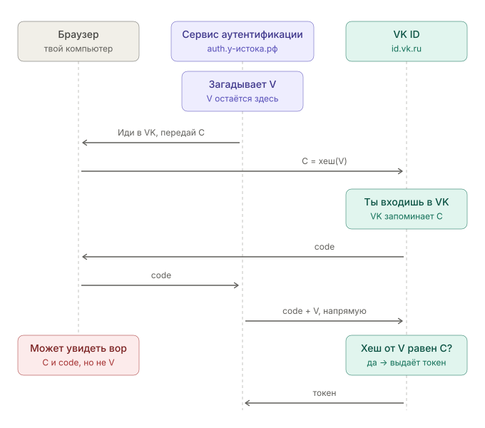

# Вход через VK: PKCE и одноразовый код

## Что на схеме

Три участника: твой **браузер**, наш **сервис авторизации** (`auth.у-истока.рф` — отдельная программа на нашем сервере) и **VK**.

Суть PKCE — одна: **секрет `V` никогда не проходит через браузер.**

- Через браузер (где его может подсмотреть вор) идут только `C` и `code`.
- `C` — это хеш от `V`: из него нельзя получить `V` обратно, как по отпечатку пальца не восстановить человека.
- Чтобы получить токен, VK требует `code` **и** сам `V`. Вор, у которого есть `C` и `code`, не может назвать `V` — VK ему откажет.
- `V` знает только наш сервис авторизации: он его придумал и отправил прямо в VK, минуя браузер.

## Что такое `code`

`code` — одноразовый код, который VK выдаёт после того, как ты вошла. Это случайная строка вроде `vk2_8f3KdQ…`.

Сам по себе он ничего не содержит — ни имени, ни доступа к профилю. VK у себя помнит: «этот код = Кира вошла и разрешила приложению 54857083 видеть имя и аватар». Код живёт несколько минут и меняется только один раз.

**Зачем он нужен, а не сразу токен.** VK возвращает тебя к нам через браузер — всё, что идёт через браузер, видно в адресной строке и попадает в историю. Если бы VK положил туда сразу токен (ключ к твоему профилю), его можно было бы украсть и пользоваться. Раньше так и делали (это называлось implicit flow) — сейчас стандарт это запрещает.

Поэтому через браузер идёт только короткоживущий одноразовый код, а настоящий токен наш сервер забирает у VK напрямую, предъявив код и секрет `V`.

Это тот же «номерок из гардероба», про который говорили для мемориалов: только здесь его выдаёт VK нашему сервису авторизации, а там — наш сервис авторизации мемориалу.
