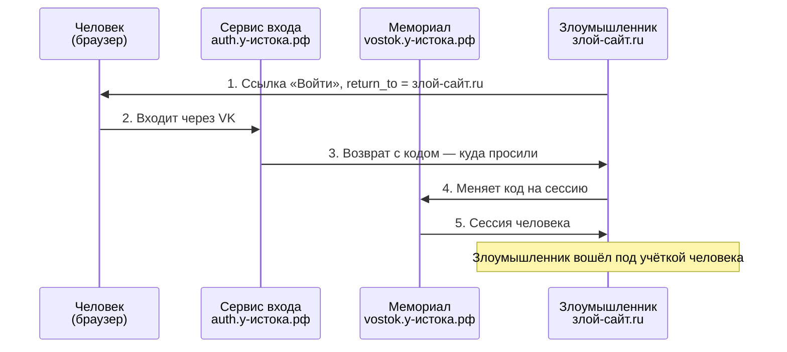
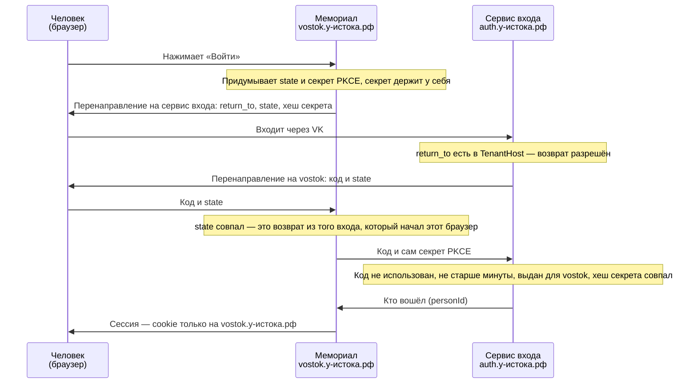

# Безопасность входа: адрес возврата, одноразовый код, state и PKCE

Пояснение к вопросу 3 из `domain_model/Access-questions.md`: как устроен возврат с общего сервиса входа на мемориал, какая атака здесь возможна и какие четыре правила её закрывают. Незнакомые слова — в словаре в конце.

## Как устроен вход

Сервис входа один на все мемориалы: `auth.у-истока.рф`. Человек нажимает «Войти» на мемориале, уходит на сервис входа, входит через VK и возвращается на мемориал с одноразовым кодом. Мемориал меняет код на свою сессию.

Чтобы сервис входа знал, куда вернуть человека — на `vostok`, на `petrovy` или на `a-vostok.ru`, — адрес возврата передаётся прямо в ссылке на вход, параметром:

```
https://auth.у-истока.рф/login?return_to=https://vostok.у-истока.рф/
```

После входа сервис читает `return_to` и отправляет браузер туда, добавив код:

```
https://vostok.у-истока.рф/?code=K7f2...
```

## Где подменяется адрес возврата

Злоумышленник сам составляет такую же ссылку со своим адресом возврата и присылает её человеку, например в мессенджер:

```
https://auth.у-истока.рф/login?return_to=https://злой-сайт.ru/
```

Ссылка ведёт на наш настоящий домен, поэтому выглядит безопасно. Человек видит настоящую страницу входа через VK и честно входит. Если сервис входа не проверяет `return_to`, он отправит браузер на

```
https://злой-сайт.ru/?code=K7f2...
```

и код окажется у злоумышленника. Пароль человека злоумышленнику не нужен.

## Атака без защиты



## Четыре правила защиты

Каждое правило закрывает свой шаг атаки:

1. **Возврат только на хосты из `TenantHost`.** Сервис входа сверяет `return_to` со списком хостов мемориалов. `vostok.у-истока.рф` в списке есть — возврат разрешён; `злой-сайт.ru` нет — сервис показывает ошибку, код не выдаётся. Закрывает шаг 3.
2. **Код одноразовый и живёт около минуты.** Код, перехваченный другим путём (история браузера, расширение), быстро становится бесполезен.
3. **Код годится только для своего хоста.** Код, выданный для `vostok`, не обменяется на сессию на `petrovy`.
4. **`state` + PKCE.** Код примет только тот браузер и тот мемориал, которые начали вход: без секрета PKCE перехваченный код не обменять (шаг 4), а `state` не даёт подсунуть человеку чужой код.

## Обычный вход с защитой



Если человек открыл подменённую ссылку злоумышленника, сервис входа на шаге проверки `return_to` показывает ошибку, и дальше вход не идёт.

## PKCE

PKCE (читается «пикси», Proof Key for Code Exchange — «ключ-доказательство для обмена кода») защищает от перехваченного кода.

Код возврата идёт через браузер в адресной строке, поэтому его можно перехватить. PKCE работает как номерок в гардеробе, разрезанный пополам:

1. Перед входом мемориал придумывает случайный секрет, например `k3J9xQ…`, и держит его у себя.
2. В ссылку на вход кладётся только хеш секрета. По хешу секрет не восстановить.
3. Сервис входа запоминает хеш вместе с выданным кодом.
4. При обмене кода на сессию мемориал присылает код и сам секрет. Сервис хеширует секрет и сверяет с запомненным хешем: совпало — выдаёт вход, нет — отказ.

Секрет никогда не проходит через адресную строку, поэтому тот, кто перехватил код, обменять его не сможет.

## state

`state` — случайное значение, которое защищает от обратной атаки: злоумышленник подсовывает человеку свой код, и человек незаметно оказывается в учётке злоумышленника — а потом загружает туда семейные фото. Мемориал кладёт `state` в ссылку на вход и при возврате проверяет, что вернулось то же значение, то есть это возврат именно из того входа, который начал этот браузер.

## Где это у нас применяется

- **VK ↔ сервис входа** — этого требует сам VK ID.
- **Сервис входа ↔ мемориал** — наш собственный одноразовый код, к нему применяем то же самое.

## Как связаны стандарты

- **OAuth 2.0** (RFC 6749) — основной стандарт авторизации: как приложение получает доступ от имени пользователя — коды, токены, адреса возврата.
- **PKCE** (RFC 7636) — отдельный стандарт-дополнение к OAuth 2.0: добавляет проверку секрета при обмене кода. Без OAuth сам по себе не используется — как поправка к закону.
- **OAuth 2.1** — обновлённая версия OAuth, пока черновик. PKCE в неё встроен как обязательная часть.
- **RFC 9700** (OAuth 2.0 Security Best Current Practice) — рекомендации по безопасности OAuth: проверка адреса возврата по точному списку, одноразовые короткоживущие коды, PKCE, `state`.

## Словарь

| Слово | Что значит |
|---|---|
| Адрес возврата (`return_to`, в OAuth — `redirect_uri`) | Куда сервис входа отправит человека после входа. Передаётся в ссылке на вход |
| Код (код авторизации) | Одноразовая строка, которую сервис входа выдаёт после входа. Сама по себе не вход: её ещё нужно обменять на сессию |
| Сессия | Состояние «человек вошёл» на конкретном сайте. Браузер хранит её идентификатор в cookie |
| Cookie | Небольшая запись, которую сайт сохраняет в браузере; браузер отправляет её обратно при каждом запросе к этому сайту |
| Хеш | Короткий «отпечаток» данных, вычисляемый по ним. По хешу исходные данные не восстановить, но можно проверить, что они те же |
| Перенаправление (redirect) | Ответ сервера «иди по этому адресу»: браузер сам переходит туда |
| Открытое перенаправление (open redirect) | Уязвимость: сервис перенаправляет на любой адрес из параметра, не проверяя его. Это и есть атака из схемы выше |
| Подделка входа (login CSRF) | Атака, от которой защищает `state`: человека незаметно входят в чужую учётку |
| `TenantHost` | Таблица хостов мемориалов в нашей модели: по ней мемориал определяется по адресу, по ней же проверяется адрес возврата |
| OAuth | Стандарт, по которому одна система входит в другую от имени человека: так работает «Войти через VK» |
| PKCE | Дополнение к OAuth: секрет, без которого перехваченный код не обменять |
| `state` | Случайное значение, связывающее начало и конец входа в одном браузере |
| RFC | Документы IETF, в которых описаны стандарты интернета: HTTP, TLS, OAuth |
| IETF | Организация, которая разрабатывает и выпускает стандарты интернета |
